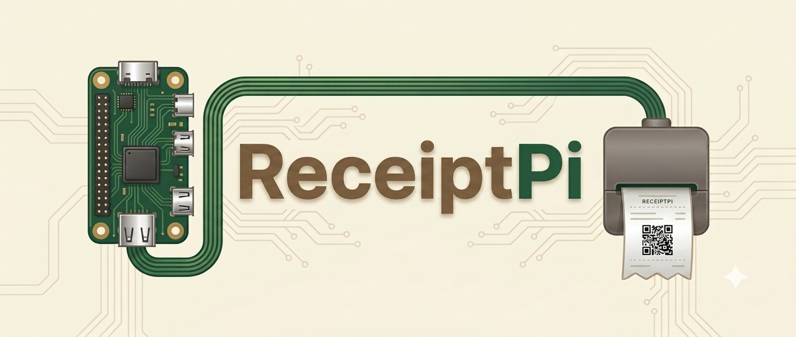
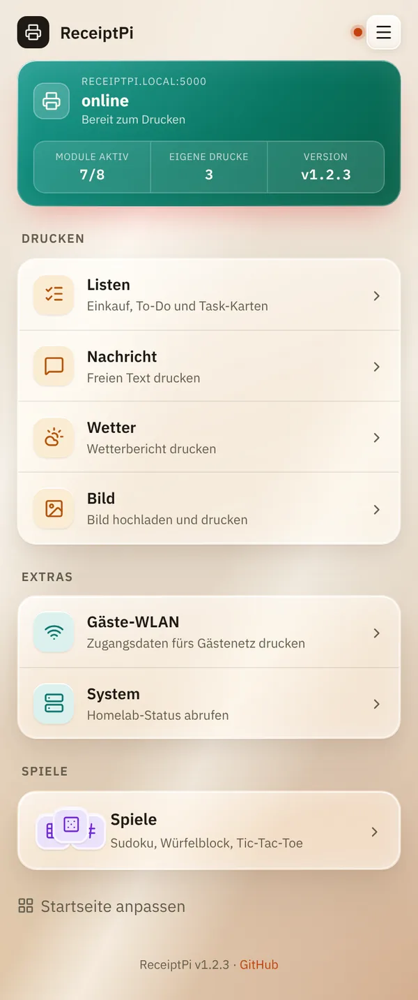
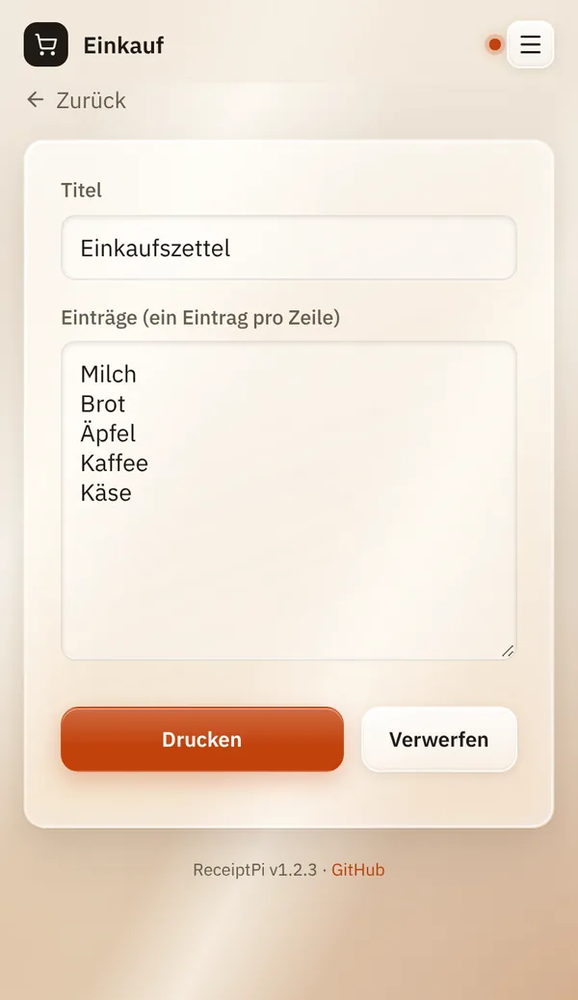
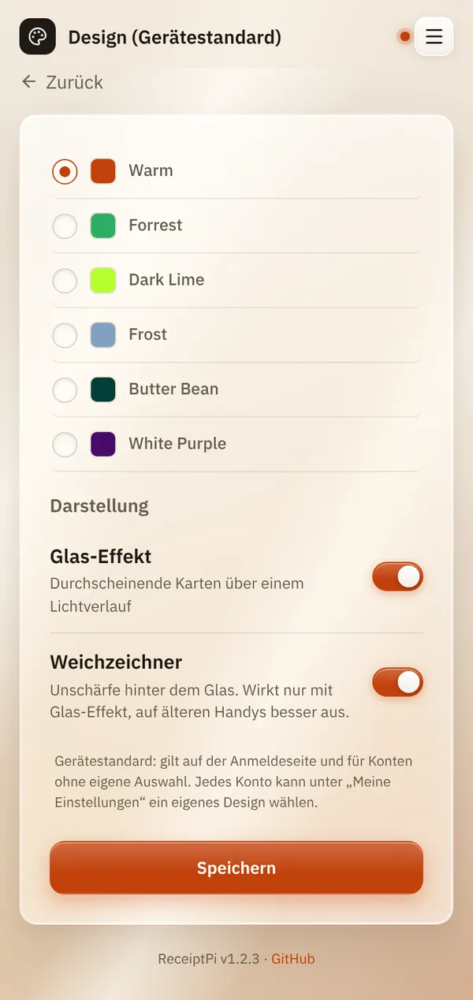

<p align="center">
  
</p>

<p align="center">
  <a href="LICENSE"></a>
  
  
  
  
</p>

<p align="center">
  <a href="#funktionen">Funktionen</a> •
  <a href="#schnellstart">Schnellstart</a> •
  <a href="docs/README.de.md">Dokumentation</a> •
  <a href="../../issues">Issues</a>
</p>

# ReceiptPi

*[English version](README.md)*

ReceiptPi macht aus einem Raspberry Pi und einem Bondrucker einen kleinen
Haushaltsdrucker: Einkaufszettel, To-dos, Notizen, Wetterberichte,
Zettel fürs Gäste-WLAN und mehr, gedruckt vom Handy aus oder automatisch
aus Home Assistant und anderen Systemen. Alles läuft auf dem Raspberry Pi
in deinem Heimnetz.

<p align="center">
  
  
  
</p>

## Funktionen

| | |
|---|---|
| **[Listen](docs/modules/lists.de.md)** | Einkaufszettel, To-do-Listen und Task-Karten zum Abhaken mit dem Stift |
| **[Nachricht](docs/modules/message.de.md)** | Beliebigen Text drucken |
| **[Bild](docs/modules/images.de.md)** | Fotos und Bilder in Schwarz-Weiß, mit Vorschau des Drucks |
| **[Wetter](docs/modules/weather.de.md)** | Wetterberichte (DWD oder Open-Meteo) und automatische Unwetterwarnungen |
| **[Rezepte](docs/modules/recipes.de.md)** | Rezepte aus Mealie suchen und drucken, Einkaufslisten übernehmen |
| **[Gäste-WLAN](docs/modules/wifi.de.md)** | Ein Zettel mit Name, Passwort und QR-Code, sobald das Gästenetz der FRITZ!Box an ist |
| **[Systemreport](docs/modules/system.de.md)** | Der Zustand deiner Server (Proxmox, PBS, jeder Host per SSH) |
| **[Spiele](docs/modules/games.de.md)** | Sudoku, Würfelblock und Tic-Tac-Toe-Felder |
| **[Druckregeln](docs/settings/print-rules.de.md)** | Ruhezeiten, Drucklimit, Duplikat-Sperre, große Schrift (Easy-Read) |
| **[Verlauf](docs/modules/history.de.md) und [ausstehende Aufträge](docs/modules/pending.de.md)** | Alles Gedruckte im Blick, und nichts geht verloren: Zurückgehaltenes wartet, bis du es druckst |
| **[Konten](docs/settings/accounts.de.md)** | Anmeldung, Admins und Nutzer, jeweils mit eigenen Entwürfen, eigenem Verlauf und [eigenen Einstellungen](docs/settings/my-settings.de.md) |
| **[Design](docs/settings/design.de.md)** | 6 Farbschemata mit optionalem Glas-Look, Deutsch und Englisch |
| **[Automations-API](docs/integrations/api.de.md), [MQTT](docs/integrations/mqtt.de.md), [Home Assistant](docs/integrations/home-assistant.de.md)** | Drucken aus Skripten, Node-RED, n8n oder Home Assistant |
| **[Sicherung](docs/settings/backup.de.md)** | Einstellungen und Logos sichern und wiederherstellen, ohne Passwörter |

## Schnellstart

Auf einem Raspberry Pi mit Raspberry Pi OS Lite (64 Bit, trixie) und
einem Epson TM-T88V an USB:

```bash
sudo apt install git
git clone https://github.com/HostisHumani/ReceiptPi.git
cd ReceiptPi
sudo ./deploy/install.sh
```

Dann `http://<hostname>:5000` öffnen und das Admin-Konto anlegen.

- [Installation](docs/installation.de.md): Details, Drucker, Watcher,
  Fehlersuche
- [Erste Schritte](docs/first-steps.de.md): vom ersten Start bis zum
  ersten Druck

## Dokumentation

Die [Dokumentation](docs/README.de.md) erklärt jede Funktion Schritt für
Schritt, mit Screenshots, auf Deutsch und Englisch: was sie kann, wie du
sie benutzt und was du tun kannst, wenn es nicht klappt. Für Entwickler
gibt es die [Entwickler-Referenz](docs/developer-reference.de.md).

## Roadmap

Als Nächstes geplant: NFC-Tag-ausgelöster Druck (nur eine URL im Tag,
keine App nötig), Tandoor als zweiter Rezeptmanager neben Mealie, sowie
ein echtes Icon-Set anstelle der Interims-Homescreen-Icons. Die Roadmap
kann sich mit weiteren Hardwaretests ändern.

## Mitwirken

Issues und Pull Requests sind willkommen. Neue Module sollen Flask-Blueprints verwenden, Druckaufträge ausschließlich über die zentrale Queue einreichen und weder direkt auf den Drucker noch auf Settings-Dateien schreiben.
Die [Entwickler-Referenz](docs/developer-reference.de.md) erklärt
Struktur, Endpunkte und wie die Dinge im Inneren funktionieren. Eine
Änderung an einer Funktion aktualisiert ihre Seite in
[docs/](docs/README.de.md) in beiden Sprachen, siehe den
[Schreibleitfaden](docs/STYLE.md).

Jeder Push und Pull Request auf `main` durchläuft Ruff und eine
Python-Syntaxprüfung (`.github/workflows/ci.yml`) sowie CodeQL für Python
und JavaScript (`.github/workflows/codeql.yml`, zusätzlich wöchentlich).

## Trademark Notice

Raspberry Pi is a trademark of Raspberry Pi Ltd. This project is
not affiliated with, endorsed by, or sponsored by Raspberry Pi Ltd.

Epson and TM-T88V are trademarks of Seiko Epson Corporation. This project is
not affiliated with, endorsed by, or sponsored by Epson.

ReceiptPi is an independent, community-built project designed to run on
Raspberry Pi hardware and to be compatible with Epson ESC/POS thermal
printers.

## Third-Party Licenses

Die Icons der Web-UI stammen von [Lucide](https://lucide.dev)
(`static/icons/`) und werden unter der ISC License verwendet – der
vollständige Lizenztext steht in
[static/icons/LICENSE](static/icons/LICENSE).

Die Schriftarten der Web-UI sind [IBM Plex Sans und IBM Plex Mono](https://github.com/IBM/plex)
(`static/fonts/`), selbst gehostet statt über Google Fonts geladen,
verwendet unter der SIL Open Font License 1.1 – der vollständige
Lizenztext steht in
[static/fonts/LICENSE.txt](static/fonts/LICENSE.txt).

## Lizenz

MIT – siehe [LICENSE](LICENSE).
