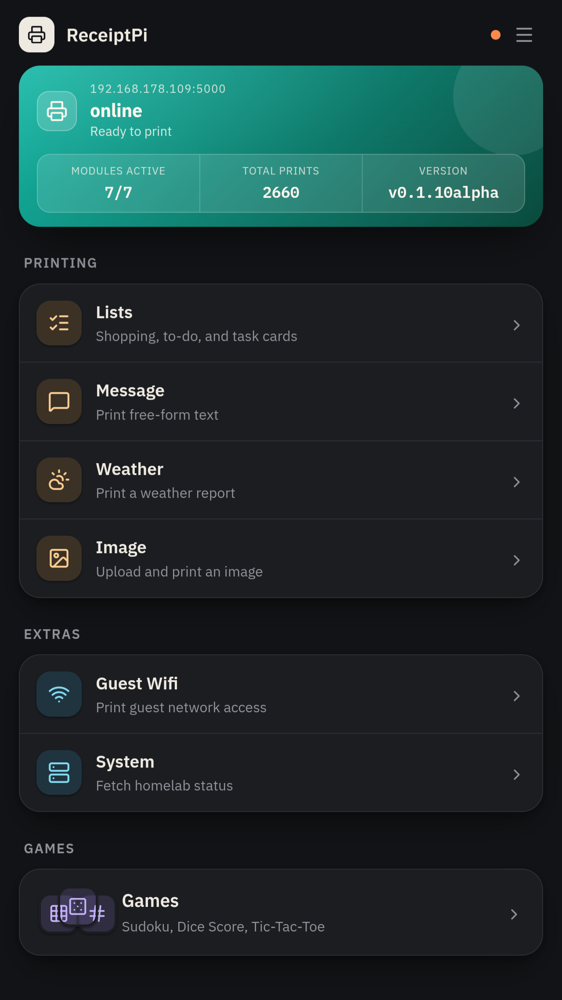

<p align="center">
  
</p>

<p align="center">
  <a href="LICENSE"></a>
  
  
  
  
</p>

<p align="center">
  <a href="#features">Features</a> •
  <a href="#quick-start">Quick Start</a> •
  <a href="#roadmap">Roadmap</a> •
  <a href="../../issues">Issues</a>
</p>

# ReceiptPi

*[Deutsche Version / German version](README.de.md)*

Flask server for an ESC/POS thermal receipt printer (tested with an Epson
TM-T88V) on a Raspberry Pi Zero (2) W. Mobile web UI (German/English) for
printing lists (shopping, to-do, task/kanban cards), status messages,
weather reports, images, system reports, and offline pen-and-paper games
(Sudoku, a dice score sheet, Tic-Tac-Toe boards) - most print types
optionally prefixed with a small logo - plus a generic automation webhook
(compatible with Home Assistant, Node-RED, n8n, or any tool that can do
an HTTP POST) and other automation triggers (GitHub stars, Fritz!Box
guest network, storm warnings).

<p align="center">
  <a href="assets/home.png">
    
  </a>
</p>

## Quick start

```bash
python3 -m venv .venv
source .venv/bin/activate
pip install -r requirements.txt

cp config.example.py config.py
# Fill config.py with real values (Home Assistant token, Netatmo entities, Fritz!Box credentials, ...)

python3 app.py
```

The server then runs on port 5000, web UI at `http://<pi-hostname>:5000`.
`python3 app.py` uses Flask's development server - for production the
service runs via Gunicorn with `gunicorn.conf.py` and exactly 1 worker, which is required because the print queue is process-local.
On every service start Gunicorn prints a short boot greeting (hostname and
IP) once, from a separate short-lived process (`boot_greeting.py`) - not
again when the worker restarts. An unreachable printer or a greeting that
takes longer than 30 seconds only gets logged; the server starts anyway.

Most settings (quiet-hour rules, weather locations, GitHub-watched repos,
SSH targets for the system report, per-module logos, UI language) are
configured entirely through the web UI's Settings page - no need to touch
`config.py` for those. Only bootstrap-level values (secret key, API token,
printer USB IDs, real credentials such as the Home Assistant token or
Fritz!Box password) stay in `config.py`. The web UI is open on the network
until an admin account is set up, see [Login and accounts](#login-and-accounts).

## Structure

```
receiptpi/
├── app.py                 Create the Flask app, register blueprints
├── gunicorn.conf.py       on_starting hook, starts the boot greeting once per service start
├── boot_greeting.py       boot greeting receipt (runs as its own short-lived process)
├── print_queue.py         central print queue + print-rule checks
├── printer.py             printer hardware access (USB)
├── printer_status.py      printer status without printing (USB presence + printer-class port status), used by /health and MQTT
├── mqtt_bridge.py         optional MQTT bridge: print commands in, printer status out, Home Assistant discovery
├── security.py            CSRF protection, API token protection, JSON parsing, access markers for the login check
├── auth_store.py          web UI accounts and login sessions (SQLite STATE_DIR/auth.db, 0600)
├── secrets_crypto.py      Fernet encryption for system-report SSH passwords, the recipe manager API token and the MQTT password (key in STATE_DIR, not in git)
├── settings_store.py      central settings (JSON in STATE_DIR, not in the project folder)
├── history_store.py       SQLite print history (STATE_DIR), auto-pruned after 180 days
├── lists_store.py          in-progress list/task-card drafts (STATE_DIR), cleared once printed
├── pending_store.py        blocked/failed print jobs (STATE_DIR, 0600), see "Pending jobs" below
├── logos.py                per-print-type logo resolution, upload validation, seeding
├── i18n.py                 minimal translation lookup (JSON files, no Flask-Babel)
├── module_catalog.py       registry of the toggleable home-page modules (key, icon, URL) + their effective on/off state
├── text_style.py           Easy-Read text-size scaling, shared by print jobs and the web UI
├── themes.py                registry of the selectable web UI color themes
├── static_versioning.py     content-hash `?v=` URLs for static files (cache busting)
├── version.py               reads VERSION, minimal comparison for ReceiptPi's own version scheme
├── VERSION                  single source of truth for the running version (e.g. "1.2.3")
├── config.example.py       template for config.py (fill in locally)
├── modules/
│   ├── lists/                 shopping lists, to-do lists, task/kanban cards
│   ├── message/               status messages (free title + text)
│   ├── images/                print images (three dithering methods + preview)
│   ├── wifi/                  guest wifi slip (text + QR code)
│   ├── weather/                weather report (DWD + Netatmo)
│   ├── system/                 system report (Proxmox/PBS via SSH, plus custom SSH commands for other hosts)
│   ├── games/                  offline games (Sudoku, dice score sheet, Tic-Tac-Toe)
│   ├── recipes/                recipe search/print + shopping list import (Mealie)
│   ├── automation/            generic automation webhook
│   ├── history/                print history dashboard
│   ├── pending/                 review/reprint/discard blocked or failed print jobs
│   ├── backup/                  settings backup and restore (.zip)
│   ├── auth/                    login, first-time setup, own account page, user management, login and role check for every request
│   └── settings/                settings pages (web UI) + settings API
├── watchers/
│   ├── github_star_watch.py     cron: prints on a new GitHub star
│   ├── fritzbox_wifi_watch.py    cron: prints a wifi slip once the guest network is enabled
│   ├── storm_warning_watch.py    cron: prints on a new active storm warning
│   ├── update_check_watch.py     cron (every 12h): caches whether a newer GitHub release exists, for the footer
│   └── crontab.example           ready-to-adjust cron template for all four watchers above
├── scripts/
│   └── manage_users.py         console account management (create-admin, reset-password, list, revoke-sessions)
├── assets/example-logos/    bundled starter logo set (outline icons)
├── static/
│   ├── style.css             design system (spacing/colors/themes, card/tile/icon styles)
│   ├── draft-autosave.js      generic auto-save for the lists/task-card forms
│   ├── mealie-import.js       Mealie shopping list import on the shopping list page
│   ├── image-preview.js       preview of the 1-bit print image on the images page
│   ├── manifest.json          web app manifest (home-screen name/icons/colors)
│   ├── sw.js                  service worker (served at /sw.js, HTTPS only)
│   ├── fonts/                 self-hosted IBM Plex fonts (see LICENSE.txt in that folder)
│   └── icons/                 local Lucide SVG icon set (see LICENSE in that folder)
└── templates/                shared layout and module pages
    ├── base.html
    ├── home.html
    ├── shopping.html
    ├── lists_*.html            lists overview, to-do page, task/kanban card page
    ├── message.html
    ├── images.html
    ├── wifi.html
    ├── weather.html
    ├── system.html
    ├── history.html
    ├── games_*.html            games overview + one page per game
    ├── recipes*.html           recipe search/random picker + recipe preview
    ├── auth_*.html             login, first-time setup, own account page, 403 page
    └── settings_*.html        settings overview + one sub-page per area
```

Each feature is implemented as its own Flask blueprint. Unhandled exceptions are isolated to the current request; modules share the same process, print queue and settings store.

## Web UI

The web UI is mobile-first (a single narrow column, no separate desktop
layout) and built as a small card/tile-based design system rather than
plain forms:

- **Home/dashboard** (`/`) - a status strip (printer reachability, polled
  live via `/health` every 60 seconds; how many of the toggleable modules
  are currently active; the print count from the history store - the
  viewer's own prints once accounts are in use),
  followed by a tile grid linking to every currently enabled module.
- **Navigation** - a topbar wordmark, a small printer-status dot, and a
  hamburger menu (History and Pending; Settings, and Users once logged in -
  for admins only, see [Login and accounts](#login-and-accounts); once
  logged in also Account and Log out).
- **Themes** - 6 selectable color themes (Warm [default], Forrest, Dark
  Lime, Frost, Butter Bean, White Purple), picked under `/settings/design`
  and applied via a `data-theme` attribute plus CSS custom properties.
  Warm is the only theme that also follows the system/browser light-dark
  preference automatically.
- **Icons** - a local set of Lucide SVG icons under `static/icons/` (no
  external icon font or CDN), rendered via CSS `mask-image` so every icon
  automatically follows the active theme's accent color instead of being
  hardcoded to one color. See [Third-Party Licenses](#third-party-licenses).
- **Easy-Read** - one text-size switch scales both the web UI and the
  receipt output, see [Easy-Read](#easy-read-large-text) below.
- **Footer** - shows the running version and a link to the GitHub repo on
  every page; if `watchers/update_check_watch.py` (cron, every 12h) has
  found a newer GitHub release (including alpha/prereleases), the footer
  links directly to it. Information only, no auto-update.

Each page shows a small icon matching its content in the topbar (a
printer icon on the home page, a message icon on the message page, and
so on). There is no browser-tab favicon yet.

**Home screen / installable web app** - `static/manifest.json` plus a
`theme-color` and an `apple-touch-icon` in `templates/base.html` let the
web UI be added to a phone's home screen with its own name and icon
(iOS: Safari share menu -> "Add to Home Screen"; Android: browser menu).
When the UI is served over **HTTPS** (e.g. behind a reverse proxy), a
service worker (`static/sw.js`, served at `/sw.js`) is registered as
well, so Chrome on Android offers "Install app". Over plain HTTP
(`http://<pi>:5000`) no service worker is registered - the home-screen
shortcut still works.

The service worker only caches same-origin `/static/` files that carry a
`?v=<content hash>` (style sheet, fonts, icons, manifest) - these URLs
change whenever their content does, so nothing stale can be served. Pages,
`/health`, `/print/*`, `/ui/*`, `/settings/*` and every other request always
go to the network. The cache is named after the `VERSION` file; a new
release replaces the worker and deletes the old cache. It is not an
offline mode - the UI still needs the Pi to be reachable. The icons under
`static/icons/` (`icon-192.png`, `icon-512.png`, `icon-maskable-512.png`,
`apple-touch-icon.png`) are an **interim solution** derived from the
existing logo - a proper icon set will follow.

## Login and accounts

Until an admin account exists, the web UI behaves as before: every page is
open to everyone on the network, and a banner at the top of the pages links
to the first-time setup. After the setup, every web UI page needs a login. Open
without a login are only `/health`, `/static/*`, `/sw.js`, `/login`, `/logout` and the
JSON API endpoints protected by `X-Api-Token` (see
[Endpoints](#endpoints)). Which routes are open is decided by the
decorators on each route, not by the URL; a route without one needs an
admin login (see Roles below).
A page opened without a login redirects to `/login`. A form sent from a page
whose login has ended redirects there too (`303`); after the login the
browser goes back to the page the form was on (taken from the `Referer` if
it is this host, otherwise the home page). The form itself is not sent
again, so nothing is printed twice. Any other request (`fetch()`, JSON, or
any request with an `X-Api-Token` header) gets `401` with
`{"status": "error", "error": "login_required", "detail": "..."}`.

**First-time setup** (`/setup`, answers `404` once an admin exists): user
name (3-32 characters from `a-z 0-9 . _ -`, stored in lower case),
password (10-128 characters, no other rules) and a setup code:
- with `API_TOKEN` set in `config.py`, the code is that token;
- without one, a "Print code" button prints a one-time code on the receipt
  printer. It is valid for 15 minutes, only the most recently printed code
  counts, it exists only in the server process's memory and never appears in
  the print history, the pending jobs or a log. If printing fails, the code
  is void and a new one has to be requested, or the admin is created with
  the console script below.

**Login** (`/login`): user name and password; a wrong name and a wrong
password get the same answer. Without "Stay logged in" the login ends when
the browser is closed or after 24 hours without use; with it, it lasts 90
days and is extended on use. `/account` changes the own password (ends all
other logins of the account) and has "Log out on all devices" (ends all
logins except the current one). Log out is in the menu.

**Roles**: every account is either `admin` or `user`. Admins may use
everything. Users may use the home page, message, lists (including drafts
and `/shopping`), weather, guest Wi-Fi, recipes, games and images, plus
their own account page, their own print history (`/history`) and
pending jobs (`/pending`, `/pending/print`, `/pending/discard`, see below)
and log out - including the form posts of these pages. Everything else is
admin only: all settings pages and `/ui/settings/*` routes, the system
report (`/system`, `/ui/system`), the backup, the user management,
language and design. Routes are admin only unless marked otherwise, so a
route added later without a marker is closed to users. The menu shows
Settings and Users only to admins, and the home page shows a user
no tile for a page they can't open. A user who opens an admin page in the
browser gets a translated `403` page with a link to the home page; a
`fetch()` or JSON request gets `403` with
`{"status": "error", "error": "forbidden", "detail": "..."}`. The role is
read from `auth.db` on every request, so changing a role, locking or
deleting an account takes effect with the account's next request.

**History and pending jobs per account**: every print job belongs to the
account that triggered it - from the queue through printing, the history,
the pending list and a reprint from there. Jobs without a logged-in
account (API token, webhook, MQTT, watchers, boot greeting, storm warning,
or no admin set up yet) belong to "System". An account is stored as its
id together with its creation time, so an account created after
`auth.db` was reset never inherits an older account's entries, even with
the same id. Users see only their own entries on `/history` and
`/pending`, and can only reprint or discard their own; ids of other
entries are ignored. Admins see every entry with its owner and can
filter by owner (all, System, an account, or a deleted account); entries
of a deleted account stay and show up for admins as "Deleted account
#id". Nobody sees a pending entry's stored content (such as a Wi-Fi
password), only the fields the lists show. A user's reprint waits for
quiet hours like a new job; only an admin's reprint skips them. The
home page counts the viewer's own prints (admins included), the
pending badge in the menu the viewer's own pending entries (admins: all).
Rate limit, duplicate suppression and quiet hours stay the same for
everyone, and the MQTT status (last job, pending count) still covers
the whole device. On the first start, existing history rows from the
web UI (source "ui" and their reprints) are given to the admin with the
lowest id; everything else stays System.

**User management** (`/settings/users`, admin only, also in the menu and
on the settings page): lists every account with role, status (active,
locked, start password) and last login. An admin can create an account
(name and role), change its role, lock and unlock it, reset its password
and delete it (after a confirmation). Creating an account and resetting a
password show a start password generated by the server (16 characters
from `a-z` and `2-9` without look-alike characters, in groups of four
separated by `-`; the dashes are part of the password) exactly once: it is
not stored (only its hash), not logged, and the page is sent with
`Cache-Control: no-store`. An account with a start password can only open
its account page to set its own password; any other page redirects there,
and `fetch()` gets `403` with `"error": "password_change_required"`.
Resetting a password and locking an account end all of its logins at
once. A locked account can't log in and gets the same answer as for a
wrong password. The last active admin can't be deleted, locked or made a
user, also not by two requests at the same time. An admin can't change
their own account on this page (the own password is under Account).

**Brute-force protection**: failed attempts are counted per user name and
per client IP on `/login` (and for the current password on `/account`), per
client IP and in total on `/setup`. From the 5th failure, further attempts
are refused for 30 s, doubling with each further failure up to 15 minutes,
with the same answer for every user name. The counters live in the server's
memory only and are reset by a service restart.

**Console script** - the way back in (forgotten password, no printer for the
setup code). Run it as the service user, from the project directory, with
the project's venv:

```bash
cd ~/receiptpi
~/receiptpi-env/bin/python scripts/manage_users.py create-admin <name>
~/receiptpi-env/bin/python scripts/manage_users.py reset-password <name>   # any account; ends all its logins, no start password
~/receiptpi-env/bin/python scripts/manage_users.py list
~/receiptpi-env/bin/python scripts/manage_users.py revoke-sessions <name>
```

Passwords are only ever asked for at the terminal, never taken as an
argument. The script refuses to run as a different user than the owner of
`STATE_DIR` (e.g. as root via `sudo`), since `auth.db` written as root
could no longer be read by the service.

**Storage**: accounts and logins are in `STATE_DIR/auth.db` (SQLite, file
mode 0600). Passwords are stored as scrypt hashes (Werkzeug's default),
logins only as SHA-256 hashes of the cookie value. `auth.db` is not part of
the settings backup. Stopping the service, deleting `auth.db` and starting
it again restores the state without an admin (web UI open).

**Configuration** (`config.py`, see `config.example.py`):
- `LOGIN_COOKIE_SECURE` (default `False`) - marks the login cookie
  `receiptpi_session` as `Secure`. Leave it off while the web UI is used
  over plain HTTP (`http://<pi>:5000`): browsers don't send a Secure cookie
  over HTTP, so nobody could stay logged in. Only turn it on when the UI is
  reached exclusively over HTTPS. The cookie is always `HttpOnly` and
  `SameSite=Lax`. Over plain HTTP, passwords and the login cookie travel
  unencrypted through the local network.
- `TRUSTED_PROXY_COUNT` (default `0`) - number of reverse proxies in front
  of the server. Only with a value above 0 are `X-Forwarded-For/-Proto/
  -Host/-Port` used (for exactly that many hops), e.g. for the per-IP
  brute-force protection; with 0 they are ignored.

**Effect on the API and the watchers**: endpoints with `X-Api-Token` work
exactly as before and never accept the login cookie, only the header - the
watchers and automations need no login. With an empty `API_TOKEN` and an
existing admin, `/print/*` stays open, but the JSON settings API under
`/settings/` answers `403`; the settings page shows a warning about it.

## Settings pages

`/settings` is an overview page (tile grid, grouped into General /
Printing / Integrations / System) linking to a dedicated sub-page per
area, instead of one long form:

- `/settings/language` - UI language (German/English)
- `/settings/design` - web UI color theme
- `/settings/modules` - enable/disable individual home-page modules, see [Module toggles](#module-toggles)
- `/settings/print-rules` - quiet-hour rules (multiple independent rules, each with its own weekdays and time window) + rate limiting + duplicate suppression + the Easy-Read text-size switch
- `/settings/logos` - global logo toggle, default logo, and a per-print-type toggle/upload/preview (falls back to the default logo if no custom one is set)
- `/settings/weather` - weather report provider (DWD or Open-Meteo), weather locations, and an independent storm-warning provider (DWD, MeteoAlarm, or NWS) with its own enable toggle and an optional "ignore quiet hours" override
- `/settings/github-watch` - watched GitHub repositories
- `/settings/system-report` - a free-form list of SSH targets for the system report, see [System report](#system-report) below
- `/settings/recipes` - recipe manager (Off / Mealie), Mealie base URL, encrypted API token, connection test, see [Recipes](#recipes) below
- `/settings/mqtt` - MQTT broker connection, topic prefix and Home Assistant discovery, see [MQTT](#mqtt) below
- `/settings/backup` - download a backup of the settings and logos, or restore one (see below)
- `/settings/users` - user management, see [Login and accounts](#login-and-accounts)

**Backup and restore** (`/settings/backup`): the backup is a `.zip` with an
allowlisted copy of the settings, all logo files and a manifest (format and
app version, SHA-256 per file). It never contains secrets: not `config.py`,
not the API token, not the encrypted Mealie token or SSH passwords (not even
encrypted), not `secret.key`, not the SSH `command` of system-report
hosts, and not the MQTT password, user name or CA file. Print history, pending jobs and list drafts are not included either.
The file still contains personal data (host and user names, locations,
addresses), so store it accordingly. Restoring checks the archive first and
shows a summary; nothing changes before you confirm. Secrets already on the
device stay as they are, everything not in the backup has to be entered
again afterwards (the result page lists it), and `config.py` values have to
be set on a new device by hand. Once an admin account exists, download and
restore need an admin login and no token. Without an admin account, with
`API_TOKEN` set, download and restore ask for it; without one, restoring is
locked. Restoring only runs while no
print job is queued, saves the previous state first (the last 5 are kept in
`STATE_DIR/restore_snapshots/`) and needs no restart. An archive can be at
most 8 MB; an uploaded archive that hasn't been confirmed is discarded after
one hour. Limit: a power loss in
the middle of a restore can leave a mix of old and new files - the latest
snapshot is the way back then.

## Endpoints

All `/print/*` and `/settings/*` endpoints require the `X-Api-Token: <value>`
header once `API_TOKEN` is set in `config.py` (empty = no protection). They
never accept the web UI's login cookie. With an empty `API_TOKEN`, once an
admin account exists, the settings API endpoints answer `403`, while
`/print/*` stays open (see [Login and accounts](#login-and-accounts)).
Every print job also passes through the central print rules: quiet hours, rate limiting and duplicate suppression.
A blocked job responds with `429`.

**Printing**
- `POST /print/message` - `{ "title": "...", "text": "..." }`
- `POST /print/list` - `{ "title": "...", "items": ["..."] }` - shopping list, unchanged since before the lists module existed, kept fully backward compatible
- `POST /print/todo` - `{ "title": "...", "items": ["..."] }` - to-do list, same shape as `/print/list`
- `POST /print/task` - `{ "title": "...", "description": "optional", "items": ["optional checklist"], "priority": "low"|"medium"|"high", "due_date": "YYYY-MM-DD" }` - printable task/kanban card; only `title` is required
- `POST /print/image` - `{ "image_base64": "...", "dither": "floyd-steinberg" }` (max. 6000px per side, 12MB); `dither` is optional: `floyd-steinberg` (default), `atkinson` or `bayer`. Images are scaled down to 512px width; Atkinson is limited to 1,024,000 pixels after scaling (512x2000) and to 15 seconds of processing, `400`/`504` otherwise
- `POST /print/image/preview` - same body as `/print/image`, returns the 1-bit print image as PNG without printing (no print rules, no history)
- `POST /print/wifi` - `{ "ssid": "...", "password": "...", "auth_type": "WPA" }`
- `POST /print/weather` - optional `{ "location": "Berlin" }`, otherwise the default location; also `GET /print/weather?location=Berlin`
- `POST /print/system` - no body needed
- `POST /print/automation` - `{ "title": "optional", "text": "..." }` - generic automation webhook (compatible with Home Assistant, Node-RED, n8n, or any tool that can do an HTTP POST)
- `GET /health` - check printer reachability without printing (no token needed): USB presence plus the printer's status byte, cached for 10 s and shared by all callers, no print job and no USB reset. 200 `{"status": "ok", "printer": "reachable", "state": "ready", "problem": false}` while the printer is attached and switched on - also with paper out or an open cover, then `state` is `paper_out`/`error` and `problem` is `true`; `state` is `unknown` if the status byte can't be read at that moment (during a print job, or after switching on until the first print while the kernel's `usblp` driver holds the printer). 500 `{"status": "error", "detail": "...", "state": "offline", "problem": false}` if the printer isn't on the USB bus (switched off or unplugged)

**Settings API**
- `GET /settings/api` - all settings sections as JSON; encrypted secrets are replaced by flags (`has_token` for the Mealie token, `has_password` for SSH and MQTT passwords)
- `POST /settings/print_rules` - change rate limit/duplicate window
- `GET|POST /settings/quiet_hours/rules`, `POST /settings/quiet_hours/rules/<id>/toggle`, `DELETE /settings/quiet_hours/rules/<id>`
- `GET|POST /settings/weather/locations`, `DELETE /settings/weather/locations/<name>`
- `GET /settings/system_report` - current list of system-report hosts (JSON, passwords redacted to a `has_password` flag)
- `POST /settings/system_report` - `{ "name": "...", "role": "proxmox"|"pbs"|"custom", "host": "...", "user": "...", "command": "required for role=custom", "password": "optional" }` - adds one host; `host` and `user` must match an allowlist (DNS name or IP address; POSIX user name; no leading `-`, no whitespace), otherwise `400`
- `DELETE /settings/system_report/<id>` - removes one host
- `GET|POST /settings/github_watch/repos`, `DELETE /settings/github_watch/repos/<owner>/<repo>`
- `GET|POST /settings/logos/config` - global/per-module logo toggles
- `POST /settings/logos/upload/<slot>`, `DELETE /settings/logos/upload/<slot>` - logo image upload/removal (base64), `slot` is `default` or a module key

**Recipes (web UI routes)**

The recipes module has no `/print/*` JSON API and no settings API - its
routes serve the web UI and need no `X-Api-Token`, but a login once an admin
account exists. All of them answer
`404` while the module is inactive (see [Module toggles](#module-toggles)).
- `GET /recipes?q=<term>` - search page with results
- `GET /recipes/view/<slug>` - recipe preview
- `GET /recipes/random?ingredients=<a,b>&match=all` - random recipe; `ingredients` optional (max. 5), `match=all` requires all of them instead of any
- `POST /ui/recipes/print` - form post (CSRF-protected), field `slug`
- `GET /recipes/import/lists` - Mealie shopping lists as JSON (used by the import on `/shopping`)
- `GET /recipes/import/lists/<id>` - unchecked items of one list as JSON, formatted as shopping list lines

## MQTT

Optional and off by default. Configured on `/settings/mqtt`; uses the
`paho-mqtt` package from `requirements.txt` (on an existing installation,
run `pip install -r requirements.txt` again in the service's venv). With
MQTT switched off nothing MQTT-related is imported or started.

Topics, with `<p>` the configurable prefix (default `receiptpi`):

| Topic | Direction | Retained | Content |
|---|---|---|---|
| `<p>/availability` | out | yes | `online` / `offline` (also the last will) |
| `<p>/state` | out | yes | JSON, published only when something changes |
| `<p>/cmd/message` | in | - | `{ "title": "optional", "text": "..." }` - like `/print/automation` |
| `<p>/cmd/list` | in | - | `{ "title": "...", "items": ["..."] }` - like `/print/list` |
| `<p>/cmd/todo` | in | - | `{ "title": "...", "items": ["..."] }` - like `/print/todo` |
| `<p>/cmd/task` | in | - | same body as `/print/task` |
| `<p>/cmd/weather` | in | - | `{}` or `{ "location": "..." }` - like `/print/weather` |
| `<p>/result` | out | no | one result per command |

Every command may carry an optional `"id"` (1-64 characters `A-Z a-z 0-9 _ . -`),
which is echoed in its result:

```json
{"id": "k42", "cmd": "list", "status": "printed", "code": 200, "detail": "2 items printed"}
{"id": "k43", "cmd": "message", "status": "error", "code": 429, "detail": "..."}
```

The state message:

```json
{"printer": "ready", "printer_since": "2030-01-15T08:00:12", "problem": false, "pending": 0,
 "last_job_type": "shopping", "last_job_result": "ok", "last_job_at": "2030-01-15T07:59:58", "version": "1.3.0"}
```

`printer` is one of `ready`, `paper_out`, `error` (any other printer error,
e.g. an open cover), `offline` (USB device gone), `unknown`. It comes from the USB printer-class port status (no
print job, no USB reset) every 15 seconds, after each print job and when
the USB device appears again; presence is checked every 5 seconds. A
kernel driver holding the printer interface (`usblp`) gives `unknown`.

Commands go through exactly the same checks as the HTTP API: input
validation, quiet hours, rate limit, duplicate suppression and the pending
list (result code `429` when blocked). Messages larger than 64 KiB, invalid
JSON, unknown commands and disabled modules are refused with a result.
Retained messages on command topics are ignored. Wi-Fi, system report and
image printing are deliberately not available over MQTT.

**Home Assistant discovery** (optional switch on the settings page) creates
one device with printer status, problem, pending jobs, last job and a
"print weather report" button. Switching it off removes the device again.

**Security.** Anyone who may publish to `<p>/cmd/#` on the broker can print.
ReceiptPi itself supports a user name/password (stored encrypted, never
shown, never returned by the API, never part of a backup), TLS with
certificate and host name verification, and your own CA. Users and access
rules are up to the broker. The settings page warns if no user name or no
TLS is configured. An own CA has to be a proper RFC 5280 CA (key usage and
key identifier extensions): from Python 3.13 on, certificates are checked
strictly (`VERIFY_X509_STRICT`). Example for
Mosquitto 2.x (placeholder paths and names):

```
listener 8883
cafile /etc/mosquitto/certs/ca.crt
certfile /etc/mosquitto/certs/server.crt
keyfile /etc/mosquitto/certs/server.key
allow_anonymous false
password_file /etc/mosquitto/passwd
acl_file /etc/mosquitto/acl
max_packet_size 65536
```

`/etc/mosquitto/acl`:

```
user receiptpi
topic readwrite receiptpi/#
topic write homeassistant/device/#
topic read homeassistant/status

user homeassistant
topic readwrite homeassistant/#
topic read receiptpi/#
topic write receiptpi/cmd/#
```

## After installation

```bash
pip freeze > requirements.lock.txt
```
Freezes the actually installed versions - `requirements.txt` itself
deliberately has no version pins (no `==x.y.z`), `requirements.lock.txt`
is only a reference in case an update ever breaks something.

### Enabling the watchers (cron)

The four scripts under `watchers/` (GitHub star notifications, guest
Wi-Fi slip, storm warnings, update check) only run when something
schedules them - they are never started by `app.py`/Gunicorn itself.
See `watchers/crontab.example` for a ready-to-adjust template covering
all four with the interval each script's own docstring recommends;
install it with `crontab watchers/crontab.example` after editing the
`PYTHON`/`PROJECT_DIR` placeholders, or copy individual lines into an
existing crontab (`crontab -e`).

## Features

- Lists: shopping lists, to-do lists, and printable task/kanban cards, see [Lists](#lists) below
- Free-form messages
- Image printing from the web UI or the JSON API, with a choice of dithering (Floyd-Steinberg, Atkinson, Bayer) and a preview of the exact 1-bit print image
- Guest Wi-Fi credentials and QR codes
- Weather reports (DWD or Open-Meteo, selectable, + optional Netatmo), with an optional storm-warning watcher (DWD, MeteoAlarm, or NWS, prints only when a warning is actually active)
- System reports: Proxmox/PBS via SSH, plus a custom-command role for any other host (e.g. a NAS), with optional encrypted password auth, see [System report](#system-report) below
- Offline games (Sudoku, a dice score sheet, Tic-Tac-Toe), see [Games](#games) below
- Recipes from [Mealie](https://mealie.io): search, preview and print recipes, random recipe by ingredient, and import a Mealie shopping list into the shopping list, see [Recipes](#recipes) below
- Print history dashboard (stats + paginated log, SQLite-backed)
- Pending jobs: review/reprint/discard print jobs blocked by quiet hours/rate limit or failed with a real printer error, see "Pending jobs" below
- Optional per-print-type logos with a global default fallback
- Individually toggleable home-page modules, see [Module toggles](#module-toggles) below
- Web-based settings, split into per-area sub-pages and grouped by topic
- 6 selectable web UI color themes
- Easy-Read: one switch for larger text on both the receipt and the web UI, see [Easy-Read](#easy-read-large-text) below
- German/English UI, including receipt content itself (not just the UI chrome)
- USB-connected ESC/POS printer (python-escpos + pyusb, Epson TM-T88V profile)
- Version footer with GitHub release update notice (checked every 12h, no auto-update)
- Optional MQTT: print commands, printer status and Home Assistant discovery, see [MQTT](#mqtt)
- Backup and restore of settings and logos, without secrets, see [Settings pages](#settings-pages)

### Lists

Grew out of the original shopping-list module; all three list types share
the same print queue, history logging, rate limiting and quiet hours as
every other module.

- **Shopping list** (`/shopping`, also reachable at `/lists/shopping`) -
  a plain checklist. The `/print/list` API endpoint is unchanged since
  before the lists module existed, kept fully backward compatible for
  existing integrations. This is the only list type with a logo slot
  (reuses the existing shopping logo slot) - to-do lists and task cards
  never show a logo.
- **To-Do list** (`/lists/todo`) - the same checklist mechanism as the
  shopping list, printed and labelled separately. `POST /print/todo`
  JSON API.
- **Task/kanban card** (`/lists/task`) - a title plus optional
  description, optional checklist, optional priority (low/medium/high)
  and optional due date; only fields actually set are printed, no empty
  placeholders on the receipt. `POST /print/task` JSON API - suitable
  for a plain `curl` call, a Home Assistant `rest_command`, or any other
  automation that can do an HTTP POST, with the same `X-Api-Token` auth,
  print queue, quiet hours, rate limit and history logging as every
  other `/print/*` endpoint.
- **Drafts** - all three forms auto-save to the server (`lists_store.py`,
  `~1s` after typing stops) so an in-progress list survives navigating
  away or closing the tab; a draft is only cleared once actually
  printed. A "Discard" button clears it back to a blank form.

### System report

`/settings/system-report` manages a free-form list of SSH targets
instead of a fixed set - each entry has a name, a role, a host and a
user, and connects either via SSH key (default) or an optional
password.

- **Proxmox** and **PBS** are structured roles with their own fixed
  set of SSH commands (CPU/RAM/LXC/VM list for Proxmox, recent backup
  tasks for PBS).
- **Custom command** runs an arbitrary user-supplied SSH command
  verbatim on the target host - the general-purpose role for anything
  that isn't Proxmox/PBS, e.g. a NAS of any kind. No NAS-specific
  software is assumed anywhere in the codebase.
- An update check (`apt list --upgradable`) runs across every
  configured host regardless of role.
- **Password auth**: an optional password field is the alternative to
  SSH-key auth, for a host with its own restricted, password-based
  user. Connects via `paramiko` instead of the system `ssh` CLI (avoids
  passing the password through a process argument, unlike `sshpass`).
  The password is encrypted at rest with Fernet (`cryptography`
  package) before being written to `settings.json`; the encryption key
  lives in its own file under `STATE_DIR` (`secret.key`, mode 0600),
  generated on first use, never in git and never in `settings.json`
  itself.
- **Host keys and inputs**: a host's SSH key is pinned on first contact
  (`StrictHostKeyChecking=accept-new` for key auth, the same rule in
  `STATE_DIR/ssh_known_hosts` for password auth); a host presenting a
  different key later is reported as an error instead of being connected
  to. Host and user have to pass an allowlist (no leading `-`, no
  whitespace), and the `ssh` call passes them as `-l <user> -- <host>`, so
  neither can be read as an `ssh` option.

### Games

Three offline games, printed through the same central print queue as
every other module. Unlike most modules they are UI-only - there is no
`/print/games/*` JSON API and they are not wired into the automation
webhook - and they have no logo slot.

- **Sudoku** (`/games/sudoku`) - a locally generated 9x9 puzzle with three
  difficulty levels (easy/medium/hard), with an option to also print the
  solution as a second receipt.
- **Dice score sheet** (`/games/dice`) - a generic five-dice score pad
  (upper section ones-sixes with subtotal/bonus, lower section
  three-/four-of-a-kind, full house, small/large straight, five-alike,
  chance, plus upper/lower/grand totals). One receipt per player, 1-12
  players per print.
- **Tic-Tac-Toe** (`/games/tictactoe`) - printable blank 3x3 boards to
  fill in by hand, 3/6/9 rounds per print.

### Recipes

Connects to a self-hosted [Mealie](https://mealie.io) instance (tested
with v3.27.0). Set it up under `/settings/recipes`: base URL + an API
token (created in Mealie under Profile -> API Tokens). The token is stored
Fernet-encrypted (same mechanism as the system report SSH passwords) and
never shown again; leaving the token field empty when saving keeps the
stored one (only while the base URL stays the same - a changed URL needs
the token entered again, so the stored token is never sent to a new
address), and "Remove token" deletes it. "Test connection" checks both
the URL and the token (via `/api/users/self` - Mealie's `/api/app/about`
answers without authentication, so it alone can't validate a token)
without saving anything.

The module is only active when its toggle under `/settings/modules` is on
**and** a recipe manager is selected - with the recipe manager set to
"Off" it behaves like a disabled module (no tile, `404` on all its
routes, no import on `/shopping`), see [Module toggles](#module-toggles).

- **Search + print** (`/recipes`) - searches recipe titles/descriptions
  (Mealie's search does not cover ingredients), shows a preview, prints
  title, total time, ingredients and instructions.
- **Random recipe** - optionally filtered by one or more ingredients
  (any/all). Ingredient names must match a Mealie food exactly
  (case-insensitive, singular or plural) - otherwise close matches are
  suggested.
- **Shopping list import** (on `/shopping`) - appends the unchecked items
  of a Mealie shopping list to the current list. Append-only, and
  read-only towards Mealie (nothing is checked off there).

UI-only (no `/print/*` JSON API, see [Endpoints](#endpoints)), no logo
slot. Fraction characters in Mealie's ingredient text (e.g. `¹/₂`) are
printed as plain ASCII (`1/2`).

### Easy-Read (large text)

A single switch under `/settings/print-rules` ("text size": Normal /
Large) scales both the receipt output and the web UI from the same
setting:

- **Receipt**: headings print at double width/double height, body text at
  double width (which halves the usable line width, so body text wraps
  more often); the footer timestamp and section separators always stay
  at normal size.
- **Web UI**: the base font size grows from 16px to 19px, and the home
  status strip and module tile grid drop from a multi-column to a
  single-column layout so nothing gets squeezed into a cramped column.

It is a plain text-size switch, not a full accessibility overhaul - there
is no separate screen-reader markup or contrast mode tied to it.

### Pending jobs

A print job blocked by quiet hours/rate limit, or one that fails with a
real printer error (device unreachable, USB error, ...), doesn't just
vanish - its content is saved so it can be reviewed and manually
reprinted or discarded later, reachable via the burger menu (each
account sees its own entries once an admin account exists, see
[Login and accounts](#login-and-accounts)). Applies
across every source (web UI, JSON API, automation webhook, watchers)
equally, since it hooks into `enqueue_print()` centrally rather than
each module individually. Duplicate-suppression blocks are deliberately
excluded - that reflects an already-accepted earlier submission of the
same content, not lost content.

Check the box next to the entries you want, then choose "Print
selected" or "Discard selected"; "Print all"/"Discard all" skip the
selection entirely. A reprint bypasses quiet hours (an explicit,
reviewed action) and duplicate suppression, but the rate limit still
applies. An entry is only removed once its reprint is CONFIRMED
successful - a failed retry leaves it in place, and never creates a
second pending entry for the same content. `/settings/print-rules` has
an optional auto-cleanup setting (0 = never, otherwise a number of
days).

Not every job type is included - weather/system reports re-fetch live
data on reprint anyway (no staleness concern), but a raw image upload
is stored as its already-downscaled/dithered print-ready version (a
few KB, not the original photo) rather than the full upload.

### Module toggles

`/settings/modules` lets each of the 8 catalog modules (lists,
message, weather, images, wifi, system, games, recipes) be switched on or
off individually:

- Disabling a module removes its tile from the home page **and** blocks
  all of its routes - web UI pages, `/ui/*` form posts, and `/print/*`
  API endpoints alike - with a 404, not just hiding the tile.
- A module can have an additional precondition on top of its toggle:
  **recipes** is only active while a recipe manager is selected under
  `/settings/recipes`. With the recipe manager set to "Off" it is
  treated exactly like a disabled module; its checkbox here stays as
  saved and shows a note explaining why the module is hidden.
- The home page's status strip shows how many of these 8 modules are
  currently active (toggle and precondition).
- History, the Settings pages themselves, and the generic automation
  webhook are outside this toggle system and stay reachable regardless.
- Two of the three watchers respect this: `fritzbox_wifi_watch.py` and
  `storm_warning_watch.py` check the `wifi`/`weather` module state and
  skip cleanly if disabled. `github_star_watch.py` does not check it and
  will simply fail its print call if the `message` module is disabled.

## Roadmap

Next up: NFC-tag-triggered printing (just a URL in the tag, no app
needed), Tandoor as a second recipe manager next to Mealie, and a
proper icon set replacing the interim home-screen icons. The roadmap may
change as ReceiptPi is tested on more hardware.

## Contributing

Issues and pull requests are welcome. New modules should use Flask Blueprints, submit print jobs through the central queue and avoid direct writes to the printer or settings files.

Every push and pull request to `main` runs Ruff and a Python syntax check
(`.github/workflows/ci.yml`) as well as CodeQL for Python and JavaScript
(`.github/workflows/codeql.yml`, also weekly).

## Trademark Notice

Raspberry Pi is a trademark of the Raspberry Pi Foundation. This project is
not affiliated with, endorsed by, or sponsored by the Raspberry Pi
Foundation.

Epson and TM-T88V are trademarks of Seiko Epson Corporation. This project is
not affiliated with, endorsed by, or sponsored by Epson.

ReceiptPi is an independent, community-built project designed to run on
Raspberry Pi hardware and to be compatible with Epson ESC/POS thermal
printers.

## Third-Party Licenses

The web UI's icons are from [Lucide](https://lucide.dev) (`static/icons/`),
used under the ISC License - see [static/icons/LICENSE](static/icons/LICENSE)
for the full text.

The web UI's typefaces are [IBM Plex Sans and IBM Plex Mono](https://github.com/IBM/plex)
(`static/fonts/`), self-hosted rather than loaded from Google Fonts, used
under the SIL Open Font License 1.1 - see
[static/fonts/LICENSE.txt](static/fonts/LICENSE.txt) for the full text.

## License

MIT - see [LICENSE](LICENSE).
