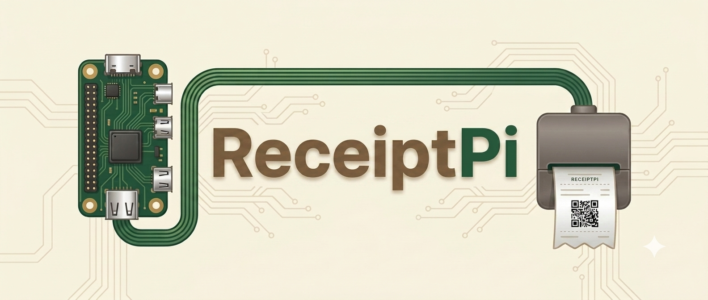
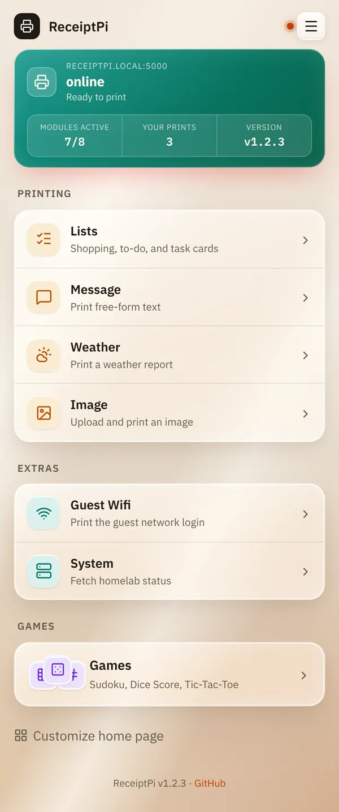
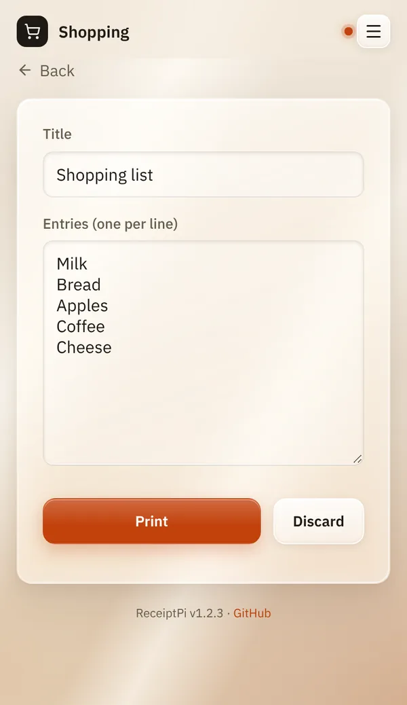
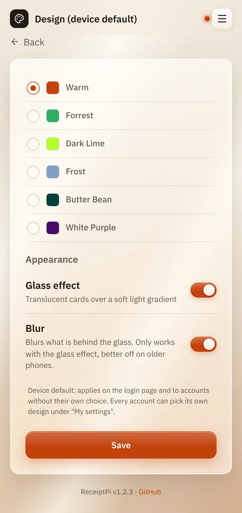

<p align="center">
  
</p>

<p align="center">
  <a href="LICENSE"></a>
  
  
  
  
</p>

<p align="center">
  <a href="#features">Features</a> •
  <a href="#quick-start">Quick Start</a> •
  <a href="docs/README.md">Documentation</a> •
  <a href="../../issues">Issues</a>
</p>

# ReceiptPi

*[Deutsche Version / German version](README.de.md)*

ReceiptPi turns a Raspberry Pi and a receipt printer into a small
household printer: shopping lists, to-dos, notes, weather reports, guest
Wi-Fi slips and more, printed from your phone or automatically from Home
Assistant and other systems. Everything runs on the Raspberry Pi in your
home network.

<p align="center">
  
  
  
</p>

## Features

| | |
|---|---|
| **[Lists](docs/modules/lists.md)** | Shopping lists, to-do lists and task cards to tick off with a pen |
| **[Message](docs/modules/message.md)** | Print any text |
| **[Image](docs/modules/images.md)** | Photos and pictures in black and white, with a preview of the print |
| **[Weather](docs/modules/weather.md)** | Weather reports (DWD or Open-Meteo) and automatic storm warnings |
| **[Recipes](docs/modules/recipes.md)** | Search and print recipes from Mealie, import its shopping lists |
| **[Guest Wi-Fi](docs/modules/wifi.md)** | A slip with name, password and QR code as soon as the FRITZ!Box guest network is on |
| **[System report](docs/modules/system.md)** | The state of your servers (Proxmox, PBS, any host via SSH) |
| **[Games](docs/modules/games.md)** | Sudoku, dice score sheets and tic-tac-toe boards |
| **[Print rules](docs/settings/print-rules.md)** | Quiet hours, print limit, duplicate suppression, large text (Easy-Read) |
| **[History](docs/modules/history.md) and [pending jobs](docs/modules/pending.md)** | Everything printed, and nothing lost: held-back prints wait until you print them |
| **[Accounts](docs/settings/accounts.md)** | Login, admins and users, each with their own drafts, history and [settings](docs/settings/my-settings.md) |
| **[Design](docs/settings/design.md)** | 6 color themes with an optional glass look, German and English |
| **[Automation API](docs/integrations/api.md), [MQTT](docs/integrations/mqtt.md), [Home Assistant](docs/integrations/home-assistant.md)** | Print from scripts, Node-RED, n8n or Home Assistant |
| **[Backup](docs/settings/backup.md)** | Save and restore settings and logos, without passwords |

## Quick start

On a Raspberry Pi with Raspberry Pi OS Lite (64-bit, trixie) and an Epson
TM-T88V on USB:

```bash
sudo apt install git
git clone https://github.com/HostisHumani/ReceiptPi.git
cd ReceiptPi
sudo ./deploy/install.sh
```

Then open `http://<hostname>:5000` and create the admin account.

- [Installation](docs/installation.md): details, printer, watchers,
  troubleshooting
- [First steps](docs/first-steps.md): from the first start to the first
  print

## Documentation

The [documentation](docs/README.md) explains every feature step by step,
with screenshots, in English and German: what it does, how to use it, and
what to do if it doesn't work. For developers there is the
[developer reference](docs/developer-reference.md).

## Roadmap

Next up: NFC-tag-triggered printing (just a URL in the tag, no app
needed), Tandoor as a second recipe manager next to Mealie, and a
proper icon set replacing the interim home-screen icons. The roadmap may
change as ReceiptPi is tested on more hardware.

## Contributing

Issues and pull requests are welcome. New modules should use Flask Blueprints, submit print jobs through the central queue and avoid direct writes to the printer or settings files.
The [developer reference](docs/developer-reference.md) explains the
structure, the endpoints and how things work inside. A change to a feature
updates its page in [docs/](docs/README.md) in both languages, see the
[style guide](docs/STYLE.md).

Every push and pull request to `main` runs Ruff and a Python syntax check
(`.github/workflows/ci.yml`) as well as CodeQL for Python and JavaScript
(`.github/workflows/codeql.yml`, also weekly).

## Trademark Notice

Raspberry Pi is a trademark of Raspberry Pi Ltd. This project is
not affiliated with, endorsed by, or sponsored by Raspberry Pi Ltd.

Epson and TM-T88V are trademarks of Seiko Epson Corporation. This project is
not affiliated with, endorsed by, or sponsored by Epson.

ReceiptPi is an independent, community-built project designed to run on
Raspberry Pi hardware and to be compatible with Epson ESC/POS thermal
printers.

## Third-Party Licenses

The web UI's icons are from [Lucide](https://lucide.dev) (`static/icons/`),
used under the ISC License - see [static/icons/LICENSE](static/icons/LICENSE)
for the full text.

The web UI's typefaces are [IBM Plex Sans and IBM Plex Mono](https://github.com/IBM/plex)
(`static/fonts/`), self-hosted rather than loaded from Google Fonts, used
under the SIL Open Font License 1.1 - see
[static/fonts/LICENSE.txt](static/fonts/LICENSE.txt) for the full text.

## License

MIT - see [LICENSE](LICENSE).
