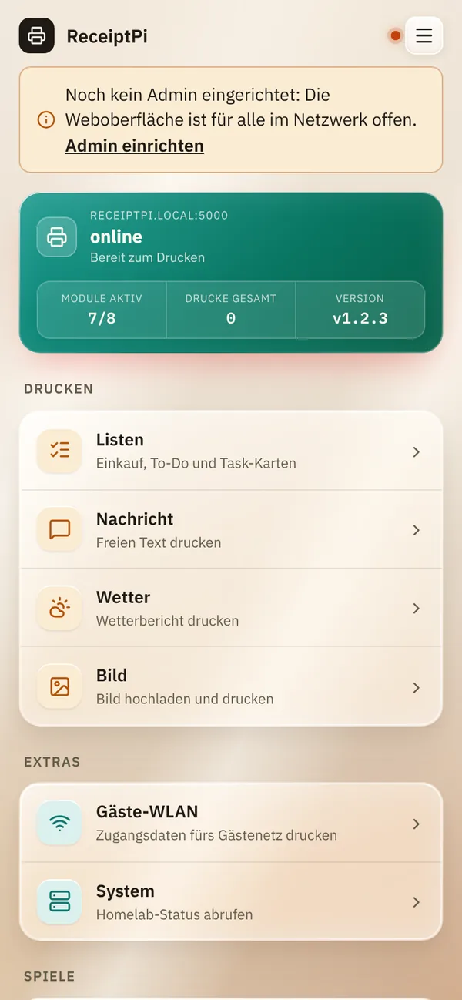
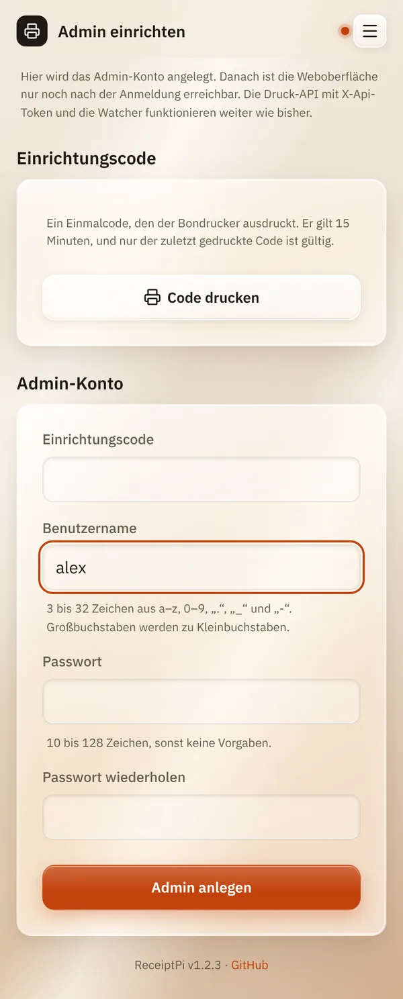

# Erste Schritte

*[English version](first-steps.md)*

**Wer:** die Person, die ReceiptPi einrichtet

## Was kann das?

Diese Seite führt dich von einem frisch installierten ReceiptPi zum
ersten Druck: Oberfläche öffnen, Admin-Konto anlegen, etwas drucken. Das
dauert etwa fünf Minuten.

## So geht's

### 1. Drucker anschließen

Verbinde den Drucker per USB-Kabel mit dem Raspberry Pi, leg Papier ein
und schalte den Drucker ein.

Wenn ReceiptPi startet, druckt der Drucker einen kurzen Zettel mit der
Überschrift **ONLINE** sowie Name und IP-Adresse des Raspberry Pi. Heb
ihn auf: Die Adresse brauchst du im nächsten Schritt.

### 2. Oberfläche öffnen

Öffne auf deinem Handy oder Rechner im selben Netzwerk:

```
http://receiptpi.local:5000
```

`receiptpi` ist der Name, den das ReceiptPi-Image dem Raspberry Pi gibt.
Hast du einen anderen Namen vergeben, nimm diesen. Öffnet sich die Seite
nicht, nimm stattdessen die IP-Adresse vom Zettel, zum Beispiel
`http://192.168.178.50:5000`.

### 3. Admin-Konto anlegen

Oben auf der Seite steht „Noch kein Admin eingerichtet: Die
Weboberfläche ist für alle im Netzwerk offen.“ Bis du einen Admin
anlegst, kann jeder in deinem Netzwerk alles benutzen und ändern.



1. Tippe auf **Admin einrichten**.
2. Wähle einen Benutzernamen (3 bis 32 Zeichen: Kleinbuchstaben, Ziffern,
   `.`, `_` und `-`) und ein Passwort (mindestens 10 Zeichen).
3. Tippe auf **Code drucken**. Der Drucker druckt einen einmaligen
   Einrichtungscode. Er gilt 15 Minuten.
4. Gib den Code unter **Einrichtungscode** ein und tippe auf
   **Admin anlegen**.

   

Ab jetzt fragt die Oberfläche nach einer Anmeldung. Setz den Haken bei
**Eingeloggt bleiben**, dann musst du dich nicht jeden Tag neu anmelden.

### 4. Dein erster Druck

1. Tippe auf der Startseite auf **Nachricht**.
2. Schreib ein paar Worte unter **Nachricht** und tippe auf **Drucken**.

Kommt der Zettel heraus, funktioniert alles.

### 5. ReceiptPi auf den Startbildschirm legen

- **iPhone:** Tippe in Safari auf den Teilen-Knopf und dann auf
  **Zum Home-Bildschirm**.
- **Android:** Öffne in Chrome das Menü (drei Punkte) und tippe auf
  **Zum Startbildschirm hinzufügen**.

ReceiptPi öffnet sich dann wie eine App.

## Gut zu wissen

Was du als Nächstes einrichten kannst:

- [Sprache](settings/language.de.md): Deutsch oder Englisch.
- [Druckregeln](settings/print-rules.de.md): Ruhezeiten, damit nachts
  nichts druckt.
- [Anmeldung und Konten](settings/accounts.de.md): Konten für den Rest
  des Haushalts.
- [Design und Glas-Effekt](settings/design.de.md): Farben und Aussehen.
- [Module ein- und ausschalten](settings/modules.de.md): ausblenden, was
  du nicht brauchst.

## Klappt nicht?

| Problem | Was du tun kannst |
|---------|-------------------|
| Die Seite öffnet sich nicht. | Ist dein Handy im selben Netzwerk (WLAN) wie der Raspberry Pi? Nimm die IP-Adresse vom **ONLINE**-Zettel. Vergiss `:5000` am Ende nicht. |
| Es kam kein **ONLINE**-Zettel. | Prüfe, ob der Drucker eingeschaltet ist, Papier hat und per USB verbunden ist. Die Adresse steht auch in der Geräteliste deines Routers. |
| „Der Code konnte nicht gedruckt werden und ist ungültig. ...“ | Der Drucker ist nicht bereit. Prüfe ihn und tippe noch einmal auf **Code drucken**. Siehe [Fehlerbehebung](help/troubleshooting.de.md). |
| Du hast das Admin-Passwort vergessen. | Siehe [Anmeldung und Konten](settings/accounts.de.md#passwort-vergessen). |

---

[Zurück zur Übersicht](README.de.md)
