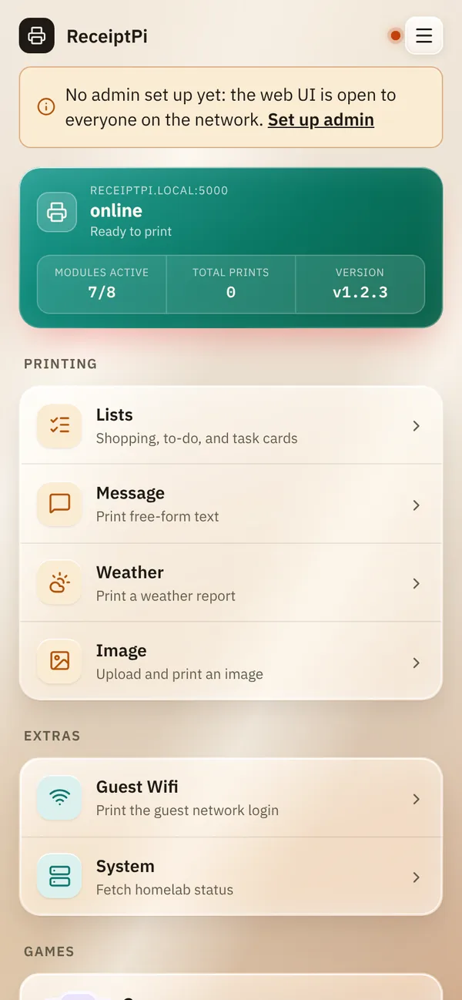
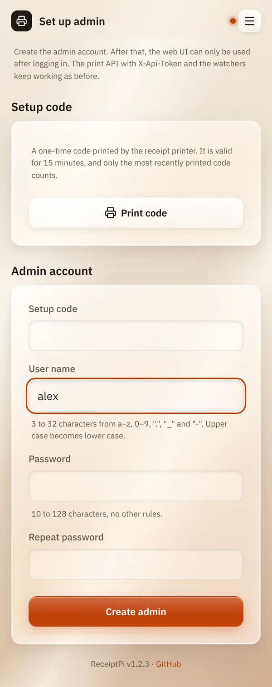

# First steps

*[Deutsche Version](first-steps.de.md)*

**Who:** the person setting up ReceiptPi

## What it does

This page takes you from a freshly installed ReceiptPi to your first
print: open the web interface, create the admin account, print something.
It takes about five minutes.

## How to use it

### 1. Connect the printer

Connect the printer to the Raspberry Pi with the USB cable, load paper
and switch the printer on.

When ReceiptPi starts, the printer prints a short slip titled **ONLINE**
with the name and IP address of the Raspberry Pi. Keep it: you need the
address in the next step.

### 2. Open the web interface

On your phone or computer, in the same network, open:

```
http://receiptpi.local:5000
```

`receiptpi` is the name the ReceiptPi image gives the Raspberry Pi. If
you gave it another name, use that one. If the page doesn't open, use
the IP address from the slip instead, for example
`http://192.168.178.50:5000`.

### 3. Create the admin account

At the top of the page you see "No admin set up yet: the web UI is open
to everyone on the network." Until you create an admin, anyone in your
network can use and change everything.



1. Tap **Set up admin**.
2. Choose a user name (3 to 32 characters: lower-case letters, digits,
   `.`, `_` and `-`) and a password (at least 10 characters).
3. Tap **Print code**. The printer prints a one-time setup code. It is
   valid for 15 minutes.
4. Type the code into **Setup code** and tap **Create admin**.

   

From now on, the web interface asks for a login. Tick
**Stay logged in** so you don't have to log in every day.

### 4. Your first print

1. On the home page, tap **Message**.
2. Type a few words under **Message** and tap **Print**.

If the slip comes out, everything works.

### 5. Put ReceiptPi on your home screen

- **iPhone:** in Safari, tap the share button, then
  **Add to Home Screen**.
- **Android:** in Chrome, open the menu (three dots) and tap
  **Add to Home screen**.

ReceiptPi then opens like an app.

## Good to know

What you might want to set up next:

- [Language](settings/language.md): German or English.
- [Print rules](settings/print-rules.md): quiet hours, so nothing prints
  at night.
- [Login and accounts](settings/accounts.md): accounts for the rest of the
  household.
- [Design and glass effect](settings/design.md): colors and look.
- [Turning modules on and off](settings/modules.md): hide what you don't
  need.

## Something not working?

| Problem | What to do |
|---------|------------|
| The page doesn't open. | Is your phone in the same network (Wi-Fi) as the Raspberry Pi? Use the IP address from the **ONLINE** slip. Don't forget `:5000` at the end. |
| No **ONLINE** slip came out. | Check that the printer is switched on, has paper and is connected by USB. The address is also shown in your router's list of devices. |
| "The code could not be printed and is not valid. ..." | The printer isn't ready. Check it and tap **Print code** again. See [Troubleshooting](help/troubleshooting.md). |
| You forgot the admin password. | See [Login and accounts](settings/accounts.md#forgotten-password). |

---

[Back to the overview](README.md)
