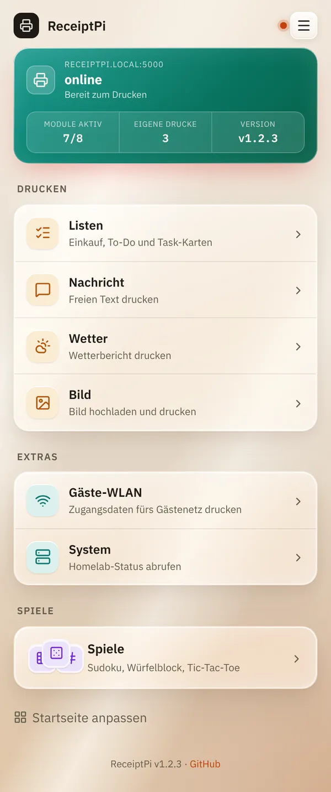
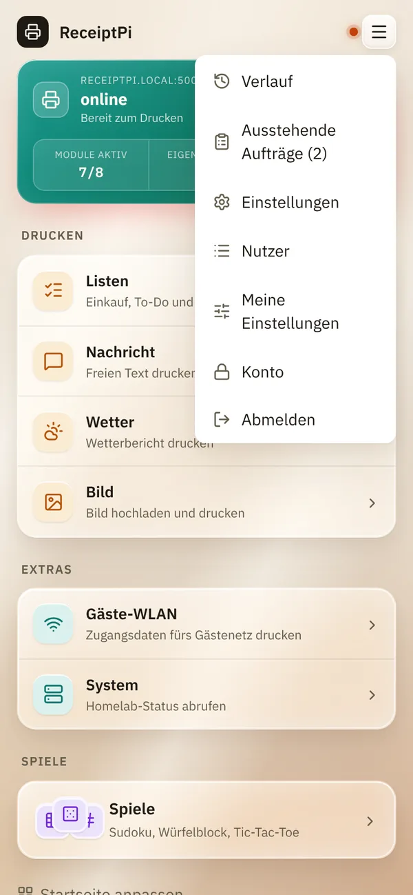
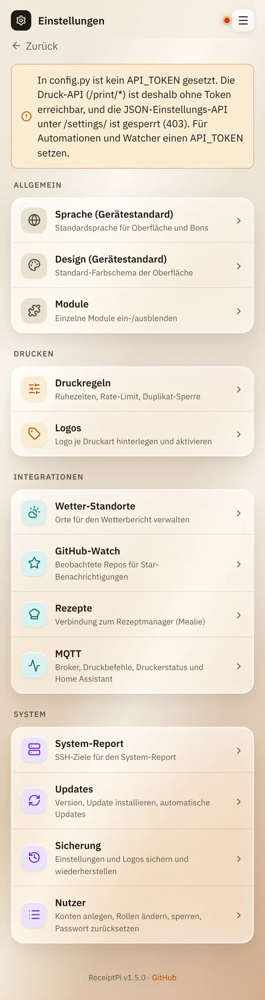

# Startseite und Menü

*[English version](home-and-menu.md)*

**Wer:** alle, die die Oberfläche öffnen können

## Was kann das?

Die Startseite zeigt auf einen Blick, ob der Drucker bereit ist, und
führt zu allem, was du drucken kannst. Das Menü oben rechts führt zu
allem anderen.

## So geht's

### Der farbige Kasten oben

Er zeigt den Druckerstatus. Der Status wird alle 60 Sekunden automatisch
geprüft.

| Anzeige | Bedeutung |
|---------|-----------|
| **online**, „Bereit zum Drucken“ | Alles in Ordnung. |
| **nicht erreichbar**, „USB/Verbindung prüfen“ | Der Drucker ist aus, nicht angeschlossen oder antwortet nicht. |

Darunter siehst du, wie viele Module eingeschaltet sind
(**Module aktiv**), wie viel gedruckt wurde (**Drucke gesamt**, mit
Konten **Eigene Drucke**) und die **Version** von ReceiptPi.

### Die Kacheln

Die Kacheln sind in Gruppen sortiert:

- **Drucken:** [Listen](modules/lists.de.md), [Nachricht](modules/message.de.md),
  [Bild](modules/images.de.md), [Wetter](modules/weather.de.md),
  [Rezepte](modules/recipes.de.md)
- **Extras:** [Gäste-WLAN](modules/wifi.de.md), [System](modules/system.de.md)
- **Spiele:** [Sudoku, Würfelblock und Tic-Tac-Toe](modules/games.de.md)

Tippe auf eine Kachel, um sie zu öffnen. Die Kachel eines Moduls, das
ausgeschaltet ist oder das dein Konto nicht öffnen darf, wird nicht
angezeigt.

Ganz unten kannst du unter **Startseite anpassen** Kacheln ausblenden und
umsortieren, siehe [Meine Einstellungen](settings/my-settings.de.md#startseite-anpassen).

### Die obere Leiste und das Menü

Neben dem Seitentitel siehst du einen kleinen Punkt: den Druckerstatus,
auf jeder Seite. Die drei Striche oben rechts öffnen das Menü:

| Eintrag | Was du dort findest | Wer ihn sieht |
|---------|---------------------|---------------|
| **Verlauf** | [Alles, was gedruckt wurde](modules/history.de.md) | alle |
| **Ausstehende Aufträge** | [Drucke, die warten](modules/pending.de.md), mit ihrer Anzahl in Klammern | alle |
| **Einstellungen** | Alle [Einstellungen](README.de.md#einstellungen) | Admins |
| **Nutzer** | [Konten](settings/accounts.de.md) | Admins |
| **Meine Einstellungen** | [Eigene Sprache, eigenes Design, eigene Startseite](settings/my-settings.de.md) | alle mit Konto |
| **Konto** | Passwort ändern, auf anderen Geräten abmelden | alle mit Konto |
| **Abmelden** | Auf diesem Gerät abmelden | alle mit Konto |

## Gut zu wissen

- **Ganz unten** auf jeder Seite steht die Version. Gibt es eine neuere,
  steht dort „Update verfügbar:“ mit einem Link.
- **Zurück** oben links auf jeder Seite führt eine Ebene nach oben.
- **Große Schrift:** Mit Easy-Read wird die ganze Oberfläche größer,
  siehe [Druckregeln](settings/print-rules.de.md#größere-schrift-easy-read).

## Klappt nicht?

| Problem | Was du tun kannst |
|---------|-------------------|
| Der Kasten zeigt **nicht erreichbar**. | Prüfe, ob der Drucker eingeschaltet ist, Papier hat und das USB-Kabel steckt. Siehe [Fehlerbehebung](help/troubleshooting.de.md). |
| Eine Kachel fehlt. | Das Modul ist vielleicht ausgeschaltet (siehe [Module ein- und ausschalten](settings/modules.de.md)), in deinen [Startseiten-Einstellungen](settings/my-settings.de.md#startseite-anpassen) ausgeblendet oder für dein Konto nicht erlaubt. |
| Im Menü fehlt **Einstellungen**. | Einstellungen sind nur für Admins. Frag einen Admin. |

---

[Zurück zur Übersicht](README.de.md)
