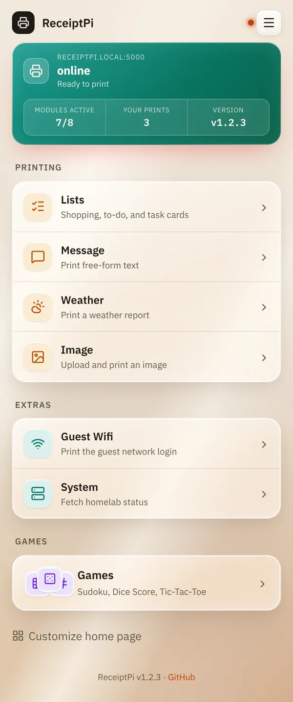
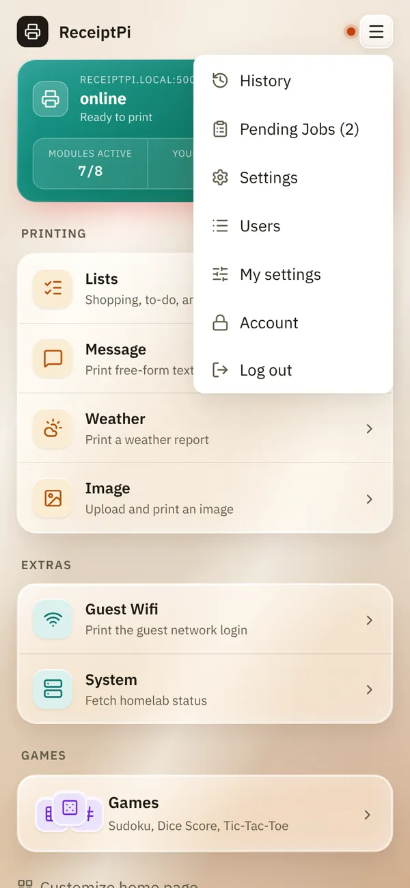
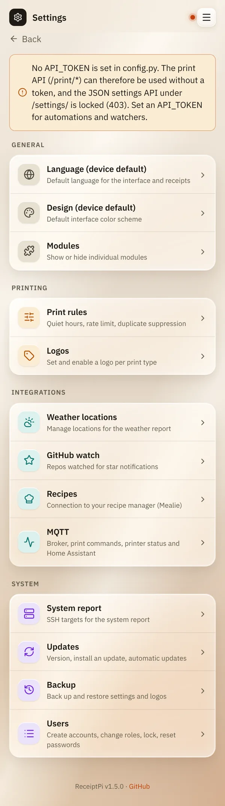

# Home page and menu

*[Deutsche Version](home-and-menu.de.md)*

**Who:** everyone who can open the web interface

## What it does

The home page shows at a glance whether the printer is ready, and leads
to everything you can print. The menu at the top right leads to
everything else.

## How to use it

### The colored box at the top

It shows the printer status. It is checked automatically every 60
seconds.

| Shows | Meaning |
|-------|---------|
| **online**, "Ready to print" | Everything is fine. |
| **unreachable**, "Check USB/connection" | The printer is switched off, unplugged or not responding. |

Below it you see how many modules are switched on (**Modules active**),
how much has been printed (**Total prints**, or **Your prints** once
there are accounts) and the **Version** of ReceiptPi.

### The tiles

The tiles are grouped:

- **Printing:** [Lists](modules/lists.md), [Message](modules/message.md),
  [Image](modules/images.md), [Weather](modules/weather.md),
  [Recipes](modules/recipes.md)
- **Extras:** [Guest Wifi](modules/wifi.md), [System](modules/system.md)
- **Games:** [Sudoku, dice score and tic-tac-toe](modules/games.md)

Tap a tile to open it. A tile for a module that is switched off or that
your account may not open isn't shown.

At the bottom, **Customize home page** lets you hide tiles and change
their order, see [My settings](settings/my-settings.md#customizing-the-home-page).

### The top bar and the menu

Next to the page title you see a small dot: the printer status on every
page. The three lines at the top right open the menu:

| Entry | What's there | Who sees it |
|-------|--------------|-------------|
| **History** | [Everything that was printed](modules/history.md) | everyone |
| **Pending Jobs** | [Prints that are waiting](modules/pending.md), with their number in brackets | everyone |
| **Settings** | All [settings](README.md#settings) | admins |
| **Users** | [Accounts](settings/accounts.md) | admins |
| **My settings** | [Your own language, design, home page](settings/my-settings.md) | everyone with an account |
| **Account** | Change your password, log out on other devices | everyone with an account |
| **Log out** | Log out on this device | everyone with an account |

## Good to know

- **At the very bottom** of every page you see the version. If a newer
  version exists, it says "Update available:" with a link.
- **Back** at the top left of each page takes you one level up.
- **Large text:** the whole interface gets larger with Easy-Read, see
  [Print rules](settings/print-rules.md#larger-text-easy-read).

## Something not working?

| Problem | What to do |
|---------|------------|
| The box says **unreachable**. | Check that the printer is switched on, has paper and the USB cable is plugged in. See [Troubleshooting](help/troubleshooting.md). |
| A tile is missing. | The module may be switched off (see [Turning modules on and off](settings/modules.md)), hidden in your [home page settings](settings/my-settings.md#customizing-the-home-page), or not allowed for your account. |
| There is no **Settings** in the menu. | Settings are for admins only. Ask an admin. |

---

[Back to the overview](README.md)
