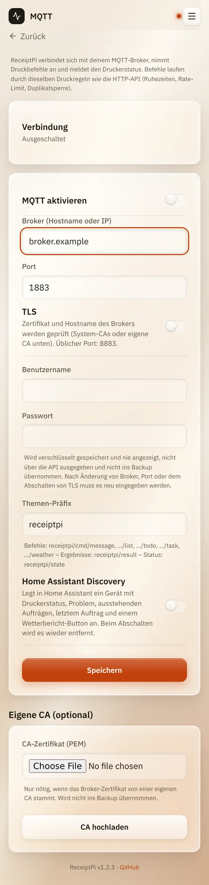

# MQTT

*[English version](mqtt.md)*

**Wer:** Admins, die schon einen MQTT-Broker betreiben (zum Beispiel
Mosquitto)

## Was kann das?

[MQTT](../help/glossary.de.md#mqtt) ist ein Nachrichtensystem, das viele
Smart-Home-Installationen nutzen. Hast du einen Broker, verbindet sich
ReceiptPi damit:

- **Druckbefehle rein:** Andere Geräte schicken eine Nachricht, ReceiptPi
  druckt.
- **Status raus:** ReceiptPi meldet, ob der Drucker bereit ist, wie viele
  Aufträge warten und was zuletzt gedruckt wurde.
- **Home Assistant:** Auf Wunsch erscheint ReceiptPi dort als eigenes
  Gerät.

MQTT ist anfangs aus.

## So geht's

1. Öffne das Menü (drei Striche oben rechts), tippe auf
   **Einstellungen** und dann auf **MQTT**.
2. Schalte **MQTT aktivieren** ein.
3. Gib den **Broker (Hostname oder IP)** und den **Port** ein (meist
   1883, mit TLS meist 8883).
4. Nutzt dein Broker Verschlüsselung, schalte **TLS** ein.
5. Gib **Benutzername** und **Passwort** für ReceiptPi am Broker ein.
6. Lass das **Themen-Präfix** auf `receiptpi`, außer du brauchst ein
   anderes.
7. Für Home Assistant schalte **Home Assistant Discovery** ein.
8. Tippe auf **Speichern**. Der Status oben sollte auf „Verbunden“
   wechseln.

   

### Einen Druck schicken

Schick eine [JSON](../help/glossary.de.md#json)-Nachricht an eines dieser
Themen (mit dem Präfix `receiptpi`):

| Thema | Druckt | Inhalt |
|-------|--------|--------|
| `receiptpi/cmd/message` | einen Text | `{"title": "optional", "text": "..."}` |
| `receiptpi/cmd/list` | einen Einkaufszettel | `{"title": "...", "items": ["..."]}` |
| `receiptpi/cmd/todo` | eine To-do-Liste | wie `list` |
| `receiptpi/cmd/task` | eine Task-Karte | wie bei der [API](api.de.md#was-du-drucken-kannst) |
| `receiptpi/cmd/weather` | einen Wetterbericht | `{}` oder `{"location": "Zuhause"}` |

Zum Beispiel mit dem Kommandozeilen-Werkzeug von Mosquitto:

```bash
mosquitto_pub -h <broker> -u <benutzer> -P <passwort> \
  -t receiptpi/cmd/message -m '{"text": "Hallo von MQTT"}'
```

Das Ergebnis jedes Befehls kommt auf `receiptpi/result` zurück. Der
Status steht auf `receiptpi/state`.

## Gut zu wissen

- **Wer am Broker senden darf, kann drucken.** Richte an deinem Broker
  Benutzer und Zugriffsregeln ein. Die Einstellungsseite warnt, wenn kein
  Benutzername oder kein TLS gesetzt ist.
- **Das Passwort wird verschlüsselt gespeichert**, nie angezeigt und ist
  nie Teil einer [Sicherung](../settings/backup.de.md). Nach einer
  Änderung von Broker, Port oder TLS musst du es neu eingeben.
- **Eigene Zertifizierungsstelle:** Stammt das Zertifikat des Brokers von
  deiner eigenen CA, lade sie unter **Eigene CA (optional)** hoch.
- **Die Druckregeln gelten** wie überall: Ruhezeiten, Drucklimit,
  Duplikate.
- **Steuerzeichen werden nicht gedruckt.** Zeilenumbrüche bleiben, ein
  Tab wird ein Leerzeichen, andere Steuerzeichen (zum Beispiel ESC)
  fallen weg.
- **Nicht über MQTT verfügbar:** Gäste-WLAN, Systemreport und Bilder.
- **Home Assistant Discovery** legt ein Gerät mit **Druckerstatus**,
  **Problem**, **Ausstehende Aufträge**, **Letzter Auftrag** und einem
  Knopf **Wetterbericht drucken** an. Ausschalten entfernt das Gerät
  wieder. Mehr unter [Home Assistant](home-assistant.de.md).

## Klappt nicht?

| Status | Was du tun kannst |
|--------|-------------------|
| „Einstellungen unvollständig oder ungültig“ | Prüfe Broker, Port und, falls genutzt, Benutzername und Passwort. |
| „Verbindung verloren, neuer Versuch läuft“ oder „Fehler, neuer Versuch läuft“ | Läuft der Broker und ist er vom Raspberry Pi aus erreichbar? Bei TLS: Stimmen Hostname und Zertifikat? |
| „Broker, Port oder TLS wurden geändert – bitte das Passwort erneut eingeben.“ | Gib das Passwort neu ein und speichere. |
| Ein Befehl bewirkt nichts. | Schau auf `receiptpi/result`: Dort steht der Grund, zum Beispiel eine Druckregel oder ein ausgeschaltetes Modul. |

---

[Zurück zur Übersicht](../README.de.md)
