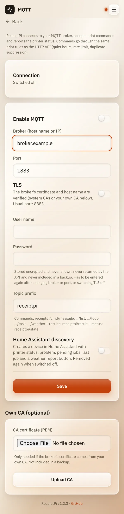

# MQTT

*[Deutsche Version](mqtt.de.md)*

**Who:** admins who already run an MQTT broker (for example Mosquitto)

## What it does

[MQTT](../help/glossary.md#mqtt) is a messaging system many smart-home
setups use. If you have a broker, ReceiptPi connects to it:

- **Print commands in:** other devices send a message, ReceiptPi prints.
- **Status out:** ReceiptPi reports whether the printer is ready, how many
  jobs are waiting and what was printed last.
- **Home Assistant:** optionally, ReceiptPi appears there as a device on
  its own.

MQTT is off by default.

## How to use it

1. Open the menu (three lines at the top right), tap **Settings** and
   then **MQTT**.
2. Switch on **Enable MQTT**.
3. Enter the **Broker (host name or IP)** and the **Port** (usually 1883,
   with TLS usually 8883).
4. If your broker uses encryption, switch on **TLS**.
5. Enter the **User name** and **Password** for ReceiptPi on the broker.
6. Leave the **Topic prefix** at `receiptpi`, unless you need another.
7. For Home Assistant, switch on **Home Assistant discovery**.
8. Tap **Save**. The status at the top should change to "Connected".

   

### Sending a print

Send a [JSON](../help/glossary.md#json) message to one of these topics
(with the prefix `receiptpi`):

| Topic | Prints | Content |
|-------|--------|---------|
| `receiptpi/cmd/message` | a text | `{"title": "optional", "text": "..."}` |
| `receiptpi/cmd/list` | a shopping list | `{"title": "...", "items": ["..."]}` |
| `receiptpi/cmd/todo` | a to-do list | like `list` |
| `receiptpi/cmd/task` | a task card | as with the [API](api.md#what-you-can-print) |
| `receiptpi/cmd/weather` | a weather report | `{}` or `{"location": "Home"}` |

For example with Mosquitto's command-line tool:

```bash
mosquitto_pub -h <broker> -u <user> -P <password> \
  -t receiptpi/cmd/message -m '{"text": "Hello from MQTT"}'
```

The result of each command comes back on `receiptpi/result`. The status
is on `receiptpi/state`.

## Good to know

- **Anyone allowed to send on the broker can print.** Set up users and
  access rules on your broker. The settings page warns if no user name
  or no TLS is set.
- **The password is stored encrypted**, never shown and never part of a
  [backup](../settings/backup.md). After changing broker, port or TLS,
  you have to enter it again.
- **Your own certificate authority:** if the broker's certificate comes
  from your own CA, upload it under **Own CA (optional)**.
- **Print rules apply**, like everywhere: quiet hours, print limit,
  duplicates.
- **Not available over MQTT:** guest Wi-Fi, system report and images.
- **Home Assistant discovery** creates a device with **Printer status**,
  **Problem**, **Pending jobs**, **Last job** and a **Print weather
  report** button. Switching it off removes the device again. More in
  [Home Assistant](home-assistant.md).

## Something not working?

| Status | What to do |
|--------|------------|
| "Settings incomplete or invalid" | Check broker, port and, if used, user name and password. |
| "Connection lost, retrying" or "Error, retrying" | Is the broker running and reachable from the Raspberry Pi? With TLS: are host name and certificate right? |
| "Broker, port or TLS changed – please enter the password again." | Enter the password again, then save. |
| A command does nothing. | Look at `receiptpi/result`: it says why, for example a print rule or a switched-off module. |

---

[Back to the overview](../README.md)
