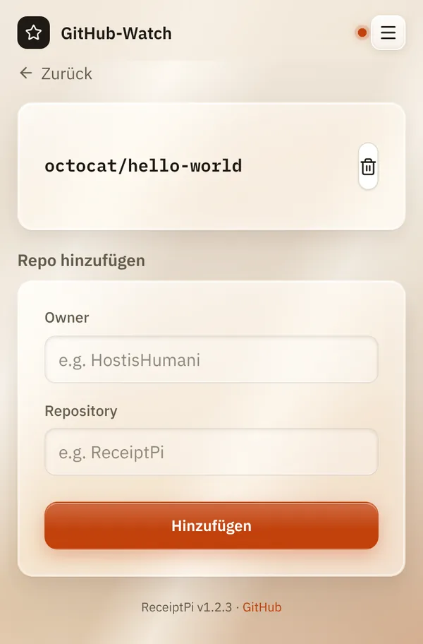

# Automatische Watcher

*[English version](watchers.md)*

**Wer:** Admins

## Was kann das?

Watcher sind kleine Helfer, die im Hintergrund laufen und von selbst
drucken, wenn etwas passiert. Niemand muss dafür einen Knopf drücken.

| Watcher | Druckt, wenn ... | Prüft alle | Anfangs an |
|---------|------------------|------------|------------|
| **GitHub-Sterne** | ein beobachtetes GitHub-Projekt einen neuen Stern bekommt | 5 Minuten | ja, beobachtet aber nichts, bis du ein Projekt einträgst |
| **Unwetterwarnung** | eine neue amtliche Wetterwarnung gilt | 15 Minuten | ja, druckt aber erst, wenn du sie in den [Wetter-Einstellungen](../modules/weather.de.md#unwetterwarnung-einschalten) einschaltest |
| **Gäste-WLAN** | du das Gästenetz deiner FRITZ!Box einschaltest | 1 Minute | nein, siehe [Gäste-WLAN](../modules/wifi.de.md#einmalige-einrichtung) |
| **Update-Prüfung** | nie. Sie sucht nach einer neuen ReceiptPi-Version und zeigt sie unten auf jeder Seite an. | 12 Stunden | ja |

## So geht's

### Ein GitHub-Projekt beobachten

1. Öffne das Menü (drei Striche oben rechts), tippe auf
   **Einstellungen** und dann auf **GitHub-Watch**.
2. Gib unter **Repo hinzufügen** den **Owner** und das **Repository**
   ein, zum Beispiel `HostisHumani` und `ReceiptPi`.
3. Tippe auf **Hinzufügen**.

Bekommt das Projekt einen neuen Stern, kommt ein Zettel „NEW GITHUB STAR“
mit dem Projekt, den neuen Sternen und der Gesamtzahl.



### Prüfen, ob die Watcher laufen

Im [Terminal](../help/glossary.de.md#terminal):

```bash
systemctl list-timers 'receiptpi-*'
```

Jeder aktive Watcher steht dort mit der Zeit seines nächsten Laufs.

## Gut zu wissen

- **Die Druckregeln gelten** auch für Watcher. Während einer Ruhezeit
  warten ihre Drucke unter [Ausstehende Aufträge](../modules/pending.de.md).
  Unwetterwarnungen dürfen auf Wunsch trotz Ruhezeit drucken.
- **Ausgeschaltete Module** pausieren ihren Watcher: kein Gäste-WLAN-Zettel,
  wenn **Gäste-WLAN** aus ist, keine Unwetterwarnung, wenn **Wetter** aus
  ist. Der GitHub-Watcher braucht das Modul **Nachricht**.
- **Watcher brauchen keine Anmeldung.** Hast du einen
  [API-Token](api.de.md#1-api-token-festlegen) festgelegt, nutzen sie ihn
  von selbst.
- **Die Update-Prüfung informiert nur.** Es wird nichts automatisch
  installiert.

## Klappt nicht?

| Problem | Was du tun kannst |
|---------|-------------------|
| Ein Watcher fehlt bei `systemctl list-timers`. | Er ist nicht eingeschaltet. Zum Beispiel: `sudo systemctl enable --now receiptpi-wifi-watch.timer`. |
| Ein Watcher läuft, druckt aber nichts. | Schau in sein Protokoll: `journalctl -u 'receiptpi-watcher@*' -n 50 --no-pager`. Dort steht der Grund, zum Beispiel „storm warning disabled in settings, skipping“. |
| Kein GitHub-Sterne-Zettel. | Prüfe die Schreibweise von Owner und Repository und ob das Modul **Nachricht** an ist. |

---

[Zurück zur Übersicht](../README.de.md)
