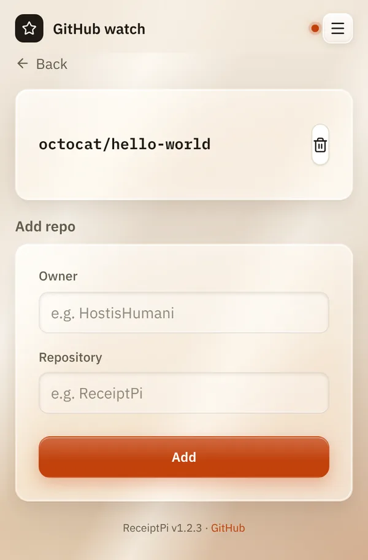

# Automatic watchers

*[Deutsche Version](watchers.de.md)*

**Who:** admins

## What it does

Watchers are small helpers that run in the background and print on their
own when something happens. No one has to press a button.

| Watcher | Prints when ... | Checks every | On by default |
|---------|-----------------|--------------|---------------|
| **GitHub stars** | a watched GitHub project gets a new star | 5 minutes | yes, but watches nothing until you add a project |
| **Storm warning** | a new official weather warning is active | 15 minutes | yes, but only prints once you switch it on in the [weather settings](../modules/weather.md#switching-on-storm-warnings) |
| **Guest Wi-Fi** | you switch on the guest network of your FRITZ!Box | 1 minute | no, see [Guest Wi-Fi](../modules/wifi.md#one-time-setup) |
| **Update check** | never prints. It looks for a new full release of ReceiptPi (no test versions) and shows it at the bottom of each page and under [Updates](../settings/updates.md). | 12 hours | yes |

## How to use it

### Watching a GitHub project

1. Open the menu (three lines at the top right), tap **Settings** and
   then **GitHub watch**.
2. Under **Add repo**, enter the **Owner** and the **Repository**, for
   example `HostisHumani` and `ReceiptPi`.
3. Tap **Add**.

When the project gets a new star, a slip "NEW GITHUB STAR" comes out with
the project, the new stars and the total.



### Checking whether the watchers run

In the [terminal](../help/glossary.md#terminal):

```bash
systemctl list-timers 'receiptpi-*'
```

Each active watcher is listed with the time of its next run.

## Good to know

- **Print rules apply** to watchers too. During quiet hours, their prints
  wait under [Pending jobs](../modules/pending.md). Storm warnings can be
  allowed to break through quiet hours.
- **Switched-off modules** pause their watcher: no guest Wi-Fi slip with
  **Guest Wifi** off, no storm warning with **Weather** off. The GitHub
  watcher needs the **Message** module.
- **Watchers don't need a login.** If you set an
  [API token](api.md#1-set-an-api-token), they use it automatically.
- **The update check only informs.** Installing happens under
  [Updates](../settings/updates.md), by hand or at night.

## Something not working?

| Problem | What to do |
|---------|------------|
| A watcher is missing from `systemctl list-timers`. | It isn't switched on. For example: `sudo systemctl enable --now receiptpi-wifi-watch.timer`. |
| A watcher runs but prints nothing. | Look at its log: `journalctl -u 'receiptpi-watcher@*' -n 50 --no-pager`. It says why, for example "storm warning disabled in settings, skipping". |
| No GitHub-star slip. | Check the spelling of owner and repository, and that the **Message** module is on. |

---

[Back to the overview](../README.md)
