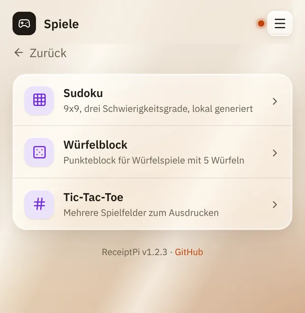
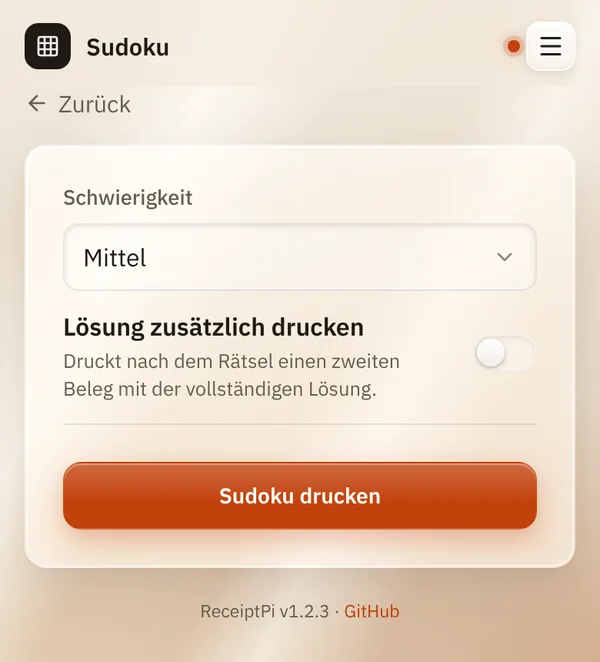

# Spiele

*[English version](games.md)*

**Wer:** alle, die die Oberfläche öffnen können

## Was kann das?

Druckt Spiele für Stift und Papier, spielfertig für den Tisch, ganz ohne
Bildschirm:

| Spiel | Was du bekommst |
|-------|-----------------|
| **Sudoku** | Ein 9×9-Rätsel in drei Stufen, jedes Mal neu erzeugt, auf Wunsch mit der Lösung auf einem zweiten Bon |
| **Würfelblock** | Ein Spielzettel für Würfelspiele mit fünf Würfeln, einer pro Spieler |
| **Tic-Tac-Toe** | Mehrere leere Spielfelder hintereinander |

## So geht's

1. Tippe auf der Startseite auf **Spiele** und dann auf das Spiel.

   

2. Wähle die Optionen:
   - **Sudoku:** eine **Schwierigkeit** (**Leicht**, **Mittel**,
     **Schwer**). Hake **Lösung zusätzlich drucken** an, wenn du die
     Lösung auch willst.
   - **Würfelblock:** die **Anzahl Spieler**, von 1 bis 12.
   - **Tic-Tac-Toe:** die **Anzahl Runden**: 3, 6 oder 9 Felder.
3. Tippe auf **Sudoku drucken**, **Würfelblock drucken** oder
   **Tic-Tac-Toe drucken**.

   

## Gut zu wissen

- **Die Lösung kommt auf einem eigenen Bon**, so kannst du sie abreißen
  und beiseitelegen.
- **Jedes Sudoku ist neu.** Es entsteht auf dem Raspberry Pi selbst, ganz
  ohne Internet.
- **Der Würfelblock** hat die üblichen Felder: Einser bis Sechser mit
  Bonus, 3er- und 4er-Pasch, Full House, kleine und große Straße,
  5 Gleiche und Chance. Namen trägst du von Hand ein.
- Die [Druckregeln](../settings/print-rules.de.md) gelten. Ein Sudoku mit
  Lösung zählt als zwei Drucke, alle Würfelzettel eines Drucks als einer.

## Klappt nicht?

| Problem | Was du tun kannst |
|---------|-------------------|
| „Fehler: Rate-Limit erreicht ...“ | In der letzten Stunde wurde zu viel gedruckt. Warte oder erhöhe das Limit unter [Druckregeln](../settings/print-rules.de.md). |
| Die Kachel **Spiele** fehlt. | Das Modul ist ausgeschaltet, siehe [Module ein- und ausschalten](../settings/modules.de.md). |

---

[Zurück zur Übersicht](../README.de.md)
