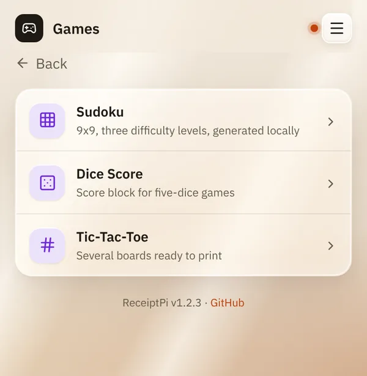
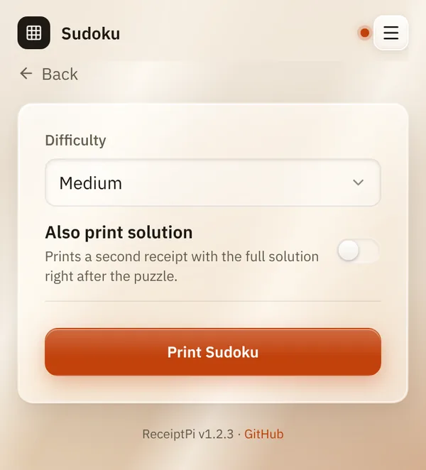

# Games

*[Deutsche Version](games.de.md)*

**Who:** everyone who can open the web interface

## What it does

Prints pen-and-paper games, ready to play at the table, no screen
needed:

| Game | What you get |
|------|--------------|
| **Sudoku** | A 9×9 puzzle in three levels, made fresh each time, optionally with the solution on a second receipt |
| **Dice Score** | A score sheet for dice games with five dice, one per player |
| **Tic-Tac-Toe** | Several empty boards in a row |

## How to use it

1. On the home page, tap **Games**, then the game you want.

   

2. Choose the options:
   - **Sudoku:** a **Difficulty** (**Easy**, **Medium**, **Hard**). Tick
     **Also print solution** if you want the solution as well.
   - **Dice Score:** the **Number of players**, from 1 to 12.
   - **Tic-Tac-Toe:** the **Number of rounds**: 3, 6 or 9 boards.
3. Tap **Print Sudoku**, **Print dice score** or **Print Tic-Tac-Toe**.

   

## Good to know

- **The solution comes on its own receipt**, so you can tear it off and
  keep it out of sight.
- **Every Sudoku is new.** It is created on the Raspberry Pi itself, no
  internet needed.
- **The dice score sheet** has the usual categories: ones to sixes with
  bonus, three and four of a kind, full house, small and large straight,
  five alike and chance. Names are filled in by hand.
- [Print rules](../settings/print-rules.md) apply. A Sudoku with its
  solution counts as two prints, all dice sheets of one print as one.

## Something not working?

| Problem | What to do |
|---------|------------|
| "Error: Rate limit reached ..." | Too many prints in the last hour. Wait, or raise the limit under [Print rules](../settings/print-rules.md). |
| The **Games** tile is missing. | The module is switched off, see [Turning modules on and off](../settings/modules.md). |

---

[Back to the overview](../README.md)
