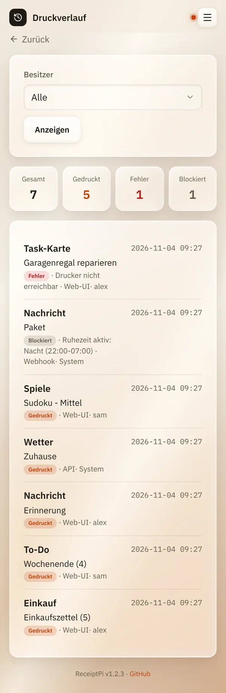

# Druckverlauf

*[English version](history.md)*

**Wer:** alle. Jedes Konto sieht seine eigenen Drucke, Admins sehen alle.

## Was kann das?

Listet alles auf, was ReceiptPi gedruckt hat oder drucken wollte: was,
wann, woher und ob es geklappt hat. Praktisch, wenn etwas nicht
herausgekommen ist.

## So geht's

Öffne das Menü (drei Striche oben rechts) und tippe auf **Verlauf**.

Oben siehst du vier Zahlen:

| Zahl | Bedeutung |
|------|-----------|
| **Gesamt** | alle Druckaufträge |
| **Gedruckt** | ist sauber herausgekommen |
| **Fehler** | fehlgeschlagen, meist wegen des Druckers |
| **Blockiert** | von einer [Druckregel](../settings/print-rules.de.md) zurückgehalten |

Darunter steht die Liste, das Neueste zuerst. Jeder Eintrag zeigt die
Art des Drucks, eine kurze Zusammenfassung, woher er kam und die Uhrzeit.
Mit **Weiter** und **Zurück** unten blätterst du.

**Für Admins:** Unter **Besitzer** kannst du nur die Drucke eines Kontos,
von **System** oder von allen (**Alle**) anzeigen. Tippe auf
**Anzeigen**, um die Auswahl zu übernehmen.

## Gut zu wissen

- **Woher ein Druck kam:**

  | Quelle | Bedeutung |
  |--------|-----------|
  | **Web-UI** | aus der Oberfläche |
  | **API** | aus einem Skript, Home Assistant oder den [Watchern](../integrations/watchers.de.md) für GitHub-Sterne und Gäste-WLAN, siehe [Automations-API](../integrations/api.de.md) |
  | **Webhook** | über den Automations-Webhook |
  | **MQTT** | über [MQTT](../integrations/mqtt.de.md) |
  | **System** | von ReceiptPi selbst: Startmeldung und Unwetterwarnungen |
  | **Nachdruck** | erneut gedruckt aus [Ausstehende Aufträge](pending.de.md) |

- **System** als Besitzer heißt: Der Druck gehörte zu keinem Konto
  (Skripte, Watcher oder vor dem ersten Admin).
- **Einträge bleiben 180 Tage**, danach werden sie automatisch gelöscht.
- **Zurückgehaltene oder fehlgeschlagene Drucke** warten meist unter
  [Ausstehende Aufträge](pending.de.md), wo du sie erneut drucken kannst.
- Drucke eines gelöschten Kontos bleiben als „Gelöschtes Konto #...“ in
  der Liste.

## Klappt nicht?

| Problem | Was du tun kannst |
|---------|-------------------|
| „Noch keine Druckjobs aufgezeichnet.“ | Mit diesem Konto wurde noch nichts gedruckt. |
| Viele Einträge unter **Fehler**. | Meistens der Drucker: kein Papier, ausgeschaltet, Kabel locker. Siehe [Fehlerbehebung](../help/troubleshooting.de.md). |

---

[Zurück zur Übersicht](../README.de.md)
