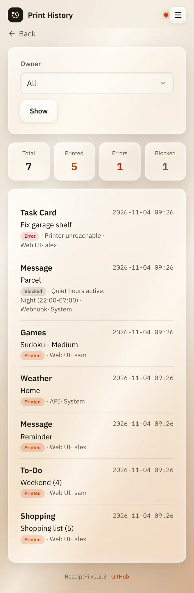

# Print history

*[Deutsche Version](history.de.md)*

**Who:** everyone. Each account sees its own prints, admins see all.

## What it does

Lists everything ReceiptPi has printed or tried to print: what, when,
from where, and whether it worked. Useful when something didn't come
out.

## How to use it

Open the menu (three lines at the top right) and tap **History**.

At the top you see four numbers:

| Number | Meaning |
|--------|---------|
| **Total** | all print jobs |
| **Printed** | came out fine |
| **Errors** | failed, usually because of the printer |
| **Blocked** | held back by a [print rule](../settings/print-rules.md) |

Below that is the list, newest first. Each entry shows the kind of print,
a short summary, where it came from and the time. Use **Next** and
**Previous** at the bottom to page through.

**For admins:** under **Owner** you can show only the prints of one
account, of **System** or of everyone (**All**). Tap **Show** to apply.

## Good to know

- **Where a print came from:**

  | Source | Meaning |
  |--------|---------|
  | **Web UI** | from the web interface |
  | **API** | from a script, Home Assistant or the GitHub-star and guest Wi-Fi [watchers](../integrations/watchers.md), see [Automation API](../integrations/api.md) |
  | **Webhook** | through the automation webhook |
  | **MQTT** | through [MQTT](../integrations/mqtt.md) |
  | **System** | from ReceiptPi itself: the start-up greeting and storm warnings |
  | **Reprint** | printed again from [Pending jobs](pending.md) |

- **System** as owner means: the print didn't belong to an account
  (scripts, watchers, or before the first admin was set up).
- **Entries are kept for 180 days**, then they are deleted
  automatically.
- **Blocked or failed prints** usually wait under
  [Pending jobs](pending.md), where you can print them again.
- Prints of a deleted account stay in the list as "Deleted account #...".

## Something not working?

| Problem | What to do |
|---------|------------|
| "No print jobs recorded yet." | Nothing has been printed with this account yet. |
| Many entries under **Errors**. | Usually the printer: no paper, switched off, cable loose. See [Troubleshooting](../help/troubleshooting.md). |

---

[Back to the overview](../README.md)
