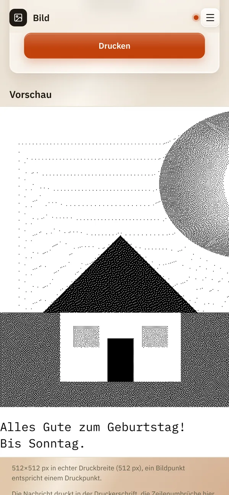

# Bild

*[English version](images.md)*

**Wer:** alle, die die Oberfläche öffnen können

## Was kann das?

Druckt ein Foto oder Bild von deinem Handy oder Rechner. Ein Bondrucker
kennt nur schwarze Punkte, deshalb wandelt ReceiptPi das Bild zuerst in
ein Punktmuster um. Vor dem Drucken kannst du das Bild drehen und
zuschneiden, eine Nachricht dazuschreiben, die unter dem Bild auf
denselben Bon gedruckt wird, und dir das Ergebnis ansehen.

## So geht's

1. Tippe auf der Startseite auf **Bild**.
2. Wähle unter **Bilddatei (PNG/JPG, max. 12MB)** ein Bild aus. Das
   Bild erscheint mit einem Rahmen darum.
3. Optional: Dreh es und schneide es zu, siehe
   [Drehen und zuschneiden](#drehen-und-zuschneiden) unten.
4. Wähle ein **Rasterverfahren**, also die Art, wie Grautöne zu Punkten
   werden:

   | Verfahren | Gut für |
   |-----------|---------|
   | **Floyd-Steinberg (Standard)** | die meisten Fotos |
   | **Atkinson (kontrastreicher)** | klarere Flächen, Zeichnungen, Logos |
   | **Bayer 8×8 (regelmäßiges Raster)** | ein gleichmäßiges Punktmuster im Retro-Look |

5. Optional: Schreib unter **Nachricht (optional)** einen Text. Der
   Zähler darunter zeigt, wie viele der 500 Zeichen du schon nutzt.
6. Tippe auf **Vorschau**, um genau zu sehen, was gedruckt wird. Die
   Nachricht steht unter dem Bild.

   

7. Tippe auf **Drucken**. Unter dem Knopf erscheint „Gedruckt ✓“; Bild
   und Bearbeitung bleiben, du kannst also etwas ändern und noch einmal
   drucken.

   

### Drehen und zuschneiden

| Bedienelement | Was es tut |
|---------------|------------|
| **↺ Links drehen**, **↻ Rechts drehen** | dreht das Bild um eine Vierteldrehung |
| die Ecken des Rahmens | ziehen zum Zuschneiden; innerhalb des Rahmens ziehen verschiebt ihn |
| **Seitenverhältnis** | **Frei**, **Original**, **1:1 (quadratisch)**, **4:3 (quer)** oder **3:4 (hoch)** |
| **Rückgängig** | nimmt die letzte Drehung, den letzten Zuschnitt oder das Zurücksetzen zurück, Schritt für Schritt |
| **Zurücksetzen** | zurück zum ganzen Bild, wie du es ausgewählt hast |

Unter den Knöpfen steht, wie groß der Druck wird, zum Beispiel „Druckt
512 × 384 Punkte, ca. 5,4 cm Bon.“

## Gut zu wissen

- **Immer volle Papierbreite.** Das bearbeitete Bild ist immer 512
  Punkte breit, die Höhe ergibt sich aus dem Zuschnitt; ein kleines Bild
  wird vergrößert und kann pixelig wirken. Ein hoher Zuschnitt ergibt
  einen langen Bon, höchstens 6.000 Punkte (etwa 85 cm).
- **Bearbeitet auf deinem Gerät.** Drehen und Zuschneiden passieren im
  Browser. Gesendet wird nur das fertige Bild, als JPG mit 512 Punkten
  Breite, meist ein paar hundert KB, egal wie groß das Foto ist. Das
  entlastet den ReceiptPi.
- **Ohne JavaScript** gibt es keinen Rahmen und keine Knöpfe; das Bild
  wird so gesendet, wie es ist. Dann wird ein Bild, das breiter als 512
  Punkte ist, auf 512 Punkte verkleinert, ein schmaleres druckt in
  seiner eigenen Größe, linksbündig. Dasselbe gilt für die API.
- **Handyfotos kommen richtig herum.** Viele Handys speichern ein
  Hochkant-Foto quer und vermerken die Drehung in der Datei
  (EXIF-Ausrichtung). Der Editor zeigt das Foto so, wie der Browser es
  zeigt, und der Server wendet den Vermerk bei Bildern an, die ohne den
  Editor oder über die API kommen.
- **Getestet** in Chromium (Desktop und Handygröße, mit Maus und
  Touch). **Nicht getestet:** Safari auf iPhone/iPad, Firefox, echte
  Android-Handys und HEIC-Fotos.
- **Die Nachricht** steht unter dem Bild, linksbündig, in der Schrift
  des Druckers, wie bei einer [Nachricht](message.de.md). Lange Zeilen
  brechen an Wortgrenzen um. Mit [Easy-Read](../settings/print-rules.de.md)
  druckt sie größer. Wo die Zeilen umbrechen, zeigt die Vorschau nur
  ungefähr, weil der Drucker den Text selbst setzt. Deine Zeilenumbrüche
  bleiben, Steuerzeichen fallen weg.
- **Kräftige Kontraste drucken am besten.** Dunkle, flaue Fotos werden
  matschig. Probier in der Vorschau ein anderes Verfahren.
- **Grenzen:** PNG oder JPG, höchstens 12 MB und 6.000 Pixel pro Seite.
  Atkinson geht bis 512×2000 Punkte nach dem Skalieren und bricht nach 15
  Sekunden ab.
- **Ein Bild nach dem anderen.** Während eins verarbeitet wird, muss ein
  zweites kurz warten.
- Die [Druckregeln](../settings/print-rules.de.md) gelten: Während einer
  Ruhezeit wartet das Bild unter [Ausstehende Aufträge](pending.de.md),
  schon in Punkte umgewandelt, zusammen mit seiner Nachricht. Dasselbe
  Bild mit einer anderen Nachricht gilt nicht als Duplikat.
- **Verlauf:** Der [Verlauf](history.de.md) zeigt die Bildgröße und die
  ersten 40 Zeichen der Nachricht.
- **Aus anderen Systemen:** Bilder können auch Skripte schicken, siehe
  [Automations-API](../integrations/api.de.md). Die API hat kein Feld
  für eine Nachricht.

## Klappt nicht?

| Du siehst | Was du tun kannst |
|-----------|-------------------|
| „Mit diesem Zuschnitt wird der Bon zu lang (höchstens 6000 Punkte). Schneide einen breiteren Teil zu.“ | Zieh den Rahmen breiter oder wähle ein Seitenverhältnis. |
| „Dieses Bild kann hier nicht bearbeitet werden. Es wird unverändert gesendet.“ | Dein Browser kann diese Datei nicht anzeigen. Speichere sie als JPG und wähle sie neu aus, oder drucke sie unverändert. |
| „Das Bild konnte nicht gelesen werden (nur PNG oder JPG).“ | Speichere das Bild als PNG oder JPG. iPhone-Fotos im HEIC-Format: als JPG teilen oder die Kamera auf „Maximale Kompatibilität“ stellen. |
| „Für Atkinson ist das Bild zu groß ...“ oder „Atkinson hat länger als 15 s gebraucht ...“ | Wähle Floyd-Steinberg oder Bayer oder schneide das Bild zu. |
| „Gerade wird schon ein Bild verarbeitet. ...“ | Warte ein paar Sekunden und versuch es noch einmal. |
| „Keine Antwort vom Server. Der Druck kann trotzdem noch kommen – schau in den Verlauf, bevor du noch einmal druckst.“ | Die Verbindung ist abgebrochen, während der Auftrag lief. Schau im [Verlauf](history.de.md), ob er gedruckt wurde, bevor du noch einmal druckst. |
| Der Druck ist zu dunkel oder zu hell. | Probier in der Vorschau ein anderes Rasterverfahren oder ändere vorher die Helligkeit des Bildes auf dem Handy. |

---

[Zurück zur Übersicht](../README.de.md)
