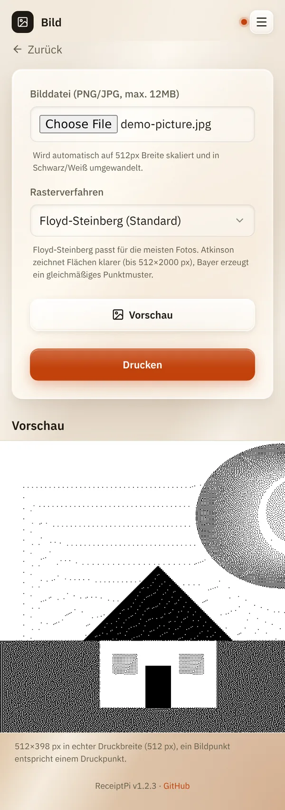

# Bild

*[English version](images.md)*

**Wer:** alle, die die Oberfläche öffnen können

## Was kann das?

Druckt ein Foto oder Bild von deinem Handy oder Rechner. Ein Bondrucker
kennt nur schwarze Punkte, deshalb wandelt ReceiptPi das Bild zuerst in
ein Punktmuster um. Das Ergebnis kannst du dir vor dem Drucken ansehen.

## So geht's

1. Tippe auf der Startseite auf **Bild**.
2. Wähle unter **Bilddatei (PNG/JPG, max. 12MB)** ein Bild aus.
3. Wähle ein **Rasterverfahren**, also die Art, wie Grautöne zu Punkten
   werden:

   | Verfahren | Gut für |
   |-----------|---------|
   | **Floyd-Steinberg (Standard)** | die meisten Fotos |
   | **Atkinson (kontrastreicher)** | klarere Flächen, Zeichnungen, Logos |
   | **Bayer 8×8 (regelmäßiges Raster)** | ein gleichmäßiges Punktmuster im Retro-Look |

4. Tippe auf **Vorschau**, um genau zu sehen, was gedruckt wird.
5. Tippe auf **Drucken**.

   

## Gut zu wissen

- **Die Breite ist immer die volle Papierbreite.** Das Bild wird auf 512
  Punkte Breite skaliert, die Höhe ergibt sich daraus. Ein hohes Bild
  ergibt einen langen Bon.
- **Kräftige Kontraste drucken am besten.** Dunkle, flaue Fotos werden
  matschig. Probier in der Vorschau ein anderes Verfahren.
- **Grenzen:** PNG oder JPG, höchstens 12 MB und 6.000 Pixel pro Seite.
  Atkinson geht bis 512×2000 Punkte nach dem Skalieren und bricht nach 15
  Sekunden ab.
- **Ein Bild nach dem anderen.** Während eins verarbeitet wird, muss ein
  zweites kurz warten.
- Die [Druckregeln](../settings/print-rules.de.md) gelten: Während einer
  Ruhezeit wartet das Bild unter [Ausstehende Aufträge](pending.de.md),
  schon in Punkte umgewandelt.
- **Aus anderen Systemen:** Bilder können auch Skripte schicken, siehe
  [Automations-API](../integrations/api.de.md).

## Klappt nicht?

| Du siehst | Was du tun kannst |
|-----------|-------------------|
| „Das Bild konnte nicht gelesen werden (nur PNG oder JPG).“ | Speichere das Bild als PNG oder JPG. iPhone-Fotos im HEIC-Format: als JPG teilen oder die Kamera auf „Maximale Kompatibilität“ stellen. |
| „Für Atkinson ist das Bild zu groß ...“ oder „Atkinson hat länger als 15 s gebraucht ...“ | Wähle Floyd-Steinberg oder Bayer oder schneide das Bild zu. |
| „Gerade wird schon ein Bild verarbeitet. ...“ | Warte ein paar Sekunden und versuch es noch einmal. |
| Der Druck ist zu dunkel oder zu hell. | Probier in der Vorschau ein anderes Rasterverfahren oder ändere vorher die Helligkeit des Bildes auf dem Handy. |

---

[Zurück zur Übersicht](../README.de.md)
