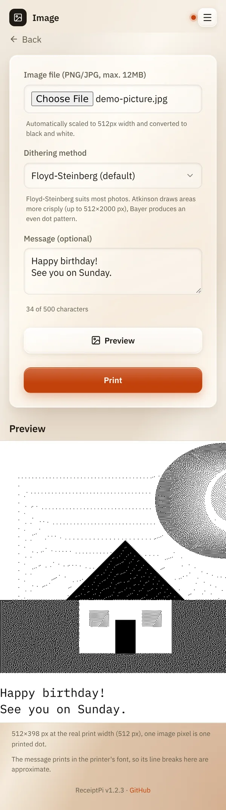

# Image

*[Deutsche Version](images.de.md)*

**Who:** everyone who can open the web interface

## What it does

Prints a photo or picture from your phone or computer. A receipt printer
only knows black dots, so ReceiptPi turns the picture into a pattern of
dots first. You can add a message that prints under the picture on the
same receipt, and look at the result before you print.

## How to use it

1. On the home page, tap **Image**.
2. Under **Image file (PNG/JPG, max. 12MB)**, choose a picture.
3. Choose a **Dithering method**, the way grey tones are turned into
   dots:

   | Method | Good for |
   |--------|----------|
   | **Floyd-Steinberg (default)** | most photos |
   | **Atkinson (higher contrast)** | clearer areas, drawings, logos |
   | **Bayer 8×8 (regular pattern)** | an even, retro-looking dot pattern |

4. Optional: write a text under **Message (optional)**. The counter
   below shows how many of the 500 characters you have used.
5. Tap **Preview** to see exactly what will be printed. The message
   shows under the picture.
6. Tap **Print**.

   

## Good to know

- **Wide pictures are scaled to the paper width.** A picture wider than
  512 dots is scaled down to 512 dots, the height follows. A narrower
  picture prints at its own size, on the left. A tall picture makes a
  long receipt.
- **Phone photos print the right way up.** Many phones save a portrait
  photo sideways and note the turn in the file (EXIF orientation).
  ReceiptPi applies that note, in the web interface and in the API.
- **The message** prints under the picture, left-aligned, in the
  printer's own font, like a [message](message.md). Long lines wrap at
  word boundaries. With [Easy-Read](../settings/print-rules.md) on, it
  prints larger. The preview shows where the lines break only roughly,
  because the printer sets the text itself. Line breaks you type stay;
  control characters are left out.
- **Strong contrasts print best.** Dark, low-contrast photos come out
  muddy. Try another method in the preview.
- **Limits:** PNG or JPG, at most 12 MB and 6,000 pixels per side.
  Atkinson works up to 512×2000 dots after scaling, and stops after 15
  seconds.
- **One picture at a time.** While one is being processed, a second has
  to wait a moment.
- [Print rules](../settings/print-rules.md) apply: during quiet hours the
  picture waits under [Pending jobs](pending.md), already converted to
  dots, together with its message. The same picture with a different
  message is not a duplicate.
- **History:** the [history](history.md) shows the picture size and the
  first 40 characters of the message.
- **From other systems:** pictures can also be sent by scripts, see
  [Automation API](../integrations/api.md). The API has no message
  field.

## Something not working?

| You see | What to do |
|---------|------------|
| "The image could not be read (PNG or JPG only)." | Save the picture as PNG or JPG. iPhone photos in HEIC format: share them as JPG, or set the camera to "Most Compatible". |
| "The image is too large for Atkinson ..." or "Atkinson took longer than 15 s ..." | Choose Floyd-Steinberg or Bayer, or crop the picture. |
| "Another image is being processed right now. ..." | Wait a few seconds and try again. |
| The print is too dark or too light. | Try another dithering method in the preview, or edit the picture's brightness on your phone first. |

---

[Back to the overview](../README.md)
