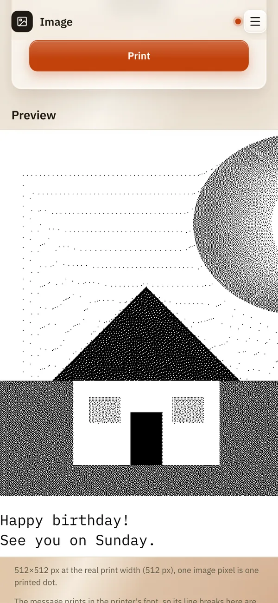

# Image

*[Deutsche Version](images.de.md)*

**Who:** everyone who can open the web interface

## What it does

Prints a photo or picture from your phone or computer. A receipt printer
only knows black dots, so ReceiptPi turns the picture into a pattern of
dots first. Before printing you can turn and crop the picture, add a
message that prints under it on the same receipt, and look at the
result.

## How to use it

1. On the home page, tap **Image**.
2. Under **Image file (PNG/JPG, max. 12MB)**, choose a picture. The
   picture appears with a frame around it.
3. Optional: turn and crop it, see [Turning and cropping](#turning-and-cropping)
   below.
4. Choose a **Dithering method**, the way grey tones are turned into
   dots:

   | Method | Good for |
   |--------|----------|
   | **Floyd-Steinberg (default)** | most photos |
   | **Atkinson (higher contrast)** | clearer areas, drawings, logos |
   | **Bayer 8×8 (regular pattern)** | an even, retro-looking dot pattern |

5. Optional: write a text under **Message (optional)**. The counter
   below shows how many of the 500 characters you have used.
6. Tap **Preview** to see exactly what will be printed. The message
   shows under the picture.

   

7. Tap **Print**. "Printed ✓" appears under the button; the picture
   and your edits stay, so you can change something and print again.

   

### Turning and cropping

| Control | What it does |
|---------|--------------|
| **↺ Turn left**, **↻ Turn right** | turns the picture by a quarter |
| the corners of the frame | drag them to crop; drag inside the frame to move it |
| **Aspect ratio** | **Free**, **Original**, **1:1 (square)**, **4:3 (landscape)** or **3:4 (portrait)** |
| **Undo** | takes back the last turn, crop or reset, step by step |
| **Reset** | back to the whole picture as you chose it |

Under the buttons you see how big the print gets, for example "Prints
512 × 384 dots, about 5.4 cm of receipt."

## Good to know

- **Always the full paper width.** The edited picture is always 512
  dots wide, the height follows from the crop; a small picture is
  enlarged and can look blocky. A tall crop makes a long receipt, at
  most 6,000 dots (about 85 cm).
- **Edited on your device.** Turning and cropping happen in the browser.
  Only the finished picture is sent, as a JPG of 512 dots width,
  usually a few hundred KB, whatever the size of the photo. This keeps
  the load off the ReceiptPi.
- **Without JavaScript** there is no frame and no buttons; the picture
  is sent as it is. Then a picture wider than 512 dots is scaled down to
  512 dots, a narrower one prints at its own size, on the left. The same
  holds for the API.
- **Phone photos print the right way up.** Many phones save a portrait
  photo sideways and note the turn in the file (EXIF orientation). The
  editor shows the photo the way the browser shows it, and the server
  applies the note to pictures sent without the editor or by the API.
- **Tested** in Chromium (desktop and phone size, with mouse and touch).
  **Not tested:** Safari on iPhone/iPad, Firefox, real Android phones
  and HEIC photos.
- **The message** prints under the picture, left-aligned, in the
  printer's own font, like a [message](message.md). Long lines wrap at
  word boundaries. With [Easy-Read](../settings/print-rules.md) on, it
  prints larger. The preview shows where the lines break only roughly,
  because the printer sets the text itself. Line breaks you type stay;
  control characters are left out.
- **Strong contrasts print best.** Dark, low-contrast photos come out
  muddy. Try another method in the preview.
- **Limits:** PNG or JPG, at most 12 MB and 6,000 pixels per side.
  Atkinson works up to 512×2000 dots after scaling, and stops after 15
  seconds.
- **One picture at a time.** While one is being processed, a second has
  to wait a moment.
- [Print rules](../settings/print-rules.md) apply: during quiet hours the
  picture waits under [Pending jobs](pending.md), already converted to
  dots, together with its message. The same picture with a different
  message is not a duplicate.
- **History:** the [history](history.md) shows the picture size and the
  first 40 characters of the message.
- **From other systems:** pictures can also be sent by scripts, see
  [Automation API](../integrations/api.md). The API has no message
  field.

## Something not working?

| You see | What to do |
|---------|------------|
| "This crop makes the receipt too long (at most 6000 dots). Crop a wider part." | Drag the frame wider, or choose an aspect ratio. |
| "This picture can't be edited here. It is sent unchanged." | Your browser can't show this file. Save it as JPG and choose it again, or print it unchanged. |
| "The image could not be read (PNG or JPG only)." | Save the picture as PNG or JPG. iPhone photos in HEIC format: share them as JPG, or set the camera to "Most Compatible". |
| "The image is too large for Atkinson ..." or "Atkinson took longer than 15 s ..." | Choose Floyd-Steinberg or Bayer, or crop the picture. |
| "Another image is being processed right now. ..." | Wait a few seconds and try again. |
| "No answer from the server. The print may still come out - check the history before you print again." | The connection broke off while the job was running. Look in the [history](history.md) whether it printed before you print again. |
| The print is too dark or too light. | Try another dithering method in the preview, or edit the picture's brightness on your phone first. |

---

[Back to the overview](../README.md)
