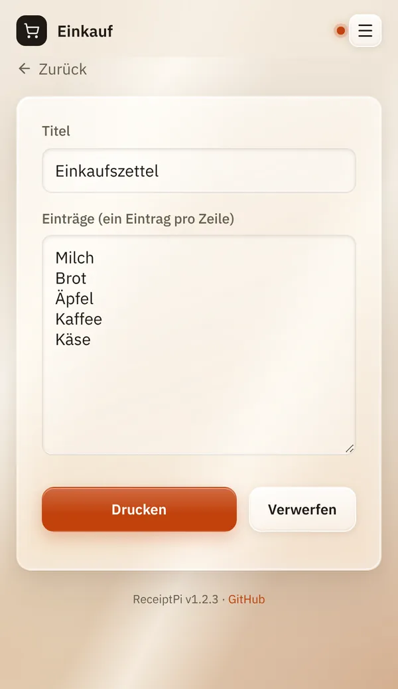
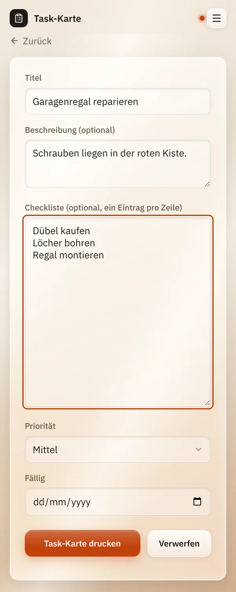

# Listen

*[English version](lists.md)*

**Wer:** alle, die die Oberfläche öffnen können

## Was kann das?

Druckt eine Liste auf Papier: einen Einkaufszettel, eine To-do-Liste oder
eine Task-Karte. Vor jedem Eintrag steht ein kleines Kästchen `( )`, das
du mit dem Stift abhaken kannst.

| Art | Wofür |
|-----|-------|
| **Einkauf** | Ein Einkaufszettel: ein Titel und deine Einträge. Oben steht dein Einkaufs-Logo, falls du eins eingerichtet hast. |
| **To-Do** | Wie der Einkaufszettel, nur ohne Logo. |
| **Task-Karte** | Eine Karte für eine Aufgabe, zum Beispiel für eine Pinnwand: Titel, kurze Beschreibung, Checkliste, Priorität und Fälligkeit. |

## So geht's

### Einkaufszettel oder To-do-Liste

1. Tippe auf der Startseite auf **Listen**.
2. Tippe auf **Einkauf** oder **To-Do**.
3. Gib unter **Titel** einen Namen für die Liste ein oder lass den
   Vorschlag stehen.
4. Schreib unter **Einträge (ein Eintrag pro Zeile)** jeden Eintrag in
   eine eigene Zeile.
5. Tippe auf **Drucken**.

Du siehst „Gedruckt ✓“, und das Formular ist leer für die nächste Liste.

### Task-Karte

1. Tippe auf der Startseite auf **Listen** und dann auf **Task-Karte**.
2. Gib einen **Titel** ein. Das ist das einzige Pflichtfeld.
3. Wenn du magst, ergänze **Beschreibung**, **Checkliste** (ein Eintrag
   pro Zeile), **Priorität** und **Fällig**.
4. Tippe auf **Task-Karte drucken**.

Auf die Karte kommt nur, was du ausgefüllt hast, ohne leere Zeilen.

## Gut zu wissen

- **Beim Tippen geht nichts verloren.** Etwa eine Sekunde, nachdem du
  aufhörst zu tippen, speichert ReceiptPi deinen Stand („Entwurf
  gespeichert“). Verlässt du die Seite oder schließt den Browser, ist er
  beim nächsten Mal noch da. **Verwerfen** löscht den Entwurf. Jedes
  Konto hat seine eigenen Entwürfe.
- **Grenzen:** bis zu 100 Einträge mit je 200 Zeichen, ein Titel bis
  100 Zeichen und eine Beschreibung bis 2.000 Zeichen. Längerer Text wird
  abgeschnitten, leere Zeilen werden übersprungen.
- **Größere Schrift:** Mit Easy-Read wird die Liste in größerer Schrift
  gedruckt, siehe [Druckregeln](../settings/print-rules.de.md#größere-schrift-easy-read).
- **Die Druckregeln gelten.** Während einer Ruhezeit oder wenn das
  Stundenlimit erreicht ist, wird die Liste nicht gedruckt. Sie wartet
  dann unter [Ausstehende Aufträge](pending.de.md), und du kannst sie
  später von dort drucken. Dieselbe Liste zweimal innerhalb einer Minute
  wird kein zweites Mal gedruckt. Siehe [Druckregeln](../settings/print-rules.de.md).
- **Aus Mealie importieren:** Ist [Rezepte](recipes.de.md) eingerichtet,
  zeigt die Einkaufsseite zusätzlich den Kasten **Aus Mealie
  importieren**. Tippe auf **Mealie-Listen laden**, wähle eine
  **Einkaufsliste** und tippe auf **Einträge anhängen**. Die offenen
  Einträge landen unter deinen eigenen, in Mealie ändert sich nichts.
- **Eigenes Logo** auf Einkaufszetteln: siehe [Logos](../settings/logos.de.md).
- **Aus anderen Systemen:** Listen lassen sich auch aus Home Assistant,
  Skripten oder per MQTT drucken, siehe [Automations-API](../integrations/api.de.md).

## Klappt nicht?

| Du siehst | Was das heißt | Was du tun kannst |
|-----------|---------------|-------------------|
| „Fehler: Ruhezeit aktiv (22:00-07:00)“ | Gerade läuft eine Ruhezeit-Regel. | Nichts: Die Liste wartet unter [Ausstehende Aufträge](pending.de.md). Drucke sie von dort oder ändere die Regel unter [Druckregeln](../settings/print-rules.de.md). |
| „Fehler: Rate-Limit erreicht (max. 20 Druckaufträge/Stunde)“ | In der letzten Stunde wurde zu viel gedruckt. | Kurz warten oder das Limit unter [Druckregeln](../settings/print-rules.de.md) erhöhen. Die Liste wartet unter [Ausstehende Aufträge](pending.de.md). |
| „Fehler: Duplikat unterdrückt (identischer Auftrag vor weniger als 60s)“ | Genau dieselbe Liste wurde vor weniger als einer Minute gedruckt. | Willst du wirklich ein zweites Exemplar, warte eine Minute. Dein Text bleibt im Formular. |
| Ein anderer Fehler | Meistens der Drucker: ausgeschaltet, kein Papier, Kabel locker. | Drucker prüfen und die Liste dann unter [Ausstehende Aufträge](pending.de.md) drucken. Siehe [Fehlerbehebung](../help/troubleshooting.de.md). |

---

[Zurück zur Übersicht](../README.de.md)
