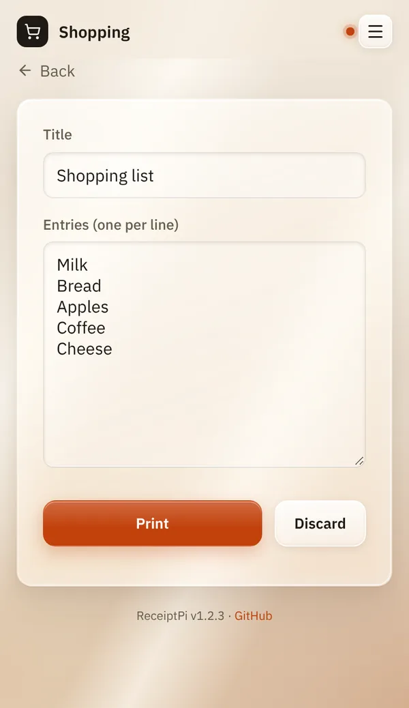
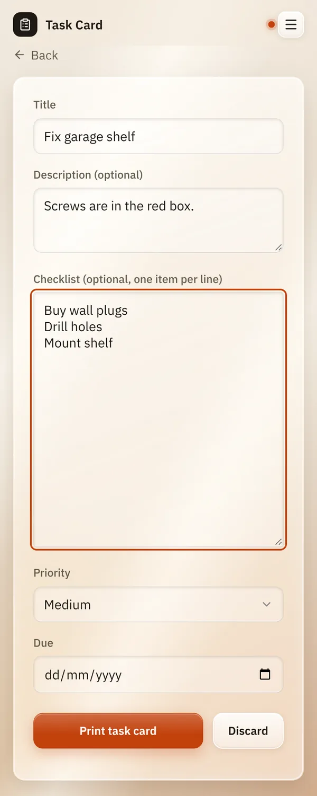

# Lists

*[Deutsche Version](lists.de.md)*

**Who:** everyone who can open the web interface

## What it does

Prints a list on paper: a shopping list, a to-do list or a task card.
Every entry gets a small box `( )` in front, so you can tick it off with
a pen.

| Kind | What it's for |
|------|---------------|
| **Shopping** | A shopping list: a title and your entries. Shows your shopping logo at the top, if you have set one. |
| **To-Do** | The same as a shopping list, without a logo. |
| **Task Card** | A card for one task, for example for a board on the wall: title, short description, checklist, priority and due date. |

## How to use it

### Shopping list or to-do list

1. On the home page, tap **Lists**.
2. Tap **Shopping** or **To-Do**.
3. Under **Title**, type a name for the list, or leave the suggested one.
4. Under **Entries (one per line)**, type one item per line.
5. Tap **Print**.

You'll see "Printed ✓" and the form is empty again for your next list.

### Task card

1. On the home page, tap **Lists**, then **Task Card**.
2. Type a **Title**. It is the only field you have to fill in.
3. If you like, add a **Description**, a **Checklist** (one item per
   line), a **Priority** and a **Due** date.
4. Tap **Print task card**.

Only what you filled in ends up on the card, without empty lines.

## Good to know

- **Nothing gets lost while you type.** About one second after you stop
  typing, ReceiptPi saves what you have so far ("Draft saved"). If you
  leave the page or close the browser, it is still there when you come
  back. **Discard** throws the draft away. Every account has its own
  drafts.
- **Limits:** up to 100 entries with 200 characters each, a title of up
  to 100 characters and a description of up to 2,000 characters. Longer
  text is cut off, empty lines are skipped.
- **Larger text:** with Easy-Read the list is printed in larger letters,
  see [Print rules](../settings/print-rules.md#larger-text-easy-read).
- **Print rules apply.** During quiet hours, or when the hourly limit is
  reached, the list is not printed. It waits under
  [Pending jobs](pending.md) instead, and you can print it from there
  later. The same list twice within a minute is not printed a second
  time. See [Print rules](../settings/print-rules.md).
- **Import from Mealie:** if [Recipes](recipes.md) is set up, the shopping
  list page has an extra box **Import from Mealie**. Tap
  **Load Mealie lists**, pick a **Shopping list** and tap
  **Append items**. The open items are added below your own; nothing is
  changed in Mealie.
- **Your own logo** on shopping lists: see [Logos](../settings/logos.md).
- **From other systems:** lists can also be printed from Home Assistant,
  scripts or MQTT, see [Automation API](../integrations/api.md).

## Something not working?

| You see | What it means | What to do |
|---------|---------------|------------|
| "Error: Quiet hours active (22:00-07:00)" | A quiet-hours rule is running right now. | Nothing: the list waits under [Pending jobs](pending.md). Print it from there, or change the rule under [Print rules](../settings/print-rules.md). |
| "Error: Rate limit reached (max. 20 print jobs/hour)" | Too many prints in the last hour. | Wait a bit, or raise the limit under [Print rules](../settings/print-rules.md). The list waits under [Pending jobs](pending.md). |
| "Error: Duplicate suppressed (identical job less than 60s ago)" | The very same list was printed less than a minute ago. | If you really want a second copy, wait a minute. Your text stays in the form. |
| Any other error | Usually the printer: switched off, no paper, cable loose. | Check the printer, then print the list from [Pending jobs](pending.md). See [Troubleshooting](../help/troubleshooting.md). |

---

[Back to the overview](../README.md)
