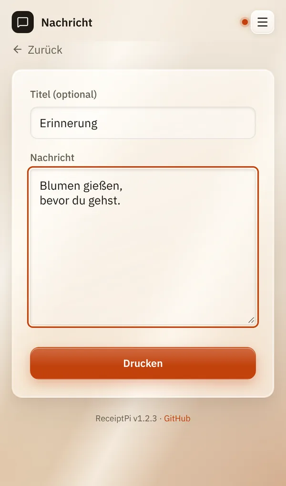

# Nachricht

*[English version](message.md)*

**Wer:** alle, die die Oberfläche öffnen können

## Was kann das?

Druckt einen beliebigen Text: eine Notiz für den Kühlschrank, eine
Erinnerung, einen Gruß. Der Titel steht groß oben, der Text darunter,
Datum und Uhrzeit am Ende.

## So geht's

1. Tippe auf der Startseite auf **Nachricht**.
2. Gib, wenn du magst, einen **Titel (optional)** ein, zum Beispiel
   „Erinnerung“.
3. Schreib deinen Text unter **Nachricht**.
4. Tippe auf **Drucken**.

Du siehst „Gedruckt ✓“.

## Gut zu wissen

- **Zeilenumbrüche bleiben erhalten.** Lange Zeilen brechen am Papierrand
  von selbst um.
- **Grenzen:** ein Titel bis 100 Zeichen und ein Text bis 2.000 Zeichen.
  Längerer Text wird abgeschnitten.
- **Eigenes Logo** oben: siehe [Logos](../settings/logos.de.md).
- **Größere Schrift:** siehe [Druckregeln](../settings/print-rules.de.md#größere-schrift-easy-read).
- Die [Druckregeln](../settings/print-rules.de.md) gelten: Während einer
  Ruhezeit wartet die Nachricht unter [Ausstehende Aufträge](pending.de.md).
- **Aus anderen Systemen:** Auch Home Assistant, Skripte oder MQTT können
  eine Nachricht drucken, siehe [Automations-API](../integrations/api.de.md).

## Klappt nicht?

| Du siehst | Was du tun kannst |
|-----------|-------------------|
| „Fehler: Ruhezeit aktiv ...“ oder „Fehler: Rate-Limit erreicht ...“ | Die Nachricht wartet unter [Ausstehende Aufträge](pending.de.md). Siehe [Druckregeln](../settings/print-rules.de.md). |
| „Fehler: Duplikat unterdrückt ...“ | Dieselbe Nachricht wurde vor weniger als einer Minute gedruckt. Warte eine Minute oder ändere den Text. |
| Ein anderer Fehler | Prüfe den Drucker, siehe [Fehlerbehebung](../help/troubleshooting.de.md). |

---

[Zurück zur Übersicht](../README.de.md)
