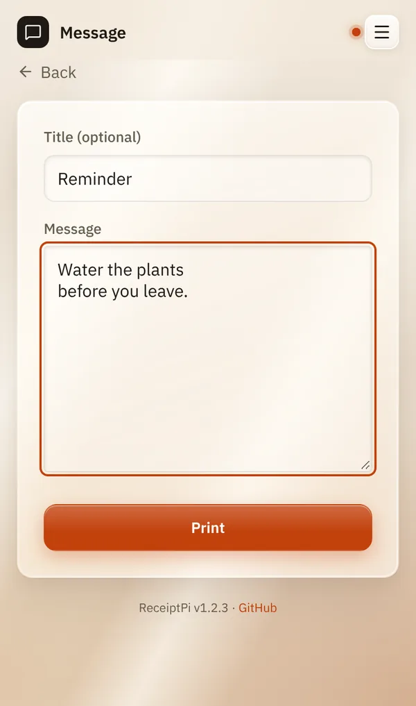

# Message

*[Deutsche Version](message.de.md)*

**Who:** everyone who can open the web interface

## What it does

Prints any text you type: a note for the fridge, a reminder, a greeting.
The title is printed large at the top, the text below it, the date and
time at the end.

## How to use it

1. On the home page, tap **Message**.
2. If you like, type a **Title (optional)**, for example "Reminder".
3. Type your text under **Message**.
4. Tap **Print**.

You'll see "Printed ✓".

## Good to know

- **Line breaks are kept.** Long lines wrap at the edge of the paper on
  their own.
- **Limits:** a title of up to 100 characters and a text of up to 2,000
  characters. Longer text is cut off.
- **Your own logo** at the top: see [Logos](../settings/logos.md).
- **Larger text:** see [Print rules](../settings/print-rules.md#larger-text-easy-read).
- [Print rules](../settings/print-rules.md) apply: during quiet hours the
  message waits under [Pending jobs](pending.md).
- **From other systems:** Home Assistant, scripts or MQTT can print a
  message too, see [Automation API](../integrations/api.md).

## Something not working?

| You see | What to do |
|---------|------------|
| "Error: Quiet hours active ..." or "Error: Rate limit reached ..." | The message waits under [Pending jobs](pending.md). See [Print rules](../settings/print-rules.md). |
| "Error: Duplicate suppressed ..." | The same message was printed less than a minute ago. Wait a minute or change the text. |
| Any other error | Check the printer, see [Troubleshooting](../help/troubleshooting.md). |

---

[Back to the overview](../README.md)
