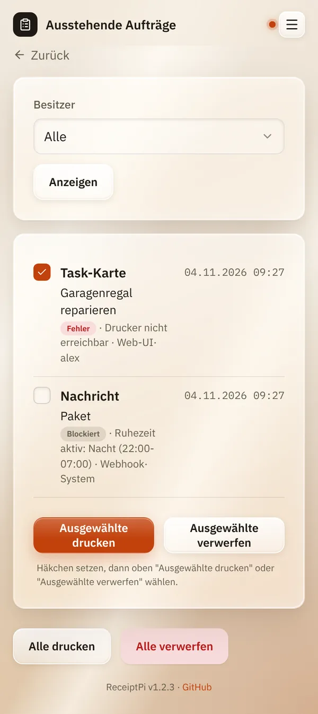

# Ausstehende Aufträge

*[English version](pending.md)*

**Wer:** alle. Jedes Konto sieht seine eigenen Aufträge, Admins sehen
alle.

## Was kann das?

Sammelt Drucke, die nicht herausgekommen sind, damit nichts verloren
geht:

- von einer **Ruhezeit** zurückgehalten,
- vom **Drucklimit** zurückgehalten,
- wegen des **Druckers** fehlgeschlagen (ausgeschaltet, kein Papier,
  Kabel locker).

Von hier druckst du sie später oder wirfst sie weg.

## So geht's

1. Öffne das Menü (drei Striche oben rechts) und tippe auf
   **Ausstehende Aufträge**. Die Zahl in Klammern zeigt, wie viele
   warten.
2. Hake die gewünschten Einträge an.
3. Tippe auf **Ausgewählte drucken** oder **Ausgewählte verwerfen**.

Für alles auf einmal gibt es unten **Alle drucken** und
**Alle verwerfen**.

**Für Admins:** Unter **Besitzer** kannst du nur die Aufträge eines
Kontos, von **System** oder von allen (**Alle**) anzeigen. Tippe auf
**Anzeigen**, um die Auswahl zu übernehmen.

## Gut zu wissen

- **Ein Eintrag verschwindet erst, wenn er wirklich gedruckt wurde.**
  Schlägt der Druck wieder fehl, bleibt er stehen und kommt nicht doppelt
  dazu.
- **Ruhezeiten:** Ein Nachdruck durch einen Admin druckt auch während
  einer Ruhezeit. Ein Nachdruck durch einen Nutzer wartet, bis die
  Ruhezeit vorbei ist.
- **Das Drucklimit gilt** auch für Nachdrucke. Die Duplikat-Sperre nicht.
- **Duplikate landen nie hier.** Ein als Duplikat übersprungener Druck
  wurde ja schon einmal gedruckt.
- **Wetter- und Systemberichte** werden beim Nachdruck frisch abgefragt
  und sind damit aktuell.
- **Der Inhalt wird nicht angezeigt**, nur eine kurze Zusammenfassung.
  Ein Gäste-WLAN-Passwort zum Beispiel bleibt verborgen.
- **Alte Einträge lassen sich automatisch löschen**, siehe
  **Ausstehende Aufträge automatisch löschen nach (Tage)** unter
  [Druckregeln](../settings/print-rules.de.md#drucklimit-und-duplikate).
  Standardmäßig bleiben sie, bis du sie druckst oder verwirfst.

## Klappt nicht?

| Du siehst | Was du tun kannst |
|-----------|-------------------|
| „... von ... Einträgen gedruckt, der Rest bleibt bestehen.“ | Einige Einträge wurden nicht gedruckt, zum Beispiel wegen einer Ruhezeit oder des Drucklimits. Versuch es später noch einmal. |
| „Keine Einträge ausgewählt.“ | Hake zuerst mindestens einen Eintrag an. |
| Einträge kommen immer wieder mit einem Fehler zurück. | Der Drucker hat ein Problem. Siehe [Fehlerbehebung](../help/troubleshooting.de.md). |

---

[Zurück zur Übersicht](../README.de.md)
