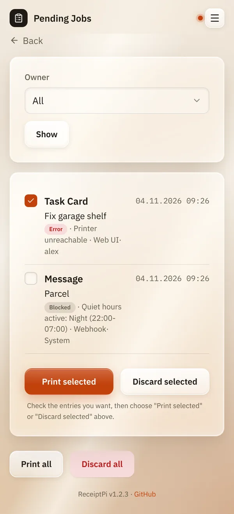

# Pending jobs

*[Deutsche Version](pending.de.md)*

**Who:** everyone. Each account sees its own jobs, admins see all.

## What it does

Collects prints that didn't come out, so nothing gets lost:

- held back by **quiet hours**,
- held back by the **print limit**,
- failed because of the **printer** (switched off, no paper, cable
  loose).

From here you print them later, or throw them away.

## How to use it

1. Open the menu (three lines at the top right) and tap
   **Pending Jobs**. The number in brackets shows how many are waiting.
2. Tick the entries you want.
3. Tap **Print selected** or **Discard selected**.

To handle everything at once, use **Print all** or **Discard all** at the
bottom.

**For admins:** under **Owner** you can show only the jobs of one
account, of **System** or of everyone (**All**). Tap **Show** to apply.

## Good to know

- **An entry disappears only after it has really been printed.** If
  printing fails again, it stays, and isn't added a second time.
- **Quiet hours:** a reprint by an admin prints even during quiet hours.
  A reprint by a user waits until the quiet hours are over.
- **The print limit still applies** to reprints. Duplicate suppression
  doesn't.
- **Duplicates never end up here.** A print skipped as a duplicate was
  already printed once.
- **Weather and system reports** are fetched fresh when you reprint them,
  so they are up to date.
- **The content isn't shown** in the list, only a short summary. A guest
  Wi-Fi password, for example, stays hidden.
- **Old entries can be deleted automatically**, see **Auto-delete
  pending jobs after (days)** under [Print rules](../settings/print-rules.md#print-limit-and-duplicates).
  By default they are kept until you print or discard them.

## Something not working?

| You see | What to do |
|---------|------------|
| "... of ... entries printed, the rest are still pending." | Some entries didn't print, for example because of quiet hours or the print limit. Try again later. |
| "No entries selected." | Tick at least one entry first. |
| Entries keep coming back with an error. | The printer has a problem. See [Troubleshooting](../help/troubleshooting.md). |

---

[Back to the overview](../README.md)
