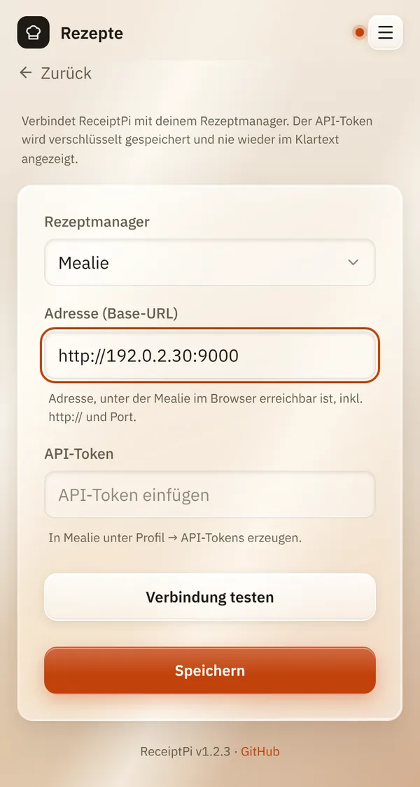

# Rezepte

*[English version](recipes.md)*

**Wer:** Benutzen: alle, die die Oberfläche öffnen können. Einrichten:
Admins.

## Was kann das?

Wenn du deine Rezepte in [Mealie](https://mealie.io) verwaltest (ein
Rezeptmanager, den du selbst betreibst), kann ReceiptPi sie durchsuchen
und eins drucken: Titel, Gesamtzeit, Zutaten und Zubereitung. Es kann
auch ein Zufallsrezept auswählen und eine Mealie-Einkaufsliste in deinen
[Einkaufszettel](lists.de.md) übernehmen.

Ohne Mealie erscheint die Kachel **Rezepte** nicht.

## So geht's

### Einmalige Einrichtung

1. Öffne in Mealie dein Profil, geh zu **API-Tokens** und erzeuge einen
   Token. Kopiere ihn.
2. Öffne in ReceiptPi das Menü (drei Striche oben rechts), tippe auf
   **Einstellungen** und dann auf **Rezepte**.
3. Stell **Rezeptmanager** auf **Mealie**.
4. Gib unter **Adresse (Base-URL)** die Adresse ein, unter der du Mealie
   im Browser öffnest, mit `http://` und Port, zum Beispiel
   `http://192.168.178.20:9000`.
5. Füge den Token unter **API-Token** ein.
6. Tippe auf **Verbindung testen**. Du solltest „Verbindung OK: Mealie
   ..., angemeldet als ...“ sehen.
7. Tippe auf **Speichern**.

   

### Rezept suchen und drucken

1. Tippe auf der Startseite auf **Rezepte**.
2. Gib unter **Rezept suchen** einen **Suchbegriff** ein, zum Beispiel
   „Granola“, und tippe auf **Suchen**.
3. Tippe auf ein Rezept, um es anzusehen.
4. Tippe auf **Rezept drucken**.

### Zufallsrezept

1. Geh auf der Seite **Rezepte** zu **Zufallsrezept**.
2. Gib, wenn du magst, bis zu fünf **Zutaten (optional)** ein, getrennt
   durch Kommas, zum Beispiel „Haferflocke, Honig“. Hake **Alle Zutaten
   müssen enthalten sein** an, wenn jede davon im Rezept vorkommen soll.
3. Tippe auf **Zufallsrezept**. Gefällt es dir nicht? Tippe auf
   **Anderes**.

## Gut zu wissen

- **Die Suche durchsucht Titel und Beschreibung, nicht die Zutaten.** Um
  Rezepte nach Zutaten zu finden, nimm das Zufallsrezept.
- **Zutaten müssen so heißen wie in Mealie.** Passt eine nicht, schlägt
  ReceiptPi ähnliche Namen vor.
- **In Mealie ändert sich nichts.** ReceiptPi liest nur.
- **Der Token wird verschlüsselt gespeichert** und nie wieder angezeigt.
  Lass das Feld beim Speichern leer, um ihn zu behalten. Änderst du die
  Adresse, musst du den Token neu eingeben. **Token entfernen** löscht
  ihn aus ReceiptPi; in Mealie bleibt er gültig, bis du ihn dort löschst.
- Die [Druckregeln](../settings/print-rules.de.md) gelten.

## Klappt nicht?

| Du siehst | Was du tun kannst |
|-----------|-------------------|
| „Mealie ist nicht erreichbar - Adresse und Netzwerk prüfen.“ | Prüfe die Adresse: Öffnet sie sich im Browser? Stimmt der Port? |
| „Mealie hat den API-Token abgelehnt - Token prüfen oder neu erzeugen.“ | Erzeuge in Mealie einen neuen Token und gib ihn neu ein. |
| „Unerwartete Antwort - ist das wirklich die Mealie-Adresse?“ | Die Adresse führt woandershin. Nimm die Adresse von Mealie selbst. |
| „Die Adresse wurde geändert - bitte den API-Token neu eingeben. ...“ | Füge den Token noch einmal ein und speichere. |
| Die Kachel **Rezepte** fehlt. | **Rezeptmanager** muss auf **Mealie** stehen, und das Modul muss eingeschaltet sein, siehe [Module ein- und ausschalten](../settings/modules.de.md). |

---

[Zurück zur Übersicht](../README.de.md)
