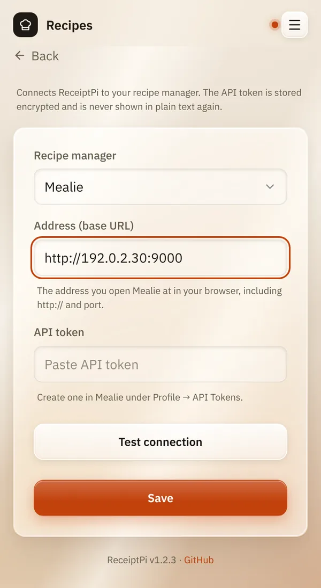

# Recipes

*[Deutsche Version](recipes.de.md)*

**Who:** using it: everyone who can open the web interface. Setting it up:
admins.

## What it does

If you keep your recipes in [Mealie](https://mealie.io) (a recipe manager
you run yourself), ReceiptPi can search them and print one: title, total
time, ingredients and instructions. It can also pick a random recipe, and
copy a Mealie shopping list into your [shopping list](lists.md).

Without Mealie, the **Recipes** tile doesn't appear.

## How to use it

### One-time setup

1. In Mealie, open your profile, go to **API Tokens** and create a
   token. Copy it.
2. In ReceiptPi, open the menu (three lines at the top right), tap
   **Settings** and then **Recipes**.
3. Set **Recipe manager** to **Mealie**.
4. Under **Address (base URL)**, enter the address you open Mealie at in
   your browser, including `http://` and the port, for example
   `http://192.168.178.20:9000`.
5. Paste the token under **API token**.
6. Tap **Test connection**. You should see "Connection OK: Mealie ...,
   signed in as ...".
7. Tap **Save**.

   

### Searching and printing a recipe

1. On the home page, tap **Recipes**.
2. Under **Search recipes**, type a **Search term**, for example
   "Granola", and tap **Search**.
3. Tap a recipe to see it.
4. Tap **Print recipe**.

### Random recipe

1. On the **Recipes** page, go to **Random recipe**.
2. If you like, type up to five **Ingredients (optional)**, separated by
   commas, for example "oats, honey". Tick **Must contain all
   ingredients** if every one of them has to be in the recipe.
3. Tap **Random recipe**. Don't like it? Tap **Another one**.

## Good to know

- **The search looks at titles and descriptions, not at ingredients.**
  To find recipes by ingredient, use the random recipe.
- **Ingredients have to match Mealie's names.** If one doesn't, ReceiptPi
  suggests similar names.
- **Nothing is changed in Mealie.** ReceiptPi only reads.
- **The token is stored encrypted** and never shown again. To keep it,
  leave the field empty when you save. If you change the address, you
  have to enter the token again. **Remove token** deletes it from
  ReceiptPi; in Mealie it stays valid until you delete it there.
- [Print rules](../settings/print-rules.md) apply.

## Something not working?

| You see | What to do |
|---------|------------|
| "Mealie is unreachable - check the address and network." | Check the address: does it open in your browser? Is the port right? |
| "Mealie rejected the API token - check it or create a new one." | Create a new token in Mealie and enter it again. |
| "Unexpected response - is this really the Mealie address?" | The address leads somewhere else. Use the address of Mealie itself. |
| "The address has changed - please enter the API token again. ..." | Paste the token again, then save. |
| The **Recipes** tile is missing. | **Recipe manager** must be set to **Mealie**, and the module must be switched on, see [Turning modules on and off](../settings/modules.md). |

---

[Back to the overview](../README.md)
