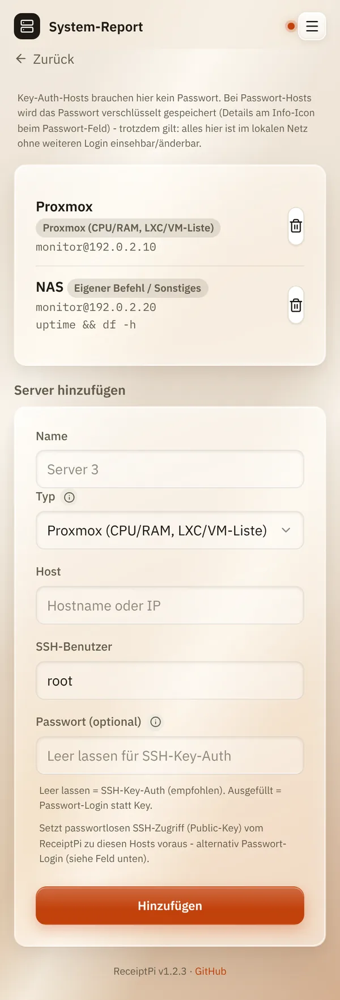

# Systemreport

*[English version](system.md)*

**Wer:** Admins

## Was kann das?

Druckt den Zustand deiner Server auf einen Bon. ReceiptPi meldet sich
dazu per [SSH](../help/glossary.de.md#ssh) an jedem Server an und fragt
ihn ab:

| Typ | Was auf dem Bon steht |
|-----|-----------------------|
| **Proxmox (CPU/RAM, LXC/VM-Liste)** | CPU- und Speicherauslastung, die Liste der Container und virtuellen Maschinen |
| **Proxmox Backup Server** | die letzten Backup-Aufgaben |
| **Eigener Befehl / Sonstiges** | die Ausgabe eines Befehls, den du festlegst, zum Beispiel für ein NAS |

Für jeden Server steht außerdem dabei, ob Updates warten.

## So geht's

### Server hinzufügen

1. Öffne das Menü (drei Striche oben rechts), tippe auf
   **Einstellungen** und dann auf **System-Report**.
2. Fülle unter **Server hinzufügen** aus:
   - **Name**: wie der Server auf dem Bon heißt.
   - **Typ**: einer der drei von oben.
   - **Host**: Name oder IP-Adresse des Servers.
   - **SSH-Benutzer**: der Benutzer, als der sich ReceiptPi anmeldet.
   - **Passwort (optional)**: das Passwort dieses Benutzers. Lass es
     leer, wenn du stattdessen einen SSH-Schlüssel nutzt (siehe unten).
   - **SSH-Befehl**: nur bei **Eigener Befehl / Sonstiges**, zum Beispiel
     `uptime && df -h`.
3. Tippe auf **Hinzufügen**.

   

### Report drucken

Tippe auf der Startseite auf **System** und dann auf
**Systembericht drucken**. Die Abfrage der Server kann ein paar Sekunden
dauern.

## Gut zu wissen

- **Nimm einen eingeschränkten Benutzer, nicht root.** ReceiptPi fragt
  mit den Rechten des Benutzers ab, den du einträgst. Bei **Eigener
  Befehl / Sonstiges** läuft der Befehl genau so, wie du ihn eingegeben
  hast.
- **Proxmox braucht einen Benutzer, der Container und VMs auflisten
  darf.** In vielen Installationen ist das nur root.
- **Passwörter werden verschlüsselt gespeichert** und nie wieder
  angezeigt.
- **Die Identität des Servers wird beim ersten Kontakt gemerkt.** Ändert
  sie sich später (zum Beispiel nach einer Neuinstallation des Servers),
  zeigt der Report einen Fehler, statt sich zu verbinden.
- **Anmeldung per SSH-Schlüssel** (ohne gespeichertes Passwort) geht
  auch. Dafür braucht der ReceiptPi-Dienstbenutzer einen Schlüssel. Das
  ist für alle, die SSH-Schlüssel kennen:

  <details>
  <summary>Befehle für den SSH-Schlüssel</summary>

  Erzeuge den Schlüssel einmal auf dem Raspberry Pi:

  ```bash
  sudo -u receiptpi -H mkdir -p -m 700 /var/lib/receiptpi/.ssh
  sudo -u receiptpi -H ssh-keygen -t ed25519 -N "" -f /var/lib/receiptpi/.ssh/id_ed25519
  ```

  Kopiere ihn dann auf jeden Server (fragt einmal nach dessen Passwort):

  ```bash
  sudo -u receiptpi -H ssh-copy-id -i /var/lib/receiptpi/.ssh/id_ed25519.pub <benutzer>@<server>
  ```

  </details>

## Klappt nicht?

| Problem | Was du tun kannst |
|---------|-------------------|
| Der Bon zeigt für einen Server einen Fehler. | Prüfe Host, Benutzer und Passwort. Kommst du selbst mit `ssh <benutzer>@<server>` hinein? |
| „Permission denied“ bei einem Proxmox-Server. | Der Benutzer darf Container und VMs nicht auflisten. Nimm einen Benutzer mit diesen Rechten. |
| Ein Fehler wegen eines geänderten Host-Schlüssels. | Der Server wurde neu installiert oder ersetzt. Nur wenn du sicher bist, dass das der Grund ist, lösche den gemerkten Schlüssel auf dem Raspberry Pi: `sudo -u receiptpi ssh-keygen -R <server> -f /var/lib/receiptpi/ssh_known_hosts` (Passwort-Anmeldung) oder `sudo -u receiptpi -H ssh-keygen -R <server>` (Schlüssel-Anmeldung). Den Server in den Einstellungen zu entfernen reicht nicht. |
| Die Kachel **System** fehlt. | Der Systemreport ist nur für Admins, und das Modul muss eingeschaltet sein, siehe [Module ein- und ausschalten](../settings/modules.de.md). |

---

[Zurück zur Übersicht](../README.de.md)
