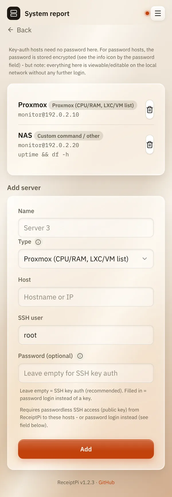

# System report

*[Deutsche Version](system.de.md)*

**Who:** admins

## What it does

Prints the state of your servers on one receipt. ReceiptPi logs in to
each server over [SSH](../help/glossary.md#ssh) and asks it:

| Type | What ends up on the receipt |
|------|-----------------------------|
| **Proxmox (CPU/RAM, LXC/VM list)** | CPU and memory use, the list of containers and virtual machines |
| **Proxmox Backup Server** | the latest backup tasks |
| **Custom command / other** | the output of a command you choose, for example for a NAS |

For every server it also shows whether updates are waiting.

## How to use it

### Adding a server

1. Open the menu (three lines at the top right), tap **Settings** and
   then **System report**.
2. Under **Add server**, fill in:
   - **Name**: what the server is called on the receipt.
   - **Type**: one of the three above.
   - **Host**: name or IP address of the server.
   - **SSH user**: the user ReceiptPi logs in as.
   - **Password (optional)**: the password of that user. Leave it empty
     if you use an SSH key instead (see below).
   - **SSH command**: only for **Custom command / other**, for example
     `uptime && df -h`.
3. Tap **Add**.

   

### Printing the report

On the home page, tap **System**, then **Print system report**. Asking
the servers can take a few seconds.

## Good to know

- **Use a restricted user, not root.** ReceiptPi runs the queries with
  the rights of the user you enter. For **Custom command / other**, the
  command runs exactly as you typed it.
- **Proxmox needs a user that may list containers and VMs.** On many
  setups that is only root.
- **Passwords are stored encrypted** and never shown again.
- **The server's identity is remembered** on first contact. If it
  changes later (for example after reinstalling the server), the report
  shows an error instead of connecting.
- **Logging in with an SSH key** (no password stored) works too. It
  needs a key for the ReceiptPi service user. This is for people who
  know SSH keys:

  <details>
  <summary>SSH key commands</summary>

  On the Raspberry Pi, create the key once:

  ```bash
  sudo -u receiptpi -H mkdir -p -m 700 /var/lib/receiptpi/.ssh
  sudo -u receiptpi -H ssh-keygen -t ed25519 -N "" -f /var/lib/receiptpi/.ssh/id_ed25519
  ```

  Then copy it to each server (asks for that server's password once):

  ```bash
  sudo -u receiptpi -H ssh-copy-id -i /var/lib/receiptpi/.ssh/id_ed25519.pub <user>@<server>
  ```

  </details>

## Something not working?

| Problem | What to do |
|---------|------------|
| The receipt shows an error for one server. | Check host, user and password. Can you log in yourself with `ssh <user>@<server>`? |
| "Permission denied" for a Proxmox server. | The user may not list containers and VMs. Use a user with these rights. |
| An error about a changed host key. | The server was reinstalled or replaced. Only if you are sure that's the reason, delete the remembered key on the Raspberry Pi: `sudo -u receiptpi ssh-keygen -R <server> -f /var/lib/receiptpi/ssh_known_hosts` (password login) or `sudo -u receiptpi -H ssh-keygen -R <server>` (key login). Removing the server in the settings is not enough. |
| The **System** tile is missing. | The system report is for admins only, and the module must be switched on, see [Turning modules on and off](../settings/modules.md). |

---

[Back to the overview](../README.md)
