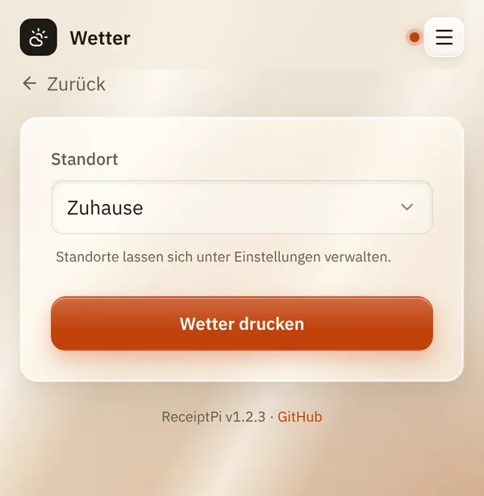
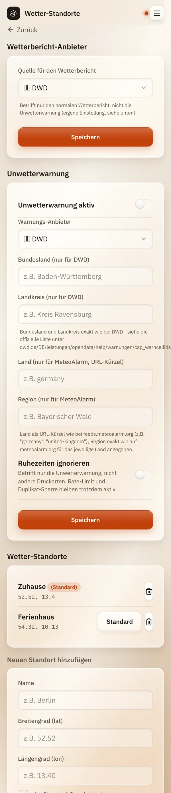

# Wetter und Unwetterwarnung

*[English version](weather.md)*

**Wer:** Drucken: alle, die die Oberfläche öffnen können. Standorte und
Unwetterwarnung: Admins.

## Was kann das?

- **Wetterbericht:** druckt das aktuelle Wetter für einen Ort: Temperatur,
  Wind und Niederschlag.
- **Unwetterwarnung:** prüft alle 15 Minuten, ob für deine Gegend eine
  amtliche Wetterwarnung gilt, und druckt sie automatisch, einmal pro
  Warnung.

## So geht's

### Wetter drucken

1. Tippe auf der Startseite auf **Wetter**.
2. Wähle einen **Standort**.
3. Tippe auf **Wetter drucken**.

   

### Standort hinzufügen

1. Öffne das Menü (drei Striche oben rechts), tippe auf
   **Einstellungen** und dann auf **Wetter-Standorte**.
2. Gib unter **Neuen Standort hinzufügen** einen **Namen** ein, zum
   Beispiel „Zuhause“.
3. Gib **Breitengrad (lat)** und **Längengrad (lon)** ein. Die findest du
   in den meisten Karten-Apps: Halte einen Punkt auf der Karte gedrückt,
   dann erscheinen die Koordinaten, zum Beispiel `52.52` und `13.40`.
4. Hake **Als Standard-Standort setzen** an, wenn dieser Ort vorausgewählt
   sein soll.
5. Tippe auf **Hinzufügen**.

   

### Unwetterwarnung einschalten

Auf derselben Einstellungsseite unter **Unwetterwarnung**:

1. Schalte **Unwetterwarnung aktiv** ein.
2. Wähle den **Warnungs-Anbieter** für dein Land:

   | Anbieter | Land | Was du eintragen musst |
   |----------|------|------------------------|
   | **DWD** | Deutschland | **Bundesland (nur für DWD)** und **Landkreis (nur für DWD)**, genau so geschrieben wie beim DWD, zum Beispiel „Baden-Württemberg“ und „Kreis Ravensburg“ |
   | **MeteoAlarm** | Europa | **Land (nur für MeteoAlarm, URL-Kürzel)**, zum Beispiel `germany`, und **Region (nur für MeteoAlarm)** genau wie auf meteoalarm.org |
   | **NWS** | USA | nichts: Es nutzt die Koordinaten deines Standard-Standorts |

3. Sollen Warnungen auch während einer Ruhezeit drucken, schalte
   **Ruhezeiten ignorieren** ein.
4. Tippe auf **Speichern**.

## Gut zu wissen

- **Zwei Wetterquellen** für den Bericht: **DWD** (Deutschland, Standard)
  und **Open-Meteo** (weltweit). Umstellen kannst du das unter
  **Wetterbericht-Anbieter** auf derselben Einstellungsseite. Auf die
  Unwetterwarnung hat das keinen Einfluss.
- **Jede Warnung druckt einmal.** Eine neue Warnung druckt wieder, eine
  noch laufende nicht.
- **Ruhezeiten ignorieren** gilt nur für Unwetterwarnungen. Drucklimit und
  Duplikat-Sperre gelten trotzdem.
- **Innen- und Außenwerte von Netatmo** lassen sich über Home Assistant
  zum Wetterbericht hinzufügen. Dafür braucht es Einträge in der
  Konfigurationsdatei, siehe [Home Assistant](../integrations/home-assistant.de.md).
- Wenn du das [Modul ausschaltest](../settings/modules.de.md), pausiert
  auch die Unwetterwarnung.
- **Aus anderen Systemen:** Auch Home Assistant oder MQTT können den
  Wetterbericht drucken, siehe [Automations-API](../integrations/api.de.md).

## Klappt nicht?

| Problem | Was du tun kannst |
|---------|-------------------|
| Im Bericht steht „DWD-Fehler: ...“ oder „DWD: keine Daten“. | Der Wetterdienst hat nicht geantwortet. Versuch es später noch einmal oder stell auf Open-Meteo um. |
| Im Bericht steht „(kein Standort konfiguriert)“. | Füge einen Standort hinzu, siehe oben. |
| Eine Unwetterwarnung wurde erwartet, aber nichts gedruckt. | Prüfe, ob **Unwetterwarnung aktiv** an ist und die Region genau so geschrieben ist wie beim Anbieter. War gerade Ruhezeit? Schau unter [Ausstehende Aufträge](pending.de.md). |
| „Letzter verbleibender Standort kann nicht gelöscht werden“ | Es muss immer einen Standort geben. Leg zuerst einen neuen an und lösche dann den alten. |

---

[Zurück zur Übersicht](../README.de.md)
