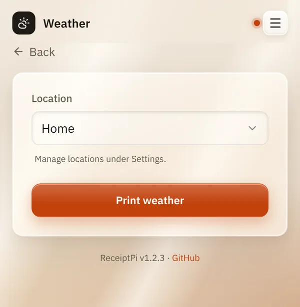
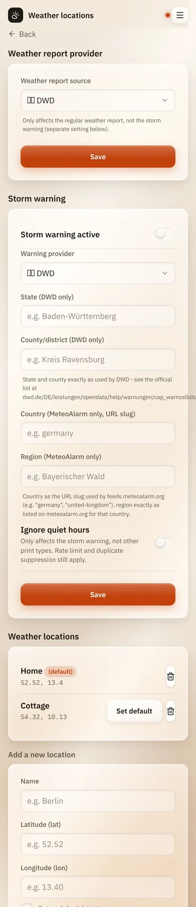

# Weather and storm warnings

*[Deutsche Version](weather.de.md)*

**Who:** printing: everyone who can open the web interface. Locations and
storm warnings: admins.

## What it does

- **Weather report:** prints the current weather for a place: temperature,
  wind and precipitation.
- **Storm warning:** checks every 15 minutes whether an official weather
  warning is active for your area, and prints it automatically, once per
  warning.

## How to use it

### Printing the weather

1. On the home page, tap **Weather**.
2. Choose a **Location**.
3. Tap **Print weather**.

   

### Adding a location

1. Open the menu (three lines at the top right), tap **Settings** and
   then **Weather locations**.
2. Under **Add a new location**, enter a **Name**, for example "Home".
3. Enter **Latitude (lat)** and **Longitude (lon)**. You find them in
   most map apps: press and hold a spot on the map, and the coordinates
   appear, for example `52.52` and `13.40`.
4. Tick **Set as default location** if this place should be pre-selected.
5. Tap **Add**.

   

### Switching on storm warnings

On the same settings page, under **Storm warning**:

1. Switch on **Storm warning active**.
2. Choose the **Warning provider** for your country:

   | Provider | Country | What to fill in |
   |----------|---------|-----------------|
   | **DWD** | Germany | **State (DWD only)** and **County/district (DWD only)**, spelled exactly as DWD writes them, for example "Baden-Württemberg" and "Kreis Ravensburg" |
   | **MeteoAlarm** | Europe | **Country (MeteoAlarm only, URL slug)**, for example `germany`, and **Region (MeteoAlarm only)** exactly as listed on meteoalarm.org |
   | **NWS** | USA | nothing: it uses the coordinates of your default location |

3. If warnings should also print during quiet hours, switch on
   **Ignore quiet hours**.
4. Tap **Save**.

## Good to know

- **Two weather sources** for the report: **DWD** (Germany, the default)
  and **Open-Meteo** (worldwide). Change it under **Weather report
  provider** on the same settings page. This doesn't affect the storm
  warning.
- **Each warning prints once.** A new warning prints again; a warning
  that is still running doesn't.
- **Ignore quiet hours** only applies to storm warnings. The print limit
  and duplicate suppression still apply.
- **Indoor and outdoor values from Netatmo** can be added to the weather
  report through Home Assistant. This needs entries in the configuration
  file, see [Home Assistant](../integrations/home-assistant.md).
- If you [switch the module off](../settings/modules.md), the storm
  warning pauses as well.
- **From other systems:** Home Assistant or MQTT can print the weather
  report too, see [Automation API](../integrations/api.md).

## Something not working?

| Problem | What to do |
|---------|------------|
| The report says "DWD error: ..." or "DWD: no data". | The weather service didn't answer. Try again later, or switch to Open-Meteo. |
| The report says "(no location configured)". | Add a location, see above. |
| A storm warning was expected but nothing printed. | Check that **Storm warning active** is on and the region is spelled exactly like the provider writes it. Was it quiet hours? Look under [Pending jobs](pending.md). |
| "The last remaining location can't be deleted" | There must always be one location. Add a new one first, then delete the old one. |

---

[Back to the overview](../README.md)
