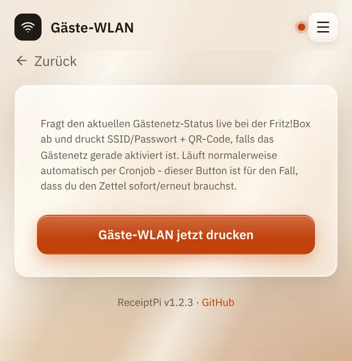

# Gäste-WLAN

*[English version](wifi.md)*

**Wer:** alle, die die Oberfläche öffnen können. Die einmalige
Einrichtung braucht einen Admin mit Zugang zum
[Terminal](../help/glossary.de.md#terminal).

## Was kann das?

Druckt für deine Gäste einen Zettel mit Name und Passwort deines
Gästenetzes und einem QR-Code. Gäste scannen den Code mit der
Handykamera und sind verbunden, ohne etwas abzutippen.

ReceiptPi holt Name und Passwort direkt aus deiner **FRITZ!Box**. Der
Zettel kommt

- **automatisch**, sobald du das Gästenetz einschaltest, oder
- **per Hand**, mit einem Knopf in der Oberfläche.

ReceiptPi schaltet das Gästenetz nicht ein oder aus. Das machst du wie
gewohnt in der FRITZ!Box.

## So geht's

### Einmalige Einrichtung

Du brauchst: eine FRITZ!Box mit Gastzugang und das
[Terminal](../help/glossary.de.md#terminal) auf dem Raspberry Pi.

1. **Lege in der FRITZ!Box einen Benutzer für ReceiptPi an.** Gehe in
   der Oberfläche der FRITZ!Box (meist `http://fritz.box`) zu **System**
   → **FRITZ!Box-Benutzer** und füge einen Benutzer hinzu, zum Beispiel
   `receiptpi`, mit eigenem Passwort und der Berechtigung
   **FRITZ!Box Einstellungen**. Die Menünamen können je nach FRITZ!OS
   leicht abweichen.
2. **Erlaube den Zugriff für Anwendungen.** Unter **Heimnetz** →
   **Netzwerk** → **Netzwerkeinstellungen** muss **Zugriff für
   Anwendungen zulassen** eingeschaltet sein. Meist ist es das schon.
3. **Trag den Benutzer auf dem Raspberry Pi ein.** Öffne die
   Konfiguration:

   ```bash
   sudo nano /etc/receiptpi/config.py
   ```

   Ändere diese drei Zeilen auf deine Werte:

   ```python
   FRITZBOX_ADDRESS = "192.168.178.1"
   FRITZBOX_USER = "receiptpi"
   FRITZBOX_PASSWORD = "das Passwort aus Schritt 1"
   ```

   Speichern mit `Strg+O`, `Enter`, schließen mit `Strg+X`.
4. **Starte ReceiptPi neu**, damit es die neuen Werte liest:

   ```bash
   sudo systemctl restart receiptpi
   ```

5. **Schalte den automatischen Zettel ein** (optional):

   ```bash
   sudo systemctl enable --now receiptpi-wifi-watch.timer
   ```

### Zettel drucken

- **Automatisch:** Schalte das Gästenetz in der FRITZ!Box ein (in ihrer
  Oberfläche, in der App oder mit der Taste am Gerät). Etwa eine Minute
  später kommt der Zettel.
- **Per Hand:** Tippe auf der Startseite auf **Gäste-WLAN** und dann auf
  **Gäste-WLAN jetzt drucken**. Praktisch, wenn ein Gast den Zettel
  noch einmal braucht.



## Gut zu wissen

- **Nur bei eingeschaltetem Gästenetz.** Ist es aus, druckt der Knopf
  nichts und zeigt „Gästenetz ist aktuell deaktiviert - nichts zu
  drucken“.
- **Einmal pro Einschalten.** Der automatische Zettel kommt einmal, wenn
  du das Gästenetz einschaltest, nicht jede Minute wieder.
- **Die Druckregeln gelten.** Während einer [Ruhezeit](../settings/print-rules.de.md)
  wartet der automatische Zettel unter [Ausstehende Aufträge](pending.de.md).
- **Auf dem Zettel steht das Passwort im Klartext.** Wer ihn hat, kommt
  in dein Gästenetz. Wirf ihn weg, wenn deine Gäste gegangen sind.
- **Offenes Gästenetz ohne Passwort:** Setze
  `WIFI_QR_AUTH_TYPE = "nopass"` in `/etc/receiptpi/config.py` und starte
  ReceiptPi neu, damit der QR-Code funktioniert.
- **Keine FRITZ!Box?** Einen Zettel mit Name und Passwort können auch
  andere Systeme schicken, siehe [Automations-API](../integrations/api.de.md).
- Wenn du das [Modul ausschaltest](../settings/modules.de.md), pausiert
  auch der automatische Zettel.

## Klappt nicht?

| Problem | Was du tun kannst |
|---------|-------------------|
| „Fritz!Box nicht erreichbar: ...“ | Prüfe Adresse, Benutzer und Passwort in `/etc/receiptpi/config.py` (Schritt 3) und ob **Zugriff für Anwendungen zulassen** an ist (Schritt 2). Starte ReceiptPi nach jeder Änderung neu. |
| „Gästenetz ist aktuell deaktiviert - nichts zu drucken“ | Schalte das Gästenetz in der FRITZ!Box ein und tippe dann noch einmal auf den Knopf. |
| Der automatische Zettel kommt nicht. | Läuft der Timer? `systemctl list-timers 'receiptpi-*'` muss `receiptpi-wifi-watch.timer` zeigen. Ist gerade Ruhezeit? Schau unter [Ausstehende Aufträge](pending.de.md). War das Gästenetz schon an, als du den Timer eingeschaltet hast? Die allererste Prüfung merkt sich nur den aktuellen Stand: Schalte das Gästenetz aus und wieder ein. |
| Der QR-Code verbindet nicht. | Vermutlich wurde das Passwort geändert, nachdem der Zettel gedruckt wurde. Drucke einen neuen Zettel. |

---

[Zurück zur Übersicht](../README.de.md)
