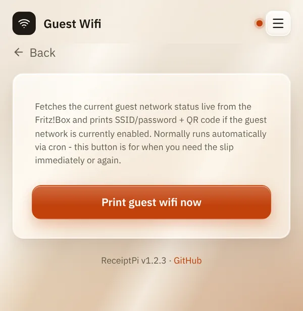

# Guest Wi-Fi

*[Deutsche Version](wifi.de.md)*

**Who:** everyone who can open the web interface. The one-time setup
needs an admin with access to the [terminal](../help/glossary.md#terminal).

## What it does

Prints a slip for your guests with the name and password of your guest
network and a QR code. Guests scan the code with their phone camera and
are connected, no typing needed.

ReceiptPi reads name and password straight from your **FRITZ!Box**. It
can print the slip

- **automatically**, as soon as you switch the guest network on, or
- **by hand**, with a button in the web interface.

ReceiptPi does not switch the guest network on or off. You do that as
usual in the FRITZ!Box.

## How to use it

### One-time setup

You need: a FRITZ!Box with guest access, and the
[terminal](../help/glossary.md#terminal) on the Raspberry Pi.

1. **Create a FRITZ!Box user for ReceiptPi.** In the FRITZ!Box web
   interface (usually `http://fritz.box`), go to **System** →
   **FRITZ!Box Users** and add a user, for example `receiptpi`, with a
   password of its own and the permission **FRITZ!Box Settings**.
   The menu names can differ slightly between FRITZ!OS versions.
2. **Allow access for apps.** Under **Home Network** → **Network** →
   **Network Settings**, **Allow access for applications** must be
   switched on. It usually is.
3. **Enter the user on the Raspberry Pi.** Open the configuration:

   ```bash
   sudo nano /etc/receiptpi/config.py
   ```

   Change these three lines to your values:

   ```python
   FRITZBOX_ADDRESS = "192.168.178.1"
   FRITZBOX_USER = "receiptpi"
   FRITZBOX_PASSWORD = "the password from step 1"
   ```

   Save with `Ctrl+O`, `Enter`, and close with `Ctrl+X`.
4. **Restart ReceiptPi**, so it reads the new values:

   ```bash
   sudo systemctl restart receiptpi
   ```

5. **Switch on the automatic slip** (optional):

   ```bash
   sudo systemctl enable --now receiptpi-wifi-watch.timer
   ```

### Printing the slip

- **Automatically:** switch the guest network on in the FRITZ!Box (in its
  web interface, the app or with the button on the box). About a minute
  later the slip comes out.
- **By hand:** on the home page, tap **Guest Wifi**, then
  **Print guest wifi now**. Useful if a guest needs the slip again.



## Good to know

- **Only while the guest network is on.** If it is off, the button prints
  nothing and shows "Guest network is currently disabled - nothing to
  print".
- **Once per switch-on.** The automatic slip comes once when you switch
  the guest network on, not again every minute.
- **Print rules apply.** During [quiet hours](../settings/print-rules.md)
  the automatic slip waits under [Pending jobs](pending.md).
- **The slip shows the password in plain text.** Anyone holding it can
  join your guest network. Throw it away when your guests have left.
- **Open guest network without a password:** set
  `WIFI_QR_AUTH_TYPE = "nopass"` in `/etc/receiptpi/config.py` and restart
  ReceiptPi, so the QR code works.
- **No FRITZ!Box?** A slip with name and password can also be sent from
  other systems, see [Automation API](../integrations/api.md).
- If you [switch the module off](../settings/modules.md), the automatic
  slip pauses as well.

## Something not working?

| Problem | What to do |
|---------|------------|
| "Fritz!Box unreachable: ..." | Check address, user and password in `/etc/receiptpi/config.py` (step 3) and that **Allow access for applications** is on (step 2). Restart ReceiptPi after every change. |
| "Guest network is currently disabled - nothing to print" | Switch the guest network on in the FRITZ!Box, then tap the button again. |
| The automatic slip doesn't come. | Is the timer on? `systemctl list-timers 'receiptpi-*'` must list `receiptpi-wifi-watch.timer`. Is it quiet hours? Look under [Pending jobs](pending.md). Was the guest network already on when you switched the timer on? The very first check only notes the current state: switch the guest network off and on again. |
| The QR code doesn't connect. | The password was probably changed after the slip was printed. Print a new slip. |

---

[Back to the overview](../README.md)
