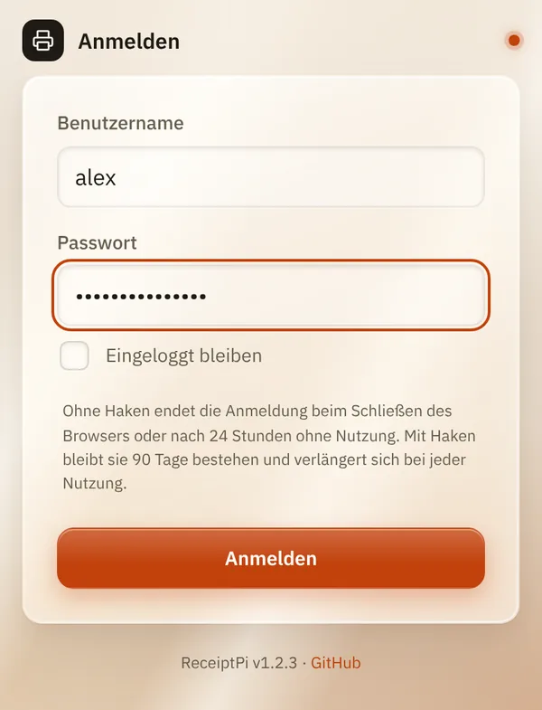
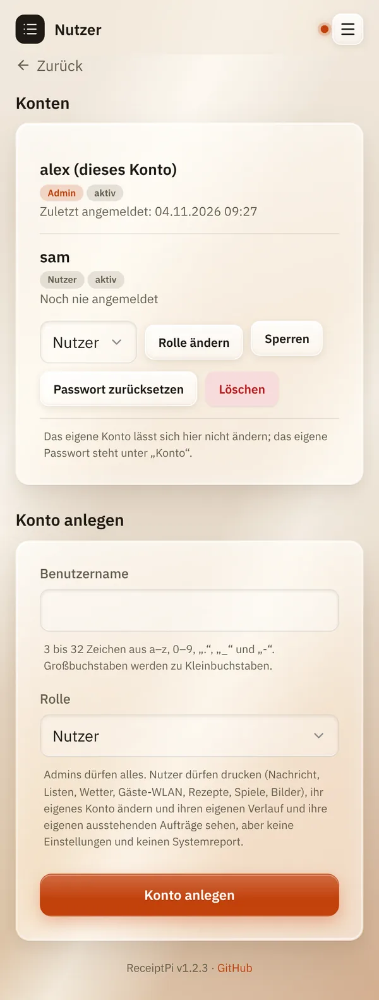
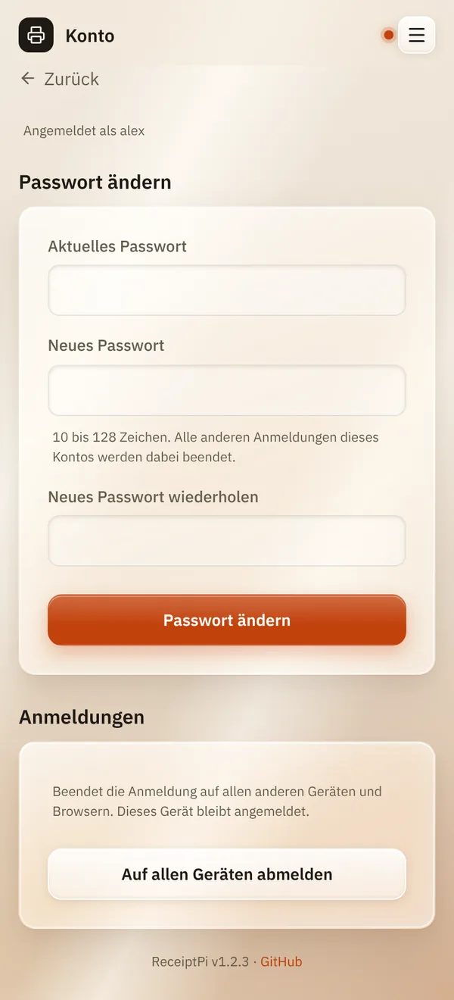

# Anmeldung und Konten

*[English version](accounts.md)*

**Wer:** Konten verwalten: Admins. Anmelden und eigenes Passwort: alle mit
Konto.

## Was kann das?

Schützt ReceiptPi mit einer Anmeldung und gibt jedem im Haushalt ein
eigenes Konto. Jedes Konto hat eigene Entwürfe, einen eigenen Verlauf,
eigene ausstehende Aufträge und [eigene Einstellungen](my-settings.de.md).

Es gibt zwei Rollen:

| Rolle | Darf |
|-------|------|
| **Admin** | alles |
| **Nutzer** | drucken (Nachricht, Listen, Wetter, Gäste-WLAN, Rezepte, Spiele, Bilder), den eigenen Verlauf und die eigenen ausstehenden Aufträge sehen, das eigene Konto ändern. Keine Einstellungen, kein Systemreport. |

Den ersten Admin legst du bei den [ersten Schritten](../first-steps.de.md)
an.

## So geht's

### Anmelden

Gib **Benutzername** und **Passwort** ein und tippe auf **Anmelden**.

- **Ohne** **Eingeloggt bleiben** endet die Anmeldung, wenn du den
  Browser schließt oder nach 24 Stunden ohne Nutzung.
- **Mit** **Eingeloggt bleiben** hält sie 90 Tage und verlängert sich bei
  jeder Nutzung.



### Konto anlegen (Admins)

1. Öffne das Menü (drei Striche oben rechts) und tippe auf **Nutzer**.
2. Gib unter **Konto anlegen** einen **Benutzernamen** ein und wähle eine
   **Rolle**.
3. Tippe auf **Konto anlegen**.
4. ReceiptPi zeigt ein **Startpasswort**, nur dieses eine Mal. Gib es der
   Person. Bei der ersten Anmeldung muss sie ein eigenes Passwort
   festlegen.

### Konten verwalten (Admins)

Auf der Seite **Nutzer** hat jedes Konto diese Knöpfe:

| Knopf | Was er macht |
|-------|--------------|
| **Rolle ändern** | macht das Konto zum Admin oder Nutzer |
| **Sperren** / **Entsperren** | blockiert die Anmeldung, ohne das Konto zu löschen |
| **Passwort zurücksetzen** | zeigt ein neues Startpasswort, beendet alle Anmeldungen des Kontos |
| **Löschen** | löscht das Konto nach einer Rückfrage. Seine Drucke bleiben im Verlauf als „Gelöschtes Konto #...“. |



### Dein eigenes Konto

Tippe im Menü auf **Konto**:

- **Passwort ändern**: Gib das **Aktuelle Passwort** und zweimal das neue
  ein. Deine anderen Anmeldungen enden.
- **Auf allen Geräten abmelden**: beendet die Anmeldung überall außer auf
  diesem Gerät. Praktisch, wenn ein Handy verloren gegangen ist.



### Passwort vergessen

Kennt ein anderer Admin seine Anmeldung noch, kann er für dich auf
**Passwort zurücksetzen** tippen.

Kann sich niemand mehr anmelden, setzt du auf dem Raspberry Pi selbst ein
neues Passwort, im [Terminal](../help/glossary.de.md#terminal):

```bash
cd /opt/receiptpi
sudo -u receiptpi venv/bin/python scripts/manage_users.py reset-password <benutzername>
```

Es fragt zweimal nach dem neuen Passwort. `list` statt
`reset-password <benutzername>` zeigt alle Konten.

## Gut zu wissen

- **Benutzernamen:** 3 bis 32 Zeichen aus a-z, 0-9, `.`, `_` und `-`.
- **Passwörter:** 10 bis 128 Zeichen, sonst keine Regeln. Ein langer Satz
  ist ein gutes Passwort.
- **Der letzte Admin ist geschützt:** Er kann nicht gelöscht, gesperrt
  oder zum Nutzer gemacht werden.
- **Dein eigenes Konto kannst du auf der Seite Nutzer nicht ändern.** Dein
  Passwort steht unter **Konto**.
- **Zu viele falsche Passwörter** sperren die Anmeldung eine Weile: ab
  dem fünften Versuch 30 Sekunden, jedes Mal doppelt so lang, bis zu
  15 Minuten.
- **Skripte, Home Assistant und Watcher** brauchen keine Anmeldung. Sie
  nutzen den API-Token, siehe [Automations-API](../integrations/api.de.md).
- **Bevor es den ersten Admin gibt**, kann jeder in deinem Netzwerk alles
  benutzen.

## Klappt nicht?

| Du siehst | Was du tun kannst |
|-----------|-------------------|
| „Benutzername oder Passwort ist falsch.“ | Achte auf Groß- und Kleinschreibung im Passwort. Benutzernamen sind immer klein geschrieben. |
| „Zu viele Fehlversuche. Bitte etwas warten und dann noch einmal versuchen.“ | Warte ein paar Minuten. |
| „Diese Seite ist nur für Admins.“ | Dein Konto ist ein Nutzer. Frag einen Admin. |
| „Bitte zuerst das Startpasswort ändern.“ | Du hast dich mit einem Startpasswort angemeldet. Leg auf der Seite **Konto** ein eigenes Passwort fest. |
| „Der letzte aktive Admin kann nicht gelöscht, gesperrt oder zum Nutzer gemacht werden.“ | Mach zuerst ein anderes Konto zum Admin. |

---

[Zurück zur Übersicht](../README.de.md)
