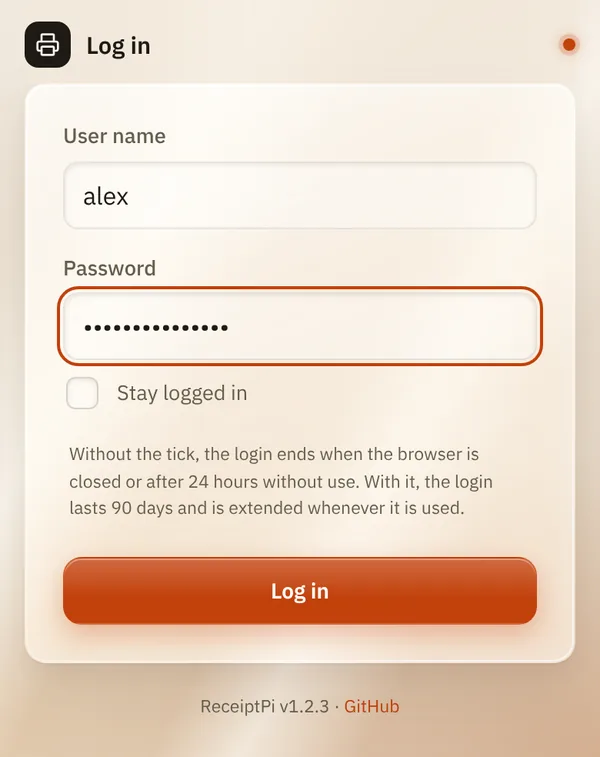
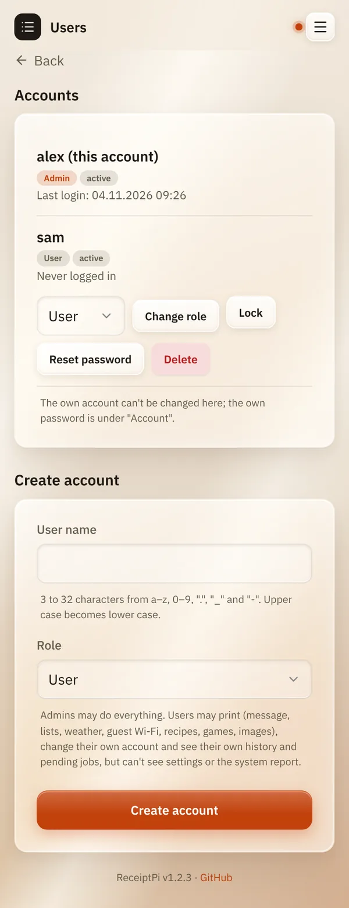
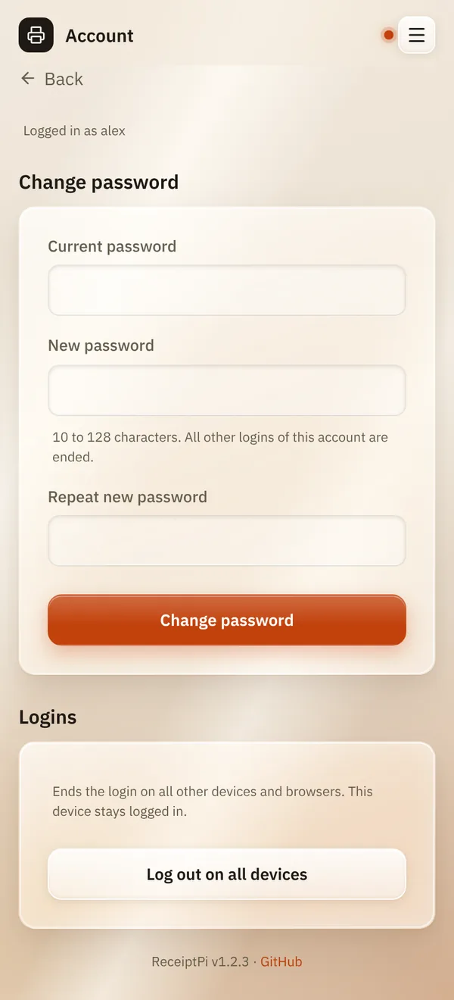

# Login and accounts

*[Deutsche Version](accounts.de.md)*

**Who:** managing accounts: admins. Logging in and your own password:
everyone with an account.

## What it does

Protects ReceiptPi with a login and gives everyone in the household
their own account. Each account has its own drafts, history, pending
jobs and [personal settings](my-settings.md).

There are two roles:

| Role | May do |
|------|--------|
| **Admin** | everything |
| **User** | print (message, lists, weather, guest Wi-Fi, recipes, games, images), see their own history and pending jobs, change their own account. No settings, no system report. |

The first admin is created during the [first steps](../first-steps.md).

## How to use it

### Logging in

Enter **User name** and **Password** and tap **Log in**.

- **Without** **Stay logged in**, the login ends when you close the
  browser, or after 24 hours without use.
- **With** **Stay logged in**, it lasts 90 days and is extended whenever
  you use ReceiptPi.



### Adding an account (admins)

1. Open the menu (three lines at the top right) and tap **Users**.
2. Under **Create account**, enter a **User name** and choose a **Role**.
3. Tap **Create account**.
4. ReceiptPi shows a **start password**, only this once. Give it to the
   person. At their first login they have to set their own password.

### Managing accounts (admins)

On the **Users** page, every account has these buttons:

| Button | What it does |
|--------|--------------|
| **Change role** | makes the account an admin or a user |
| **Lock** / **Unlock** | blocks the login without deleting the account |
| **Reset password** | shows a new start password, ends all logins of the account |
| **Delete** | deletes the account after a confirmation. Its prints stay in the history as "Deleted account #...". |



### Your own account

In the menu, tap **Account**:

- **Change password**: enter the **Current password** and the new one
  twice. Your other logins end.
- **Log out on all devices**: ends the login everywhere except on this
  device. Useful if you lost a phone.



### Forgotten password

If you still know another admin's login, that admin can tap
**Reset password** for you.

If nobody can log in anymore, set a new password on the Raspberry Pi
itself, in the [terminal](../help/glossary.md#terminal):

```bash
cd /opt/receiptpi
sudo -u receiptpi venv/bin/python scripts/manage_users.py reset-password <user name>
```

It asks for the new password twice. `list` instead of
`reset-password <user name>` shows all accounts.

## Good to know

- **User names:** 3 to 32 characters from a-z, 0-9, `.`, `_` and `-`.
- **Passwords:** 10 to 128 characters, no other rules. A long sentence is
  a good password.
- **The last admin is protected:** it can't be deleted, locked or made a
  user.
- **You can't change your own account on the Users page.** Your own
  password is under **Account**.
- **Too many wrong passwords** lock the login for a while: from the
  fifth attempt 30 seconds, doubling each time, up to 15 minutes.
- **Scripts, Home Assistant and watchers** don't need a login. They use
  the API token, see [Automation API](../integrations/api.md).
- **Before the first admin exists**, everyone in your network can use
  everything.

## Something not working?

| You see | What to do |
|---------|------------|
| "User name or password is wrong." | Check upper and lower case in the password. User names are always lower case. |
| "Too many failed attempts. Please wait a while and try again." | Wait a few minutes. |
| "This page is for admins only." | Your account is a user. Ask an admin. |
| "Please change the start password first." | You logged in with a start password. Set your own password on the **Account** page. |
| "The last active admin can't be deleted, locked or made a user." | Make another account admin first. |

---

[Back to the overview](../README.md)
