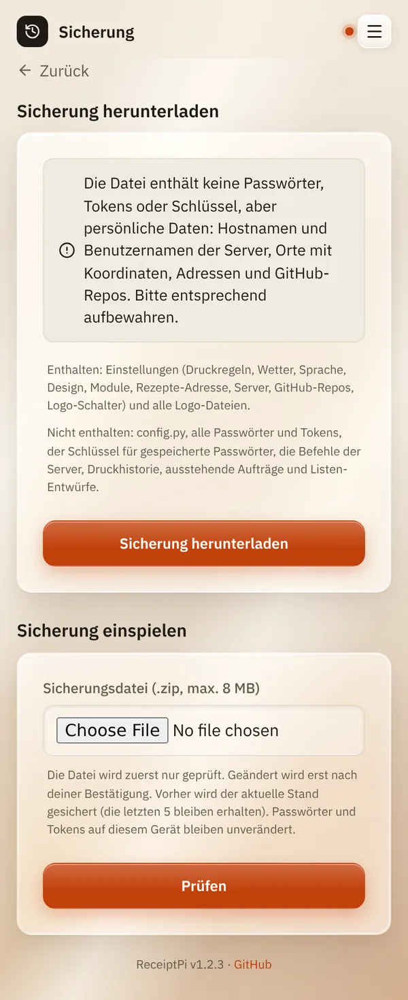

# Sicherung

*[English version](backup.md)*

**Wer:** Admins

## Was kann das?

Speichert deine Einstellungen und Logos in einer Datei und spielt sie
später wieder ein: nach einer Neuinstallation, auf einem zweiten Gerät
oder wenn etwas schiefgegangen ist.

**Enthalten:** Druckregeln, Wetter, Sprache, Design, Module,
Rezept-Adresse, Server, GitHub-Repos, Logo-Schalter und alle Logo-Dateien.

**Nicht enthalten:** `config.py`, alle Passwörter und Tokens, der
Schlüssel für gespeicherte Passwörter, die Befehle der Server,
Druckverlauf, ausstehende Aufträge, Listen-Entwürfe und die Konten.

## So geht's

### Sicherung speichern

1. Öffne das Menü (drei Striche oben rechts), tippe auf
   **Einstellungen** und dann auf **Sicherung**.
2. Tippe auf **Sicherung herunterladen**. Dein Browser speichert eine
   `.zip`-Datei.

   

### Sicherung einspielen

1. Wähle auf derselben Seite unter **Sicherung einspielen** die
   `.zip`-Datei.
2. Tippe auf **Prüfen**. Noch ändert sich nichts: Du siehst, was die
   Sicherung enthält und was sie ersetzt.
3. Lies die Zusammenfassung, hake **Ich habe die Zusammenfassung gelesen
   und möchte die Sicherung einspielen.** an und tippe auf
   **Sicherung einspielen**.
4. Die Ergebnisseite zeigt, was du neu eingeben musst, zum Beispiel
   Passwörter und Tokens (**Jetzt neu eingeben**).

Ein Neustart ist nicht nötig, die Änderungen gelten sofort.

## Gut zu wissen

- **Bewahr die Datei sicher auf.** Sie enthält keine Passwörter, aber
  persönliche Daten: Server- und Benutzernamen, Orte mit Koordinaten,
  Adressen und GitHub-Repos.
- **Der vorherige Stand wird vorher gesichert.** ReceiptPi behält die
  letzten 5 Stände, falls beim Einspielen etwas schiefgeht.
- **Passwörter und Tokens auf dem Gerät bleiben, wie sie sind.** Was die
  Sicherung nicht enthält, musst du neu eingeben.
- **Werte aus `config.py`** (zum Beispiel die FRITZ!Box-Anmeldung) sind
  nie Teil einer Sicherung. Auf einem neuen Gerät trägst du sie dort
  wieder ein.
- **Grenze:** Eine Sicherungsdatei darf höchstens 8 MB groß sein. Große
  Logo-Dateien machen sie größer.

## Klappt nicht?

| Problem | Was du tun kannst |
|---------|-------------------|
| „Hinweis: Diese Sicherung ist größer als 8 MB und könnte deshalb nicht wieder eingespielt werden ...“ | Nimm kleinere Logo-Dateien und lade die Sicherung dann neu herunter. |
| Server mit Schlüssel-Anmeldung gehen nach dem Einspielen auf einem neuen Gerät nicht. | Sie brauchen den SSH-Schlüssel dieses Geräts, siehe [Systemreport](../modules/system.de.md). |
| „Gerade läuft ein Druckauftrag. Bitte warten, bis er fertig ist, und noch einmal versuchen.“ | Warte kurz und tippe dann noch einmal auf **Sicherung einspielen**. |
| Rezepte sind nach dem Einspielen ausgeschaltet. | Gib den Mealie-Token unter **Einstellungen** → **Rezepte** neu ein. |

---

[Zurück zur Übersicht](../README.de.md)
