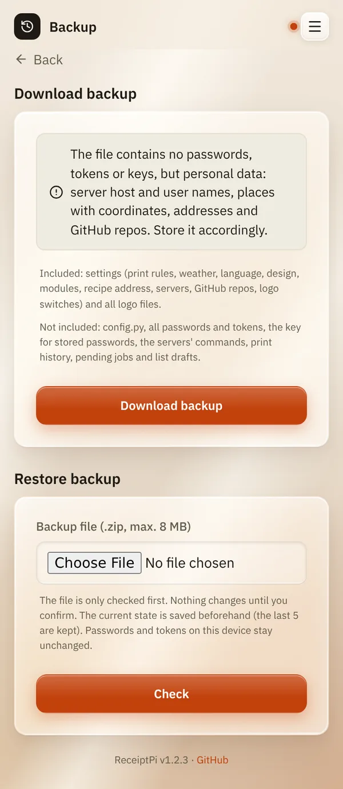

# Backup

*[Deutsche Version](backup.de.md)*

**Who:** admins

## What it does

Saves your settings and logos in one file, and brings them back later:
after a new installation, on a second device, or if something went wrong.

**Included:** print rules, weather, language, design, modules, recipe
address, servers, GitHub repos, logo switches and all logo files.

**Not included:** `config.py`, all passwords and tokens, the key for
stored passwords, the servers' commands, print history, pending jobs,
list drafts, and the accounts.

## How to use it

### Saving a backup

1. Open the menu (three lines at the top right), tap **Settings** and
   then **Backup**.
2. Tap **Download backup**. Your browser saves a `.zip` file.

   

### Restoring a backup

1. On the same page, under **Restore backup**, choose the `.zip` file.
2. Tap **Check**. Nothing is changed yet: you see what the backup
   contains and what it will replace.
3. Read the summary, tick **I have read the summary and want to restore
   this backup.** and tap **Restore backup**.
4. The result page lists what you have to enter again, for example
   passwords and tokens (**Enter again now**).

No restart is needed, the changes apply immediately.

## Good to know

- **Keep the file safe.** It contains no passwords, but personal data:
  server and user names, places with coordinates, addresses and GitHub
  repos.
- **The previous state is saved first.** ReceiptPi keeps the last 5
  states, in case a restore goes wrong.
- **Passwords and tokens on the device stay as they are.** Anything the
  backup doesn't include has to be entered again.
- **Values from `config.py`** (for example the FRITZ!Box login) are never
  part of a backup. On a new device, enter them there again.
- **Limit:** a backup file can be at most 8 MB. Large logo files make it
  bigger.

## Something not working?

| Problem | What to do |
|---------|------------|
| "Note: this backup is larger than 8 MB and could not be restored. ..." | Use smaller logo files, then download the backup again. |
| Servers with key login don't work after restoring on a new device. | They need this device's SSH key, see [System report](../modules/system.md). |
| "A print job is running. Please wait until it's done and try again." | Wait a moment, then tap **Restore backup** again. |
| Recipes are switched off after restoring. | Enter the Mealie token again under **Settings** → **Recipes**. |

---

[Back to the overview](../README.md)
