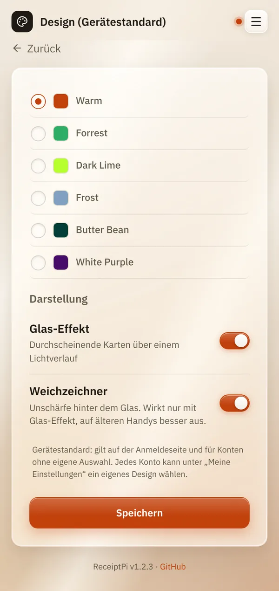

# Design und Glas-Effekt

*[English version](design.md)*

**Wer:** Admins (solange es noch kein Admin-Konto gibt: alle)

## Was kann das?

Ändert das Aussehen der Oberfläche: die Farben (Theme) und den
Glas-Effekt. Auf den Bons ändert sich dadurch nichts.

| Theme | Aussehen |
|-------|----------|
| **Warm** (Standard) | warmes Beige, wird automatisch dunkel, wenn dein Handy im Dunkelmodus ist |
| **Forrest** | dunkles Grün |
| **Dark Lime** | dunkles Grau mit Limettengrün |
| **Frost** | dunkles Blaugrau |
| **Butter Bean** | helles Gelb |
| **White Purple** | Weiß mit Lila |

Der **Glas-Effekt** macht die Karten durchscheinend, wie Milchglas über
einem weichen Licht. Der **Weichzeichner** fügt eine sanfte Unschärfe
hinter dem Glas hinzu.

## So geht's

1. Öffne das Menü (drei Striche oben rechts), tippe auf
   **Einstellungen** und dann auf **Design** (sobald es Konten gibt:
   **Design (Gerätestandard)**).
2. Wähle ein Theme.
3. Schalte unter **Darstellung** **Glas-Effekt** und **Weichzeichner**
   ein oder aus.
4. Tippe auf **Speichern**.

   

## Gut zu wissen

- **Das ist der Gerätestandard.** Er gilt auf der Anmeldeseite und für
  jedes Konto ohne eigene Auswahl. Jedes Konto kann unter
  [Meine Einstellungen](my-settings.de.md) ein eigenes wählen.
- **Der Weichzeichner wirkt nur mit Glas-Effekt.** Ist der Glas-Effekt
  aus, wird die Zeile **Weichzeichner** blass.
- **Ältere Handys:** Ruckelt das Scrollen, schalte zuerst den
  **Weichzeichner** aus. Der Glas-Look bleibt.
- **Keine zusätzliche Last für den Raspberry Pi.** Das Aussehen zeichnet
  dein Handy.

## Klappt nicht?

| Problem | Was du tun kannst |
|---------|-------------------|
| Nach dem Speichern hat sich nichts geändert. | Vielleicht hat dein Konto ein eigenes Design. Schau unter [Meine Einstellungen](my-settings.de.md). Lade die Seite neu. |
| Warm ist dunkel, obwohl du das nicht gewählt hast. | Dein Handy ist im Dunkelmodus. Warm folgt ihm. Wähle ein anderes Theme, wenn es immer hell sein soll. |

---

[Zurück zur Übersicht](../README.de.md)
