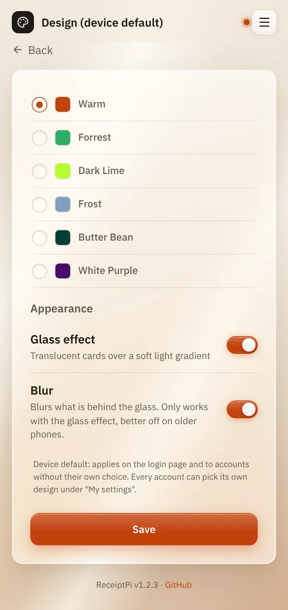

# Design and glass effect

*[Deutsche Version](design.de.md)*

**Who:** admins (before the first admin account exists: everyone)

## What it does

Changes how the web interface looks: the colors (theme) and the glass
effect. It changes nothing on the receipts.

| Theme | Look |
|-------|------|
| **Warm** (default) | warm beige, switches to dark automatically when your phone is in dark mode |
| **Forrest** | dark green |
| **Dark Lime** | dark grey with lime green |
| **Frost** | dark blue-grey |
| **Butter Bean** | light yellow |
| **White Purple** | white with purple |

The **Glass effect** makes cards translucent, like frosted glass over a
soft light. **Blur** adds a soft blur behind the glass.

## How to use it

1. Open the menu (three lines at the top right), tap **Settings** and
   then **Design** (once there are accounts: **Design (device
   default)**).
2. Choose a theme.
3. Under **Appearance**, switch **Glass effect** and **Blur** on or off.
4. Tap **Save**.

   

## Good to know

- **This is the device default.** It applies on the login page and to
  every account without its own choice. Every account can choose its own
  under [My settings](my-settings.md).
- **Blur only works with the glass effect.** While the glass effect is
  off, the **Blur** row is greyed out.
- **Older phones:** if scrolling feels slow, switch **Blur** off first.
  The glass look stays.
- **No extra load on the Raspberry Pi.** Your phone draws the look.

## Something not working?

| Problem | What to do |
|---------|------------|
| Nothing changed after saving. | Your account may have its own design. Check [My settings](my-settings.md). Reload the page. |
| Warm is dark although you didn't choose that. | Your phone is in dark mode. Warm follows it. Choose another theme if you always want it light. |

---

[Back to the overview](../README.md)
