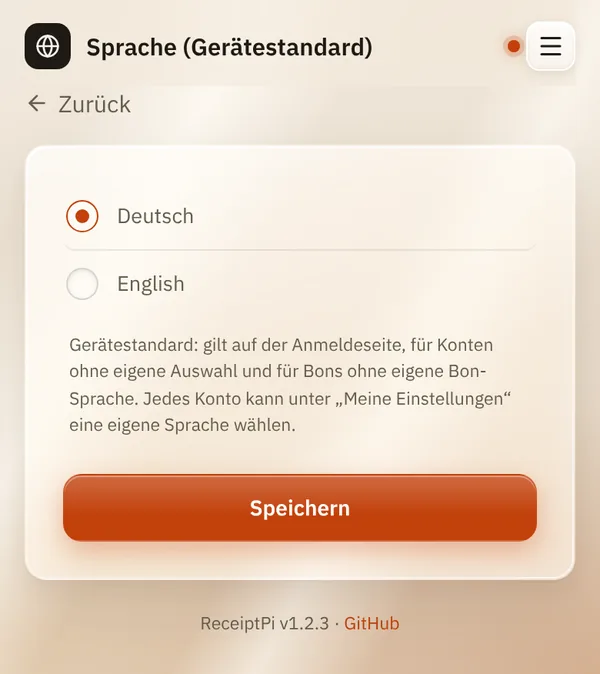

# Sprache

*[English version](language.md)*

**Wer:** Admins (solange es noch kein Admin-Konto gibt: alle)

## Was kann das?

Legt die Sprache von ReceiptPi fest: **Deutsch** oder **English**. Sie
gilt für die Oberfläche und für das, was auf den Bons steht, zum
Beispiel „Wetter für ...“ oder „GAESTE-WLAN“.

## So geht's

1. Öffne das Menü (drei Striche oben rechts), tippe auf
   **Einstellungen** und dann auf **Sprache** (sobald es Konten gibt:
   **Sprache (Gerätestandard)**).
2. Wähle **Deutsch** oder **English**.
3. Tippe auf **Speichern**.

   

## Gut zu wissen

- **Das ist der Gerätestandard.** Er gilt auf der Anmeldeseite, für jedes
  Konto ohne eigene Auswahl und für Bons ohne eigene Bon-Sprache.
- **Jedes Konto kann eine eigene** Oberflächen- und Bon-Sprache unter
  [Meine Einstellungen](my-settings.de.md) wählen.
- **Drucke aus anderen Systemen** (Skripte, Home Assistant, MQTT,
  Watcher) nutzen immer die Gerätesprache.
- **Dein eigener Text wird nicht übersetzt.** Nur die festen Wörter, die
  ReceiptPi ergänzt, ändern sich, etwa Überschriften und Beschriftungen.

## Klappt nicht?

| Problem | Was du tun kannst |
|---------|-------------------|
| Die Oberfläche ist noch in der alten Sprache. | Vielleicht hat dein Konto eine eigene Sprache. Schau unter [Meine Einstellungen](my-settings.de.md). |
| Bons aus Home Assistant sind in der falschen Sprache. | Sie nutzen immer die Gerätesprache, die du hier einstellst. |

---

[Zurück zur Übersicht](../README.de.md)
