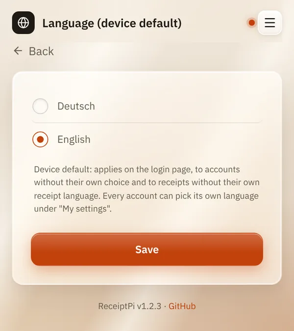

# Language

*[Deutsche Version](language.de.md)*

**Who:** admins (before the first admin account exists: everyone)

## What it does

Sets the language of ReceiptPi: **Deutsch** (German) or **English**. It
applies to the web interface and to what is printed on the receipts, for
example "Weather for ..." or "GUEST WIFI".

## How to use it

1. Open the menu (three lines at the top right), tap **Settings** and
   then **Language** (once there are accounts: **Language (device
   default)**).
2. Choose **Deutsch** or **English**.
3. Tap **Save**.

   

## Good to know

- **This is the device default.** It applies on the login page, to
  every account without its own choice, and to receipts without their
  own receipt language.
- **Every account can choose its own** interface language and receipt
  language under [My settings](my-settings.md).
- **Prints from other systems** (scripts, Home Assistant, MQTT, watchers)
  always use the device language.
- **Your own text isn't translated.** Only the fixed words ReceiptPi adds
  change, like headings and labels.

## Something not working?

| Problem | What to do |
|---------|------------|
| The interface is still in the old language. | Your account may have its own language set. Check [My settings](my-settings.md). |
| Receipts from Home Assistant are in the wrong language. | They always use the device language set here. |

---

[Back to the overview](../README.md)
