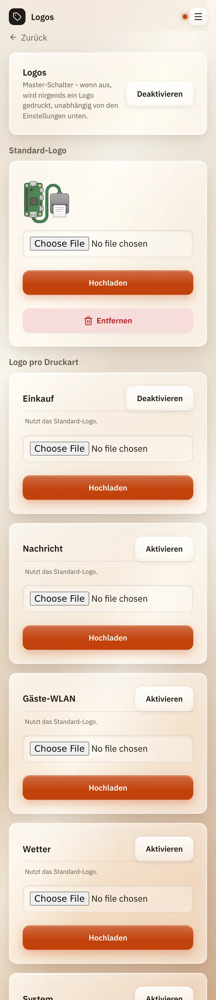

# Logos

*[English version](logos.md)*

**Wer:** Admins (solange es noch kein Admin-Konto gibt: alle)

## Was kann das?

Druckt ein kleines Logo oben auf den Bon, zum Beispiel dein Familienwappen
auf den Einkaufszettel. Du kannst ein Logo für alles nehmen oder je Druckart
ein anderes.

Logos sind möglich bei: **Einkauf**, **Nachricht**, **Gäste-WLAN**,
**Wetter**, **System** und **Automation-Webhook**.

## So geht's

1. Öffne das Menü (drei Striche oben rechts), tippe auf
   **Einstellungen** und dann auf **Logos**.
2. Tippe oben neben **Logos** auf **Aktivieren**. Das ist der
   Hauptschalter: Solange er aus ist, wird nirgends ein Logo gedruckt.
3. Wähle unter **Standard-Logo** ein Bild und tippe auf **Hochladen**.
   ReceiptPi bringt ein schlichtes Start-Logo mit, das du behalten oder
   ersetzen kannst.
4. Tippe unter **Logo pro Druckart** bei jeder Druckart, die ein Logo
   bekommen soll, auf **Aktivieren**.
5. Optional: Lade für eine Druckart ein eigenes Bild hoch. Ohne eigenes
   Bild nutzt sie das Standard-Logo („Nutzt das Standard-Logo.“).

   

## Gut zu wissen

- **Logos sind anfangs aus.**
- **Klein ist gewollt.** Das Logo wird höchstens 150 Punkte breit
  gedruckt, etwa ein Drittel der Papierbreite.
- **Schlichte Bilder wirken am besten:** schwarze Umrisse auf Weiß. Fotos
  werden zu grauem Rauschen.
- **Grenzen:** höchstens 3 MB und 4.000 Pixel pro Seite.
- **Listen:** Nur Einkaufszettel bekommen ein Logo, To-do-Listen und
  Task-Karten nicht.
- **Entfernen** löscht ein hochgeladenes Logo.
- Logos sind Teil einer [Sicherung](backup.de.md).

## Klappt nicht?

| Problem | Was du tun kannst |
|---------|-------------------|
| Es wird kein Logo gedruckt. | Ist der Hauptschalter **Logos** aktiviert und die Druckart auch? Gibt es ein Standard-Logo oder ein eigenes? |
| „Logo file too large ...“ oder „Logo too large ...“ | Verkleinere das Bild (unter 3 MB, höchstens 4.000 Pixel pro Seite). |
| Das Logo sieht grau und unscharf aus. | Nimm ein schlichtes Schwarz-Weiß-Bild ohne Schattierungen. |

---

[Zurück zur Übersicht](../README.de.md)
