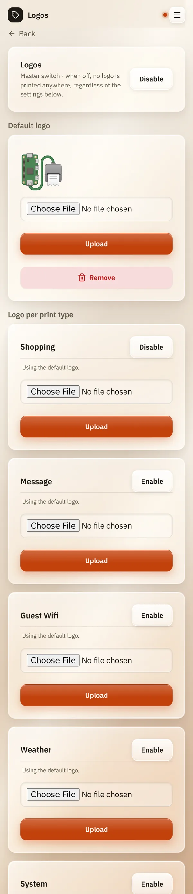

# Logos

*[Deutsche Version](logos.de.md)*

**Who:** admins (before the first admin account exists: everyone)

## What it does

Prints a small logo at the top of a receipt, for example your family
crest on the shopping list. You can use one logo for everything, or a
different one per kind of print.

Logos are possible on: **Shopping**, **Message**, **Guest Wifi**,
**Weather**, **System** and **Automation webhook**.

## How to use it

1. Open the menu (three lines at the top right), tap **Settings** and
   then **Logos**.
2. At the top, next to **Logos**, tap **Enable**. This is the main
   switch: while it is off, no logo is printed anywhere.
3. Under **Default logo**, choose a picture and tap **Upload**. ReceiptPi
   comes with a simple starter logo you can keep or replace.
4. Under **Logo per print type**, tap **Enable** for each kind of print
   that should get a logo.
5. Optional: upload a different picture for one kind of print. Without
   its own picture, it uses the default logo ("Using the default logo.").

   

## Good to know

- **Logos are off by default.**
- **Small is the idea.** The logo is printed at most 150 dots wide, about
  a third of the paper width.
- **Simple pictures work best:** black outlines on white. Photos turn
  into grey noise.
- **Limits:** at most 3 MB and 4,000 pixels per side.
- **Lists:** only shopping lists get a logo, to-do lists and task cards
  don't.
- **Remove** deletes an uploaded logo.
- Logos are part of a [backup](backup.md).

## Something not working?

| Problem | What to do |
|---------|------------|
| No logo is printed. | Is the main switch **Logos** enabled, and the kind of print as well? Is there a default logo or one of its own? |
| "Logo file too large ..." or "Logo too large ..." | Make the picture smaller (under 3 MB, at most 4,000 pixels per side). |
| The logo looks grey and blurry. | Use a simple black-and-white picture without shades. |

---

[Back to the overview](../README.md)
