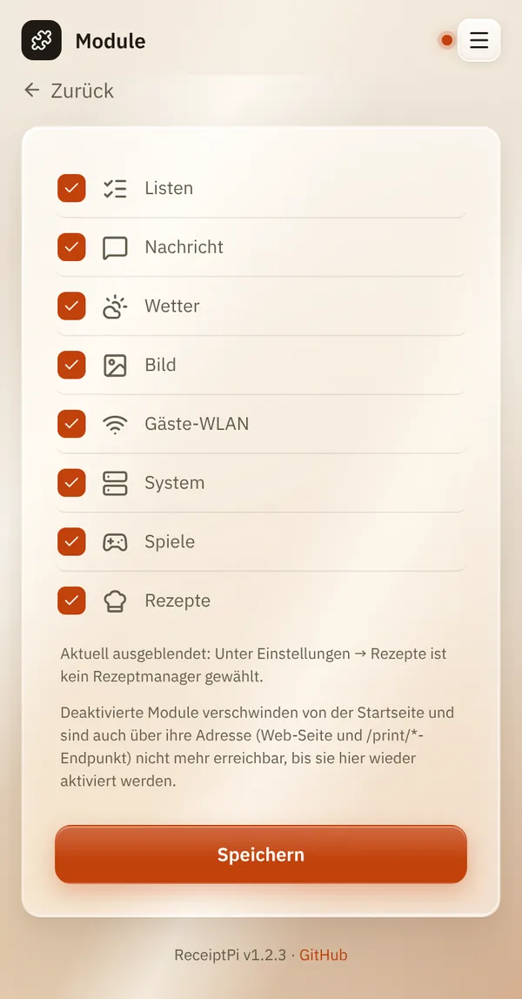

# Module ein- und ausschalten

*[English version](modules.md)*

**Wer:** Admins (solange es noch kein Admin-Konto gibt: alle)

## Was kann das?

Schaltet ganze Funktionen für alle ein oder aus. Ein ausgeschaltetes
Modul verschwindet von der Startseite und lässt sich gar nicht mehr
benutzen, auch nicht aus Home Assistant oder Skripten.

Diese acht Module lassen sich schalten: **Listen**, **Nachricht**,
**Wetter**, **Bild**, **Gäste-WLAN**, **System**, **Spiele** und
**Rezepte**.

## So geht's

1. Öffne das Menü (drei Striche oben rechts), tippe auf
   **Einstellungen** und dann auf **Module**.
2. Entferne den Haken bei den Modulen, die du nicht brauchst, und setz
   ihn bei denen, die du zurückhaben willst.
3. Tippe auf **Speichern**.

   

## Gut zu wissen

- **Es wird nichts gelöscht.** Einstellungen und Daten eines Moduls
  bleiben. Schaltest du es wieder ein, ist alles wieder da.
- **Eine Kachel nur für dich ausblenden?** Nimm stattdessen
  [Startseite anpassen](my-settings.de.md#startseite-anpassen). Für alle
  anderen bleibt das Modul nutzbar.
- **Rezepte** braucht zusätzlich einen Rezeptmanager, siehe
  [Rezepte](../modules/recipes.de.md). Ohne ihn bleibt es ausgeblendet,
  auch wenn es angehakt ist.
- **Watcher pausieren mit:** Ist **Gäste-WLAN** aus, kommt kein
  automatischer Gästezettel; ist **Wetter** aus, keine Unwetterwarnung.
  Der GitHub-Sterne-Watcher braucht **Nachricht**.
- **Immer verfügbar**, egal was du schaltest: Verlauf, Ausstehende
  Aufträge, Einstellungen und der Automations-Webhook.

## Klappt nicht?

| Problem | Was du tun kannst |
|---------|-------------------|
| Eine Home-Assistant-Automation funktioniert nicht mehr. | Sie nutzt vermutlich ein Modul, das du ausgeschaltet hast. Schalte es wieder ein. |
| **Rezepte** bleibt ausgeblendet, obwohl angehakt. | Der Hinweis daneben nennt den Grund: Es ist kein Rezeptmanager gewählt. Siehe [Rezepte](../modules/recipes.de.md). |

---

[Zurück zur Übersicht](../README.de.md)
