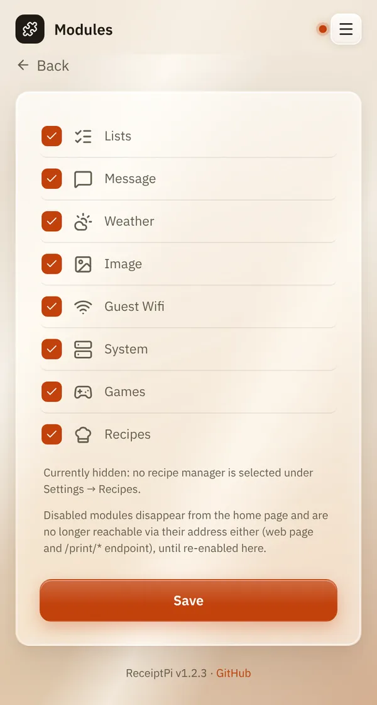

# Turning modules on and off

*[Deutsche Version](modules.de.md)*

**Who:** admins (before the first admin account exists: everyone)

## What it does

Switches whole features on or off for everyone. A switched-off module
disappears from the home page and can't be used at all, not even by
Home Assistant or scripts.

These eight modules can be switched: **Lists**, **Message**,
**Weather**, **Image**, **Guest Wifi**, **System**, **Games** and
**Recipes**.

## How to use it

1. Open the menu (three lines at the top right), tap **Settings** and
   then **Modules**.
2. Untick the modules you don't need, tick the ones you want back.
3. Tap **Save**.

   

## Good to know

- **Nothing is deleted.** Settings and data of a module stay. Switch it
  on again and everything is back.
- **Only hide a tile for yourself?** Use
  [Customize home page](my-settings.md#customizing-the-home-page)
  instead. The module stays usable for everyone else.
- **Recipes** additionally needs a recipe manager, see
  [Recipes](../modules/recipes.md). Without one it stays hidden, even when
  ticked.
- **Watchers pause too:** with **Guest Wifi** off, no automatic guest
  slip; with **Weather** off, no storm warnings. The GitHub-star watcher
  needs **Message**.
- **Always available**, whatever you switch: history, pending jobs,
  settings and the automation webhook.

## Something not working?

| Problem | What to do |
|---------|------------|
| A Home Assistant automation stopped working. | It probably uses a module you switched off. Switch it on again. |
| **Recipes** stays hidden although ticked. | The note next to it says why: no recipe manager is selected. See [Recipes](../modules/recipes.md). |

---

[Back to the overview](../README.md)
