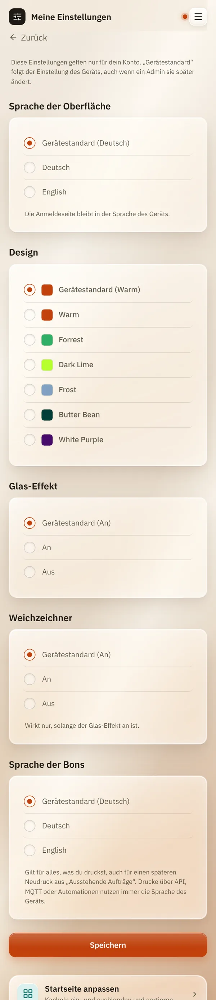
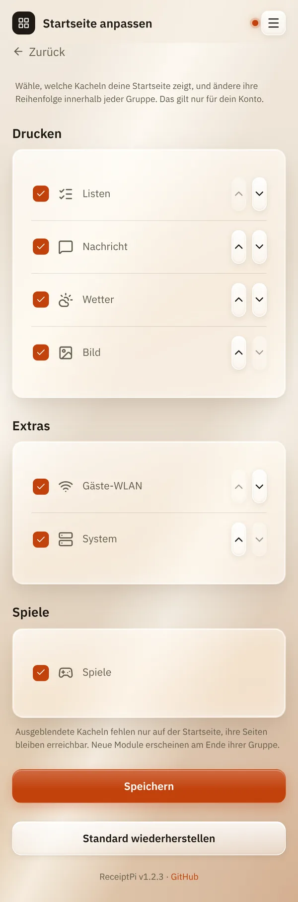

# Meine Einstellungen

*[English version](my-settings.md)*

**Wer:** alle mit Konto

## Was kann das?

Damit richtest du ReceiptPi so ein, wie es dir gefällt, nur für dein
Konto:

| Einstellung | Was sie ändert |
|-------------|----------------|
| **Sprache der Oberfläche** | die Sprache der Oberfläche |
| **Design** | die Farben der Oberfläche |
| **Glas-Effekt** und **Weichzeichner** | den [Glas-Look](design.de.md) |
| **Sprache der Bons** | die Sprache der festen Wörter auf deinen Bons |
| **Startseite anpassen** | welche Kacheln du siehst und in welcher Reihenfolge |

Alle anderen behalten ihre eigenen Einstellungen.

## So geht's

### Sprache, Design und Bons

1. Öffne das Menü (drei Striche oben rechts) und tippe auf
   **Meine Einstellungen**.
2. Wähle bei jeder Einstellung einen Wert oder **Gerätestandard (...)**,
   um dem zu folgen, was der Admin für das Gerät eingestellt hat.
3. Tippe auf **Speichern**.

   

### Startseite anpassen

1. Tippe unten auf **Meine Einstellungen** auf **Startseite anpassen**.
   Du findest es auch ganz unten auf der Startseite.
2. Entferne den Haken bei den Kacheln, die du nicht sehen willst.
3. Mit den Pfeil-Knöpfen schiebst du eine Kachel innerhalb ihrer Gruppe
   nach oben oder unten.
4. Tippe auf **Speichern**.

**Standard wiederherstellen** zeigt wieder alle Kacheln in der
ursprünglichen Reihenfolge.

## Gut zu wissen

- **Gerätestandard** folgt der Einstellung des Geräts, auch wenn ein
  Admin sie später ändert.
- **Die Sprache der Bons** gilt für alles, was du druckst, auch für einen
  späteren Nachdruck aus [Ausstehende Aufträge](../modules/pending.de.md).
  Drucke über API, MQTT oder Automationen nutzen immer die Sprache des
  Geräts.
- **Die Anmeldeseite** nutzt immer Sprache und Design des Geräts.
- **Ausgeblendete Kacheln sind nur für dich weg.** Die Seite bleibt
  erreichbar, und andere sehen die Kachel weiterhin. Um eine Funktion für
  alle abzuschalten, nutzt ein Admin
  [Module ein- und ausschalten](modules.de.md).
- **Neue Module** einer späteren Version erscheinen am Ende ihrer Gruppe.

## Klappt nicht?

| Problem | Was du tun kannst |
|---------|-------------------|
| Im Menü fehlt **Meine Einstellungen**. | Das gibt es erst, wenn ein Admin-Konto existiert und du angemeldet bist. |
| „Ungültige Auswahl - nichts gespeichert.“ | Lade die Seite neu und versuch es noch einmal. |

---

[Zurück zur Übersicht](../README.de.md)
