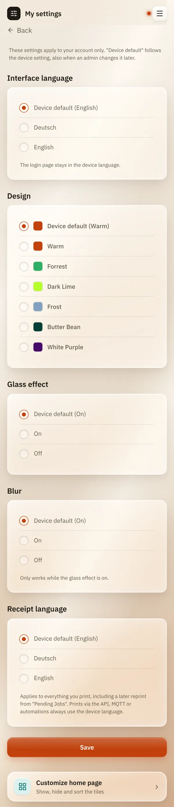
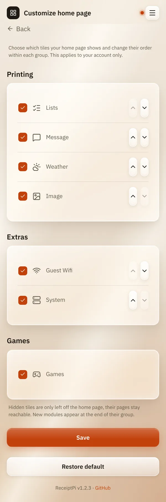

# My settings

*[Deutsche Version](my-settings.de.md)*

**Who:** everyone with an account

## What it does

Lets you set ReceiptPi up the way you like it, for your account only:

| Setting | What it changes |
|---------|-----------------|
| **Interface language** | the language of the web interface |
| **Design** | the colors of the web interface |
| **Glass effect** and **Blur** | the [glass look](design.md) |
| **Receipt language** | the language of the fixed words on your receipts |
| **Customize home page** | which tiles you see, and in which order |

Everyone else keeps their own settings.

## How to use it

### Language, design and receipts

1. Open the menu (three lines at the top right) and tap **My settings**.
2. For each setting, choose a value, or **Device default (...)** to follow
   what the admin has set for the device.
3. Tap **Save**.

   

### Customizing the home page

1. On **My settings**, tap **Customize home page** at the bottom. You also
   find it at the bottom of the home page.
2. Untick the tiles you don't want to see.
3. Use the arrow buttons to move a tile up or down within its group.
4. Tap **Save**.

**Restore default** shows all tiles again in the original order.

## Good to know

- **Device default** follows the device setting, also when an admin
  changes it later.
- **The receipt language** applies to everything you print, also to a
  later reprint from [Pending jobs](../modules/pending.md). Prints from
  the API, MQTT or automations always use the device language.
- **The login page** always uses the device language and design.
- **Hidden tiles are only hidden for you.** The page stays reachable,
  and others still see the tile. To switch a feature off for everyone,
  an admin uses [Turning modules on and off](modules.md).
- **New modules** in a later version appear at the end of their group.

## Something not working?

| Problem | What to do |
|---------|------------|
| There is no **My settings** in the menu. | It only exists once there is an admin account and you are logged in. |
| "Invalid choice - nothing was saved." | Reload the page and try again. |

---

[Back to the overview](../README.md)
