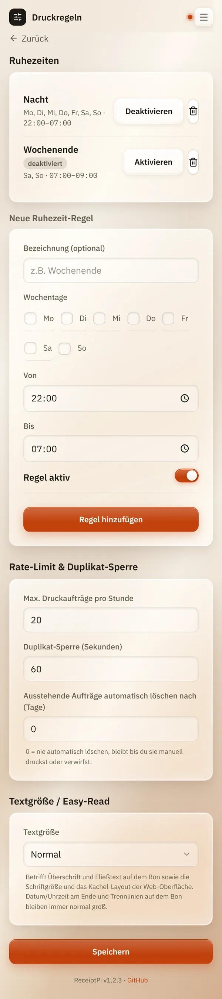

# Druckregeln

*[English version](print-rules.md)*

**Wer:** Admins (solange es noch kein Admin-Konto gibt: alle)

## Was kann das?

Druckregeln legen fest, wann und wie viel ReceiptPi druckt:

- **Ruhezeiten:** Zeiten, in denen nichts gedruckt wird, zum Beispiel
  nachts.
- **Drucklimit:** höchstens so viele Drucke pro Stunde.
- **Duplikat-Sperre:** Derselbe Druck zweimal hintereinander kommt nur
  einmal heraus.
- **Große Schrift (Easy-Read):** größere Buchstaben auf dem Bon und in
  der Oberfläche.

Die Regeln gelten für jeden Druck: aus der Oberfläche, aus Home Assistant
oder Skripten und von den [automatischen Watchern](../integrations/watchers.de.md).
Einzige Ausnahme ist der kurze Gruß, den ReceiptPi beim Start druckt.

## So geht's

Öffne das Menü (die drei Striche oben rechts), tippe auf
**Einstellungen** und dann auf **Druckregeln**.

### Ruhezeit einrichten

1. Gib der Regel unter **Neue Ruhezeit-Regel** einen Namen, wenn du
   magst, zum Beispiel „Nacht“. Dafür ist das Feld **Bezeichnung
   (optional)** da.
2. Hake die **Wochentage** an, an denen die Regel beginnen soll.
3. Stell **Von** und **Bis** ein. Vorgeschlagen ist 22:00 bis 07:00.
4. Lass **Regel aktiv** eingeschaltet und tippe auf **Regel hinzufügen**.

Die Regel steht jetzt oben in der Liste. Daneben kannst du sie zeitweise
**Deaktivieren**, wieder **Aktivieren** oder mit dem Mülleimer löschen.

### Drucklimit und Duplikate

Unter **Rate-Limit & Duplikat-Sperre**:

| Feld | Bedeutung | Standard |
|------|-----------|----------|
| **Max. Druckaufträge pro Stunde** | Weitere Drucke innerhalb von 60 Minuten werden zurückgehalten. | 20 |
| **Duplikat-Sperre (Sekunden)** | Derselbe Druck innerhalb dieser Zeit wird übersprungen. `0` schaltet das ab. | 60 |
| **Ausstehende Aufträge automatisch löschen nach (Tage)** | Zurückgehaltene Aufträge werden nach so vielen Tagen gelöscht. `0` behält sie, bis du sie druckst oder verwirfst. | 0 |

Tippe unten auf **Speichern**.

### Größere Schrift (Easy-Read)

1. Stell unter **Textgröße / Easy-Read** die **Textgröße** auf
   **Groß (Easy-Read)**.
2. Tippe auf **Speichern**.

Überschriften und Text auf dem Bon werden größer, ebenso Schrift und
Kacheln in der Oberfläche. Das Datum am Ende des Bons und die
Trennlinien bleiben normal groß.

## Gut zu wissen

- **Zurückgehalten heißt nicht verloren.** Ein Druck während einer
  Ruhezeit oder über dem Limit wartet unter
  [Ausstehende Aufträge](../modules/pending.de.md). Von dort druckst du
  ihn später mit einem Tipp.
- **Duplikate werden nicht aufgehoben.** Ein als Duplikat übersprungener
  Druck landet nicht unter Ausstehende Aufträge. In der Oberfläche bleibt
  dein Text im Formular stehen.
- **Ruhezeit über Mitternacht:** Ist **Von** später als **Bis**, läuft
  die Regel über Nacht. Eine Regel Mo-Fr 22:00-07:00 gilt auch noch am
  Samstag um 3 Uhr, weil sie am Freitagabend begonnen hat.
- **Mehrere Regeln gleichzeitig** sind kein Problem, zum Beispiel
  „Nacht“ an jedem Tag und „Wochenende“ an Samstag und Sonntag. Sobald
  eine davon greift, wird nichts gedruckt.
- **Unwetterwarnungen** dürfen auf Wunsch trotz Ruhezeit drucken, siehe
  [Wetter und Unwetterwarnung](../modules/weather.de.md).
- **Die Uhrzeit kommt vom Raspberry Pi.** Stimmt seine Zeitzone nicht,
  beginnen die Ruhezeiten zur falschen Zeit.
- Das Drucklimit zählt ab dem letzten Neustart von ReceiptPi.

## Klappt nicht?

| Problem | Was du tun kannst |
|---------|-------------------|
| Nachts wurde trotzdem gedruckt. | Prüfe die Regel: Steht **deaktiviert** daneben? Sind die richtigen Wochentage angehakt? Eine Regel beginnt nur an ihren Wochentagen. |
| Tagsüber druckt nichts. | Vermutlich greift eine Regel, mit der du nicht gerechnet hast. Die Fehlermeldung nennt sie, zum Beispiel „Ruhezeit aktiv: Wochenende (00:00-23:59)“. Deaktiviere sie oder ändere die Zeiten. |
| „Mindestens ein Wochentag muss ausgewählt sein“ | Hake für die neue Regel mindestens einen Tag an. |
| „... muss eine ganze Zahl ab 1 sein“ (oder „ab 0“) | Gib eine ganze Zahl ein: beim Drucklimit mindestens 1, bei den anderen beiden Feldern mindestens 0. |
| Die Ruhezeiten sind um ein, zwei Stunden verschoben. | Die Zeitzone des Raspberry Pi stimmt nicht. Stell sie mit `sudo raspi-config` ein (Localisation Options, Timezone). |

---

[Zurück zur Übersicht](../README.de.md)
