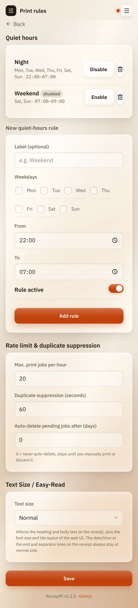

# Print rules

*[Deutsche Version](print-rules.de.md)*

**Who:** admins (before the first admin account exists: everyone)

## What it does

Print rules decide when and how much ReceiptPi prints:

- **Quiet hours:** times when nothing is printed, for example at night.
- **Print limit:** at most this many prints per hour.
- **Duplicate suppression:** the same print twice in a row comes out only
  once.
- **Large text (Easy-Read):** larger letters on the receipt and in the web
  interface.

The rules apply to every print: from the web interface, from Home
Assistant or scripts, and from the [automatic watchers](../integrations/watchers.md).
The only exception is the short greeting ReceiptPi prints when it starts.

## How to use it

Open the menu (the three lines at the top right), tap **Settings** and
then **Print rules**.

### Setting up quiet hours

1. Under **New quiet-hours rule**, give the rule a name if you like, for
   example "Night". This is the field **Label (optional)**.
2. Tick the **Weekdays** on which the rule should start.
3. Set **From** and **To**. The suggestion is 22:00 to 07:00.
4. Leave **Rule active** switched on and tap **Add rule**.

The rule now appears in the list at the top. Next to it you can
**Disable** it for a while, **Enable** it again, or delete it with the
bin icon.

### Print limit and duplicates

Under **Rate limit & duplicate suppression**:

| Field | Meaning | Default |
|-------|---------|---------|
| **Max. print jobs per hour** | More prints within 60 minutes are held back. | 20 |
| **Duplicate suppression (seconds)** | The same print again within this time is skipped. `0` switches this off. | 60 |
| **Auto-delete pending jobs after (days)** | Held-back jobs are deleted after this many days. `0` keeps them until you print or discard them. | 0 |

Tap **Save** at the bottom.

### Larger text (Easy-Read)

1. Under **Text Size / Easy-Read**, set **Text size** to
   **Large (Easy-Read)**.
2. Tap **Save**.

Headings and text on the receipt get larger, and so do the letters and
tiles in the web interface. The date at the end of a receipt and the
separator lines stay at normal size.

## Good to know

- **Held back is not lost.** A print during quiet hours or over the limit
  waits under [Pending jobs](../modules/pending.md). From there you print
  it later with one tap.
- **Duplicates are not kept.** A print skipped as a duplicate does not go
  to Pending jobs. From the web interface, your text stays in the form.
- **Quiet hours over midnight:** if **From** is later than **To**, the
  rule runs through the night. A rule Mon-Fri 22:00-07:00 also covers
  Saturday 03:00, because it started on Friday evening.
- **Several rules at once** are fine, for example "Night" every day and
  "Weekend" on Saturday and Sunday. As soon as one of them applies,
  nothing is printed.
- **Storm warnings** can be allowed to break through quiet hours, see
  [Weather and storm warnings](../modules/weather.md).
- **The time comes from the Raspberry Pi.** If its time zone is wrong,
  the quiet hours start at the wrong time.
- The print limit counts from the last restart of ReceiptPi.

## Something not working?

| Problem | What to do |
|---------|------------|
| Something printed at night anyway. | Check the rule: is it marked **disabled**? Are the right weekdays ticked? Remember that a rule only starts on its weekdays. |
| Nothing prints during the day. | A rule may be running that you didn't expect. The error message names it, for example "Quiet hours active: Weekend (00:00-23:59)". Disable it or change its times. |
| "At least one weekday must be selected" | Tick at least one day for the new rule. |
| "... must be a whole number of at least 1" (or "of at least 0") | Enter a whole number: at least 1 for the print limit, at least 0 for the other two fields. |
| The quiet hours are off by one or two hours. | The time zone of the Raspberry Pi is wrong. Set it with `sudo raspi-config` (Localisation Options, Timezone). |

---

[Back to the overview](../README.md)
