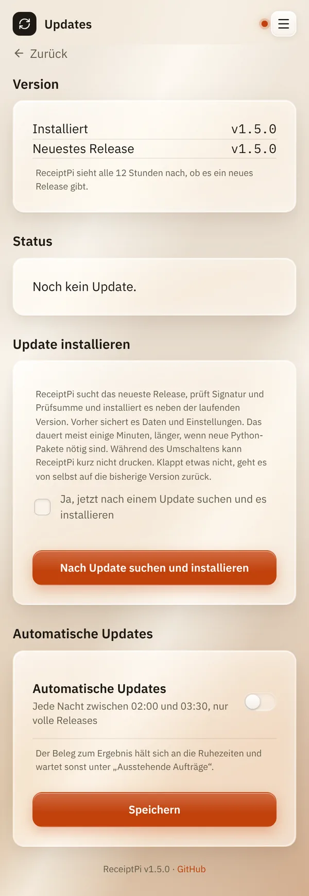

# Updates

*[English version](updates.md)*

**Wer:** Admins

## Was kann das?

Zeigt, welche ReceiptPi-Version läuft und ob es eine neuere gibt, und
installiert sie mit einem Tipp. Vorher sichert ReceiptPi deine Daten und
Einstellungen. Startet die neue Version nicht sauber, geht es von selbst
auf die bisherige zurück. Auf Wunsch macht ReceiptPi das nachts ohne
dich.

Installiert werden nur volle Releases, keine Testversionen. Jedes Update
ist signiert: ReceiptPi installiert nur, was wirklich vom
ReceiptPi-Projekt kommt.

## So geht's

### Ein Update installieren

1. Öffne das Menü (drei Striche oben rechts), tippe auf **Einstellungen**
   und dann auf **Updates**.
2. Unter **Version** siehst du, was **Installiert** ist, und das
   **Neueste Release**.
3. Setze unter **Update installieren** den Haken bei **Ja, jetzt nach
   einem Update suchen und es installieren**.
4. Tippe auf **Nach Update suchen und installieren**.

   

5. Unter **Status** verfolgst du das Update. Während ReceiptPi neu
   startet, steht dort „ReceiptPi startet gerade neu, die Seite meldet
   sich gleich wieder.“ Ist das Update fertig, lädt die Seite von selbst
   neu.
6. Ein Beleg zeigt das Ergebnis, auf Deutsch und Englisch.

### Automatische Updates

1. Schalte auf derselben Seite unter **Automatische Updates** den
   Schalter **Automatische Updates** ein.
2. Tippe auf **Speichern**.

ReceiptPi sieht dann jede Nacht zwischen 02:00 und 03:30 nach einem neuen
Release und installiert es.

## Gut zu wissen

- **Nur für Admins, und nur mit Admin-Konto.** Solange es kein
  Admin-Konto gibt, steht auf der Seite „Updates lassen sich erst
  installieren, wenn es ein Admin-Konto gibt.“
- **Wie lange es dauert:** meist einige Minuten, länger, wenn neue
  Python-Pakete nötig sind. Während ReceiptPi umschaltet, kann es kurz
  nicht drucken.
- **Erst sichern, notfalls zurück.** Vor dem Umschalten sichert ReceiptPi
  Daten, Einstellungen und Konten auf dem Gerät. Startet die neue Version
  nicht sauber, kommt die bisherige mit genau diesen Daten zurück. Was in
  diesen wenigen Minuten gedruckt wurde, kann im Verlauf fehlen.
- **Der Beleg in der Nacht** hält sich an deine
  [Ruhezeiten](print-rules.de.md). Während einer Ruhezeit wartet er unter
  [Ausstehende Aufträge](../modules/pending.de.md). Nach einem Tipp auf
  den Knopf druckt er sofort.
- **Der Start-Beleg** („Server gestartet“) wird während eines Updates
  nicht gedruckt; der Beleg zum Ergebnis ersetzt ihn.
- **Neue Releases** sucht ReceiptPi alle 12 Stunden, siehe
  [Automatische Watcher](../integrations/watchers.de.md). Ein neues
  Release kann dort ein paar Minuten früher stehen, als sein Update-Paket
  bereit ist.
- **Nicht bei jeder Installation.** Auf einem Gerät, das nicht aus dem
  Image oder mit `deploy/install.sh` installiert wurde, steht „Auf diesem
  Gerät werden Updates von Hand installiert. ...“, und es gibt keinen
  Knopf.
- Die technischen Einzelheiten (Signatur, zweistufiger Updater, Rückweg
  über SSH) stehen in der
  [Entwickler-Referenz](../developer-reference.de.md#updates).

## Klappt nicht?

| Problem | Was du tun kannst |
|---------|-------------------|
| „Gerade ist kein Update-Paket verfügbar. Bitte später noch einmal versuchen.“ | Das Release ist gerade erst erschienen, sein Paket folgt ein paar Minuten später. Versuche es später noch einmal. |
| „Grund: Der Download hat nicht geklappt.“ | Ist das Gerät online? Sperrt dein Netz `github.com` oder `pypi.org`? Versuche es später noch einmal. |
| „Grund: Auf der Speicherkarte ist zu wenig Platz.“ | Lösche, was du auf dem Gerät nicht brauchst, oder nimm eine größere Speicherkarte. |
| „Grund: Dieses Release lässt sich nicht automatisch installieren, es braucht eine manuelle Installation.“ | Installiere es wie unter [Installation](../installation.de.md#installieren) beschrieben. |
| „Update auf ... hat nicht geklappt. ReceiptPi läuft wieder mit ..., ...“ | Es ist nichts verloren: Die bisherige Version läuft mit deinen Daten. Den Grund zeigt die Seite; passiert es wieder, melde es auf [GitHub](https://github.com/HostisHumani/ReceiptPi/issues). |
| „... und der Weg zurück auf ... auch nicht.“ | Den Rückweg über SSH findest du unter [Fehlersuche](../help/troubleshooting.de.md#ein-update). |
| Die Seite zeigt „Testmodus: ...“ | Dieses Gerät nimmt Testpakete an. Lösche `/etc/receiptpi/update.conf` (Terminal: `sudo rm /etc/receiptpi/update.conf`). |

---

[Zurück zur Übersicht](../README.de.md)
